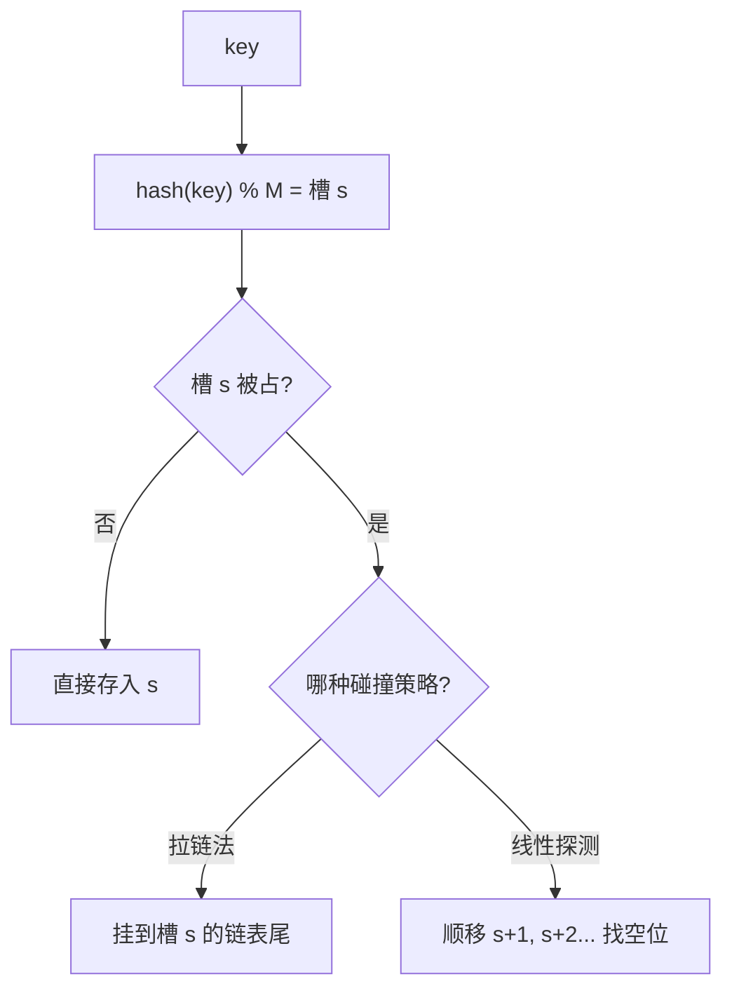

# 第 3 章（3.4）：散列表（哈希表）

- **难度**：★★☆ | **预估学时**：3 小时 | **前置**：ch03a、ch01c

## 学习目标
学完本节，你能：
1. 说清**散列函数**：把 key 压成数组下标；
2. 区分两种**碰撞解决**：拉链法（separate chaining）与线性探测（linear probing）；
3. 理解**装载因子**为什么要控制在 1/2 附近，以及动态扩缩容。

## 一句话核心
散列表 = key 经散列函数直接算出存储下标，理想情况查找/插入**常数时间**——代价是失去有序性。

## 零基础讲解

### 概念 1：散列函数（hash function，难度：基础）
**散列函数** `hash(key)`：把任意 key 映射成数组 `[]` 的下标（0 ~ M-1）。理想性质：① 计算快；② 分布均匀，不同 key 尽量落到不同槽。Java 的 `hashCode()` 再用除留余数法 `% M` 压到槽数。

### 概念 2：碰撞（collision，难度：基础）
**碰撞**：两个不同 key 散列到同一个槽。槽只有那么多，碰撞必然发生——问题不是"会不会撞"，而是"撞了怎么办"。

### 概念 3：拉链法（separate chaining，难度：进阶）
每个槽放一条**链表**（背包）。碰撞的 key 全挂同一条链。查找：先散列到槽，再在链上顺序找。
- 若 N 个键分到 M 条链，平均链长 N/M；
- 控制 M ≈ N → 每条链常数长 → 查找/插入**O(1)**。

### 概念 4：线性探测（linear probing，难度：进阶）
**开放寻址**：数组本身存键值对，不挂链表。碰撞时往后顺移一格（`(hash+1)%M`）找空位。查找同理：散列到槽，不等就往后扫，直到命中或遇到空位。
要求：数组必须比键多——**装载因子 α = N/M 保持 ≤ 1/2**，否则探测链太长。

### 概念 5：动态扩缩容（难度：进阶）
α 超过 1/2 时数组翻倍重建；低于 1/8 时减半。重建 = 把所有键重新散列到新槽（槽数变了，hash%M 全变）。

## 图示

**看图说明**：散列函数是入口；两种碰撞策略决定了"撞了之后往哪走"。

## 类比与实例
- **类比**：旅馆房间号由"姓氏首字母"算出（散列）。同姓的人多了（碰撞）：拉链法=同一房间加床住一串人；线性探测=顺着房间号往后找空房。*失效边界*：房间住太满（α→1），找房要走很长走廊——所以必须控制装载因子。
- **实例**：M=3 槽，键 A、B、C 的 hash 分别为 0、0、1。拉链法：槽0 链 [A,B]，槽1 链 [C]。查 B：散列到 0，在链上第二个命中。

## 常见误解
- **别以为**散列表查找是 O(1) 无条件——实际上只有装载因子低、散列均匀时才是；最坏（全撞一条链）退化成 O(N)。
- **别以为**散列表支持按顺序遍历键——实际上散列打乱了键顺序，**不支持 min/floor/rank** 这类有序操作。
- **别以为**拉链法和线性探测随便选——实际上内存紧张用线性探测（无链表节点开销），允许链长时拉链法实现简单。

## 自测题（答案）
1. 散列函数的两个理想性质？（答案：计算快、分布均匀；解析。）
2. 拉链法如何解决碰撞？（答案：每个槽挂链表，碰撞键串在同一条链上；解析。）
3. 线性探测要求装载因子 α 控制在多少？（答案：≤ 1/2；解析：否则探测链过长。）
4. 散列表为什么不支持 rank/select？（答案：散列打乱键顺序，无有序结构；解析。）

## 复习锚点
- 散列：key → 下标，理想 O(1)。
- 碰撞两策：拉链法（挂链）、线性探测（顺移）。
- 装载因子 ≤ 1/2；超了就扩容重散列。
