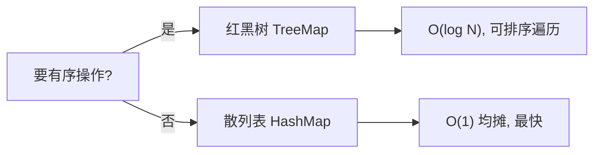

# 第 3 章（3.5）：符号表应用——字典、索引与稀疏向量

- **难度**：★☆☆ | **预估学时**：1.5 小时 | **前置**：ch03a~ch03d

## 学习目标
学完本节，你能：
1. 说清"我该用哪种符号表实现"的选型决策；
2. 看懂字典类用例（词频统计、白名单过滤）；
3. 理解**稀疏向量**：用符号表存非零分量，省内存。

## 一句话核心
符号表是工程里最常用的抽象——字典、索引、稀疏矩阵全是它；选型口诀：要有序用红黑树，要最快用散列。

## 零基础讲解

### 概念 1：选型决策（原书 3.5.1，难度：基础）
| 需求 | 选 |
|---|---|
| 需要有序操作（min/floor/rank/范围） | 红黑树（TreeMap） |
| 只要 put/get、追求最快 | 散列表（HashMap） |
| 键全是整数且稠密 | 直接数组下标 |

经验：Java 库默认 HashMap（散列），需要排序遍历才换 TreeMap。

### 概念 2：字典类用例（难度：基础）
- **词频统计**：`get(word)+1` 累加；
- **白名单过滤**：读入白名单进符号表，输入查不到就丢弃；
- **去重**：put 时若 get 已存在则跳过。

### 概念 3：索引类用例（难度：进阶）
**索引**：为加速查找而建的辅助符号表。例：反向索引——词 → 出现它的所有文档列表。搜索引擎的核心就是这个。

### 概念 4：稀疏向量（sparse vector，难度：高难）
**稀疏向量**：绝大多数分量为 0 的向量。直接存 N 维数组浪费内存。改用符号表：`索引 → 非零值`，只存非零位置。
点积 `a·b = Σ a[i]*b[i]`：只遍历两边都非零的索引——成本正比于非零分量数，而非 N。

## 图示

**看图说明**：选型就一条分叉——要不要有序能力。

## 类比与实例
- **类比**：稀疏向量像只记了几个联系人的通讯录——绝大多数位置是空的，没必要买厚电话本。*失效边界*：当向量稠密（非零占大多数）时，符号表的节点开销反而比数组大，应直接用数组。
- **实例**：向量 (0,0,3,0,0,7) 存成 {2:3, 5:7}，点积只算这两个位置。

## 常见误解
- **别以为**散列表总是首选——实际上需要按 key 排序输出时（如排行榜），必须用红黑树。
- **别以为**稀疏向量省内存没代价——实际上每个非零分量要付一个符号表节点（键+值+指针）开销，稀疏才划算。
- **别以为**符号表只用于内存——实际上磁盘数据库的索引也是符号表思想。

## 自测题（答案）
1. 需要"找小于某键的最大键"用哪种符号表？（答案：红黑树 TreeMap；解析：散列表无有序操作。）
2. 稀疏向量为什么用符号表存？（答案：只存非零分量，省内存；解析。）
3. 反向索引是什么？（答案：词 → 包含该词的文档列表；解析：搜索引擎基础。）
4. 键是稠密整数时最朴素的符号表实现是？（答案：直接用数组下标；解析。）

## 复习锚点
- 选型：有序→红黑树；极速→散列。
- 字典/索引/稀疏向量都是符号表用例。
- 稀疏向量：只存非零，点积成本=非零数。
