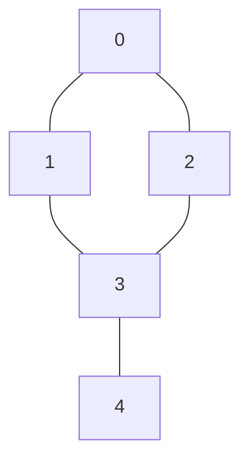

# 第 4 章（4.1）：无向图——DFS 与 BFS

- **难度**：★★☆ | **预估学时**：3.5 小时 | **前置**：ch01c（栈/队列）、ch01e（连通分量）

## 学习目标
学完本节，你能：
1. 说清图的术语：顶点、边、度、路径、环、连通分量；
2. 用**邻接表**表示图，并写出 DFS（深度优先）与 BFS（广度优先）；
3. 说清 BFS 为什么能求"最短路径"。

## 一句话核心
图 = 顶点 + 边；DFS 像走迷宫一条路走到黑，BFS 像水波一圈圈扩散——BFS 第一次到达某点的路就是最短路径。

## 零基础讲解

### 概念 1：图的术语（难度：基础）
- **顶点（vertex）**：节点；**边（edge）**：两顶点间的连接；
- **度（degree）**：一个顶点连出几条边；
- **路径（path）**：边连成的序列；**环（cycle）**：起点=终点的路径；
- **连通（connected）**：两点间有路径；**连通分量**：互相连通的极大顶点集合。

### 概念 2：邻接表表示（难度：基础）
**邻接表**：数组 `adj[]`，每个顶点 v 对应一条链表，存它的所有邻居。V 个顶点、E 条边的图，空间 O(V+E)。

```java
public class Graph {
    private int V;
    private Bag<Integer>[] adj;          // 邻接表
    public Graph(int V) {
        this.V = V; adj = (Bag<Integer>[]) new Bag[V];
        for (int v = 0; v < V; v++) adj[v] = new Bag<Integer>();
    }
    public void addEdge(int v, int w) {
        adj[v].add(w); adj[w].add(v);    // 无向：两边都加
    }
}
```

### 概念 3：深度优先搜索 DFS（难度：进阶）
**DFS（Depth-First Search）**：访问顶点 v，标记 `marked[v]=true`，然后递归访问它每个未标记的邻居。像走迷宫：一条路走到死，回头换岔路。

```java
private void dfs(Graph G, int v) {
    marked[v] = true;
    for (int w : G.adj(v))
        if (!marked[w]) dfs(G, w);
}
```
用途：判断连通性、找路径、数连通分量。

### 概念 4：广度优先搜索 BFS（难度：进阶）
**BFS（Breadth-First Search）**：用**队列**。从起点出发，先访问距离 1 的所有邻居，再距离 2……一圈圈扩散。

```java
private void bfs(Graph G, int s) {
    Queue<Integer> q = new Queue<Integer>();
    marked[s] = true; q.enqueue(s);
    while (!q.isEmpty()) {
        int v = q.dequeue();
        for (int w : G.adj(v))
            if (!marked[w]) { marked[w]=true; q.enqueue(w); }
    }
}
```

**为什么 BFS 给最短路径**：按距离从小到大访问，第一次碰到 w 时，当前这条路径必然是边数最少的（更短的路早该被发现）。

### 概念 5：连通分量（难度：进阶）
遍历所有顶点：每个未标记顶点启动一次 DFS，这次 DFS 能到达的全部顶点就是一个连通分量。和第 1.5 节并查集呼应——但 DFS 版能给出具体路径。

## 图示

**看图说明**：以 0 为起点。DFS：0→1→3→2→4（一条路扎到底）。BFS：先访问 1、2（距离1），再 3、4（距离2）。


**看图说明**：BFS 按"波纹"层次扩散——先到的层距离短，故首次到达即最短。

## 类比与实例
- **类比（DFS）**：走迷宫，每条岔路走到死胡同才回头。*失效边界*：DFS 不保证先走最短的路。
- **类比（BFS）**：往池塘扔石头，波纹一圈圈外扩。*失效边界*：BFS 要存整个队列，大图内存开销比 DFS 大。
- **实例**：上图中 BFS 从 0 到 4 的最短路径是 0-3-4（2 条边）；DFS 可能走 0-1-3-4（3 条边）。

## 常见误解
- **别以为** DFS 和 BFS 只是写法不同——实际上 DFS 用栈（递归）、BFS 用队列，顺序本质不同。
- **别以为** DFS 能求最短路径——实际上只有 BFS 保证最短；DFS 找到的第一条路不一定最短。
- **别以为** 图必须画成圈圈——实际上邻接表才是标准表示，画出来的图只是辅助想象。

## 自测题（答案）
1. 无向图中"度"指什么？（答案：一个顶点连出的边数；解析。）
2. DFS 用什么数据结构？BFS 呢？（答案：DFS 栈（递归调用栈）；BFS 队列；解析。）
3. 为什么 BFS 能求最短路径？（答案：按距离从小到大访问，首次到达即最短；解析。）
4. V 顶点 E 边的邻接表占多少空间？（答案：O(V+E)；解析。）

## 复习锚点
- 图 = 顶点 + 边；邻接表 O(V+E)。
- DFS 栈式扎到底；BFS 队列式波纹扩散。
- 最短路径 = BFS 首次到达。
