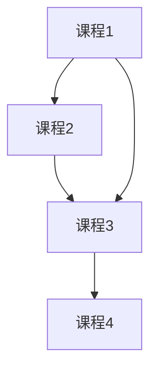
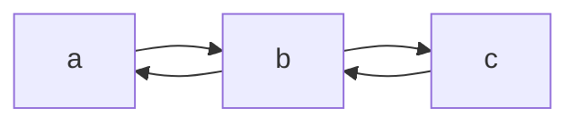

# 第 4 章（4.2）：有向图——可达性、环与强连通

- **难度**：★★☆ | **预估学时**：3 小时 | **前置**：ch04a

## 学习目标
学完本节，你能：
1. 说清有向图与无向图的差别（边有方向）；
2. 判断**环**与**有向无环图（DAG）**，做**拓扑排序**；
3. 理解**强连通**：a 能到 b、b 也能到 a。

## 一句话核心
有向图的边是"单行道"；DAG（无环）能做拓扑排序排任务依赖；强连通是"互相可达"。

## 零基础讲解

### 概念 1：有向图术语（难度：基础）
**有向图（digraph）**：边带方向，v→w 不等于 w→v。类比：网页链接（A 链到 B 不代表 B 链回 A）、课程先修关系。

### 概念 2：可达性（reachability，难度：基础）
**可达**：从 s 出发沿有向边能到 v。用 DFS 从 s 出发遍历，能到的顶点集合就是 s 的可达集。

### 概念 3：环与 DAG（难度：进阶）
**环（cycle）**：沿有向边绕回起点。**有向无环图（DAG, Directed Acyclic Graph）**：没有环的有向图。
- 判断环：DFS 时若遇到"正在访问中"的祖先节点，就成环。
- **拓扑排序（topological sort）**：把 DAG 的顶点排成线性序，使每条边从前者指向后者。用途：排课程先修顺序、任务调度。做法：DFS 后序逆序输出。

### 概念 4：强连通（strongly connected，难度：高难）
**强连通**：a 能到 b **且** b 能到 a（双向可达）。强连通把图分成若干"互相可达团"。
- 普通连通（无向）是双向天然成立；有向图里必须两边都能走。
- 用途：网页重要性、编译器依赖分析。

## 图示

**看图说明**：这是 DAG（无环）。拓扑序：课程1→课程2→课程3→课程4——先修在前。

**看图说明**：a、b、c 两两互相可达——构成一个强连通分量。

## 类比与实例
- **类比（拓扑排序）**：做菜步骤——先备菜才能炒，先炒才能装盘。*失效边界*：若步骤互相依赖（"先做 A 才能 B，先做 B 才能 A"），就成环，无法拓扑排序——现实中就是死锁。
- **实例**：先修关系 1→2、2→3、1→3、3→4，拓扑序 1,2,3,4 合法。

## 常见误解
- **别以为**有向图连通和无向图一样——实际上有向图"a 到 b"不代表"b 到 a"，强连通要求双向。
- **别以为**拓扑排序适用于任何图——实际上只适用于 DAG；有环图排不出合法顺序。
- **别以为**强连通分量要两两直接相连——实际上只要间接可达即可，不要求直接边。

## 自测题（答案）
1. 有向图的"可达"和无向图有何不同？（答案：可达是单向的，a→b 不代表 b→a；解析。）
2. DAG 是什么？（答案：有向无环图；解析：可做拓扑排序。）
3. 拓扑排序的用途？（答案：排任务依赖/课程先修顺序；解析。）
4. 强连通的定义？（答案：两顶点互相可达（双向）；解析。）

## 复习锚点
- 有向边 = 单行道。
- DAG → 拓扑排序；有环 → 死锁。
- 强连通 = 互相可达。
