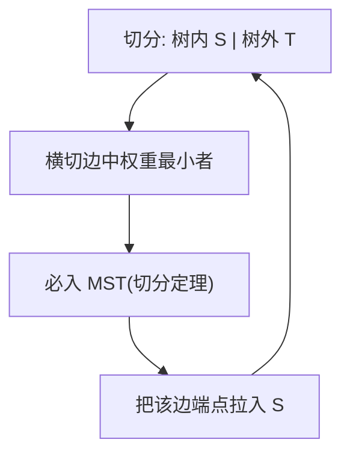
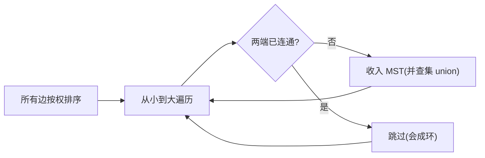

# 第 4 章（4.3）：最小生成树（MST）

- **难度**：★★★ | **预估学时**：3.5 小时 | **前置**：ch04a、ch02d（优先队列）

## 学习目标
学完本节，你能：
1. 说清**最小生成树**问题：给连通加权无向图，选 V-1 条边连起所有顶点且总权重最小；
2. 讲出**切分定理**（MST 的理论基础）；
3. 写出 Prim 与 Kruskal 两种算法，说出它们的复杂度 E log V。

## 一句话核心
最小生成树 = 用最少的"总修路成本"把所有城市连起来；Prim 从一个点长出去，Kruskal 按边权从小到大接。

## 零基础讲解

### 概念 1：问题定义（难度：基础）
**最小生成树（Minimum Spanning Tree, MST）**：连通加权无向图中，一棵包含所有顶点、边数 V-1、**总权重最小**的树。
类比：要在若干城市间铺光缆连通全部，求总成本最低方案。

### 概念 2：切分定理（cut property，难度：高难）
**切分（cut）**：把顶点分成两组。**横切边**：连接两组的边。
**切分定理**：在所有横切边中，**权重最小的那条边一定属于 MST**。
这是 Prim/Kruskal 共同的理论基石——每一步"挑最小横切边"都安全。

### 概念 3：Prim 算法（难度：进阶）
从任一顶点开始，维护"已在树中的顶点集"。每次选**连接树内与树外的最小横切边**，把树外顶点拉进来。用**优先队列**存候选边。
复杂度（原书）：时间 **E log V**，空间 V。

### 概念 4：Kruskal 算法（难度：进阶）
把所有边按权重**从小到大排序**，依次考虑：若这条边连接两个不同连通分量（用并查集判断），就收进 MST；否则跳过（会成环）。直到收满 V-1 条边。
复杂度：排序 E log E + 并查集近常数 → 整体 E log E ≈ E log V。

## 图示

**看图说明**：Prim 的循环——每轮用切分定理安全地加一条边。

**看图说明**：Kruskal = 排序 + 并查集；只收"连接新分量"的边。

## 类比与实例
- **类比（Prim）**：从首都开始修地铁，每次修一条连接"已通地铁区"和"未通区"的最便宜线路，路网像树一样长出去。*失效边界*：Prim 要求图连通；不连通图没有 MST。
- **类比（Kruskal）**：把所有候选路按造价排队，从最便宜的开始修，能连通新地方就修，会绕圈就不修。
- **实例**：4 城市，边权 AB=1、BC=2、CD=3、AD=4。MST 选 AB、BC、CD（总 6），AD 被弃（会成环）。

## 常见误解
- **别以为** MST 是"最短路径树"——实际上 MST 最小化的是**总边权和**，不是任意两点间的最短距离。
- **别以为** Kruskal 用 DFS——实际上它用**并查集**判断连通，和第 1.5 节呼应。
- **别以为** MST 唯一——实际上权重有并列时 MST 可能不唯一，但总权重一定最小。

## 自测题（答案）
1. MST 要选多少条边？（答案：V-1 条；解析：树的定义。）
2. 切分定理说横切边中哪条必入 MST？（答案：权重最小的那条；解析。）
3. Kruskal 用什么数据结构判断两端是否已连通？（答案：并查集；解析。）
4. Prim 算法的时间复杂度？（答案：E log V；解析：优先队列操作。）

## 复习锚点
- MST = 总权重最小的生成树。
- 切分定理：最小横切边必入 MST。
- Prim 从点长出去；Kruskal 按边权排序+并查集。
