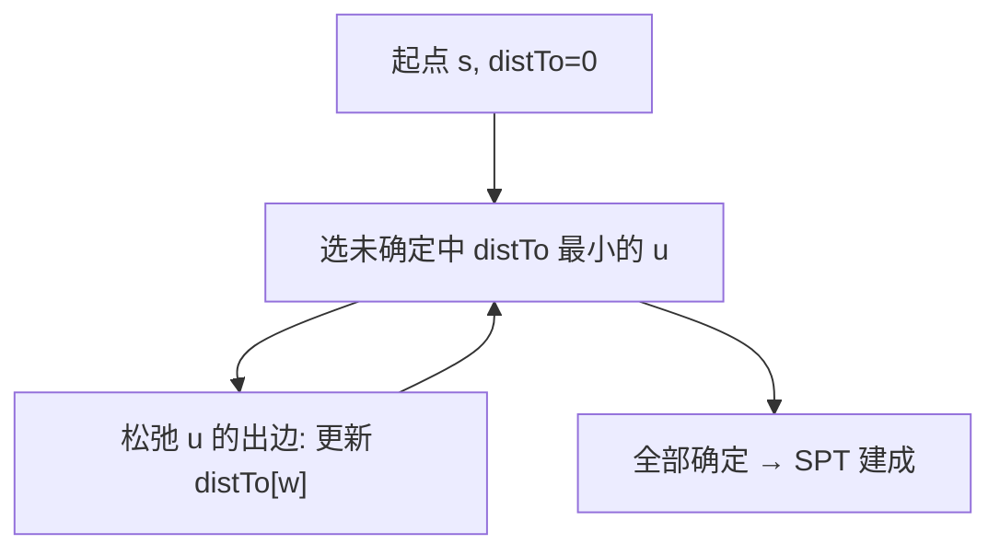

# 第 4 章（4.4）：最短路径——Dijkstra 与无环图算法

- **难度**：★★★ | **预估学时**：4 小时 | **前置**：ch04c、ch02d（优先队列）

## 学习目标
学完本节，你能：
1. 说清**最短路径树（SPT）**：从起点到所有顶点的最短路径集合；
2. 写出 **Dijkstra 算法**（非负权），说出复杂度 E log V；
3. 理解无环加权有向图可以线性时间求最短/最长路径。

## 一句话核心
最短路径 = 从起点找"到各点最便宜的路"；Dijkstra 像 Prim 一样每次锁定当前最近点，前提是边权非负。

## 零基础讲解

### 概念 1：最短路径树 SPT（难度：基础）
**最短路径树（Shortest-Path Tree, SPT）**：以起点 s 为根，每个顶点到 s 的路径都是最短路径。用两个数组存：`distTo[v]`（s 到 v 的最短距离）、`edgeTo[v]`（最短路上 v 的前一条边）。

### 概念 2：松弛（relaxation，难度：进阶）
**松弛**：考察边 v→w。若 `distTo[v] + 边权 < distTo[w]`，就更新 `distTo[w]` 和 `edgeTo[w]`——发现一条更短的路。所有最短路径算法本质都是反复松弛。

### 概念 3：Dijkstra 算法（难度：高难）
前提：**所有边权非负**。
1. 起点 distTo=0，其余无穷；
2. 选**未确定顶点中 distTo 最小**的 u，标记 u 已确定；
3. 松弛 u 的所有出边；
4. 重复直到全部确定。

为什么非负才行？：一旦锁定 u，不可能再有"更短的路绕到 u"——因为后续路只会加非负权。

复杂度：优先队列实现 → **E log V**。

### 概念 4：无环加权有向图（难度：高难）
若图是 DAG，可以**拓扑排序后按序松弛**——线性时间 O(V+E) 同时求出最短和最长路径。因为拓扑序保证松弛 v 时，v 的所有入边都已处理过。

## 图示

**看图说明**：Dijkstra = 反复"锁定最近点 + 松弛它的边"。和 Prim 几乎同构，区别在松弛规则。

## 类比与实例
- **类比**：导航软件规划路线——先锁定"当前已知最近的路口"，再从它往外探新路。*失效边界*：若有负权边（如某段路倒贴钱），Dijkstra 会错——锁定后还可能出现更短路。
- **实例**：s→a 权 2，s→b 权 5，a→b 权 1。松弛后 distTo[b] = min(5, 2+1)=3，edgeTo[b]=a→b。

## 常见误解
- **别以为** Dijkstra 适用于任何图——实际上它**要求边权非负**；有负权边要换 Bellman-Ford。
- **别以为** 最短路径和 MST 是一回事——实际上 MST 最小化总边权，最短路径最小化起点到各点距离，目标不同。
- **别以为** Dijkstra 用队列——实际上它用**优先队列**（每次取 distTo 最小）。

## 自测题（答案）
1. SPT 用哪两个数组记录？（答案：distTo[v] 最短距离、edgeTo[v] 前驱边；解析。）
2. "松弛"一条边做什么？（答案：若经 v 到 w 更短，更新 distTo[w] 和 edgeTo[w]；解析。）
3. Dijkstra 为什么要求边权非负？（答案：锁定 u 后不能再有更短路绕到 u；负权会破坏此性质；解析。）
4. Dijkstra 的时间复杂度？（答案：E log V；解析：优先队列。）

## 复习锚点
- SPT：起点到各点的最短路集合。
- 松弛 = 发现更短路就更新。
- Dijkstra：非负权，E log V；DAG 可线性求解。
