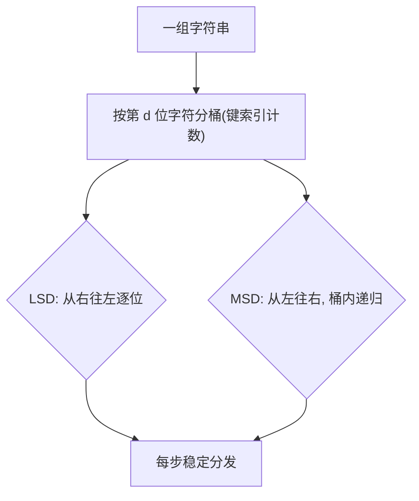

# 第 5 章（5.1）：字符串排序——键索引计数、LSD、MSD、三向快排

- **难度**：★★☆ | **预估学时**：3 小时 | **前置**：ch02c（快排）

## 学习目标
学完本节，你能：
1. 说清**键索引计数法**：O(N+R) 按字母分桶；
2. 区分 **LSD**（低位优先，定长串）与 **MSD**（高位优先，变长串）；
3. 说出三向字符串快速排序的适用场景。

## 一句话核心
字符串排序不逐字符比较，而是按字符"分桶"：从低位或高位逐位稳定分发，桶内再递归。

## 零基础讲解

### 概念 1：键索引计数法（key-indexed counting，难度：进阶）
**键索引计数**：字母表大小 R。统计每个字符出现次数 → 算前缀和确定每组起始位置 → 按序分发到辅助数组。**O(N+R)**，稳定。这是所有字符串排序的地基。

### 概念 2：LSD 低位优先（Least Significant Digit，难度：进阶）
**LSD 字符串排序**：从**最右字符**开始，逐位向左做键索引计数。前提：所有字符串**等长**。
类比：按学号排序——先比个位，再十位，再百位，每步稳定分发。

### 概念 3：MSD 高位优先（Most Significant Digit，难度：高难）
**MSD**：从**最左字符**开始分桶，桶内递归。支持**变长字符串**。痛点：短字符串提前结束（补"更小"字符）；小桶退化，小数组改用插入排序。

### 概念 4：三向字符串快速排序（难度：高难）
**三向字符串快排**：按当前字符把字符串分成 `<`、`=`、`>` 三组，只对 `<` 和 `>` 组递归下一位。避免 MSD 小桶爆炸，工程常用。

## 图示

**看图说明**：核心动作都是"按某位字符分桶"，区别只在从哪头开始。

## 类比与实例
- **类比（LSD）**：整理一摞等长卡片，先按个位数分 10 堆，每堆再按十分位细分。*失效边界*：卡片长度不一就不能用 LSD——长短不一得用 MSD。
- **实例**：定长 3 位串 ["cab","acb","bca"]，LSD 先按第 3 位分桶 → 再第 2 位 → 第 1 位，得序。

## 常见误解
- **别以为** LSD 适用于任何字符串——实际上它要求**等长**；变长串用 MSD。
- **别以为**字符串排序靠比较——实际上 LSD/MSD 是**分桶**，不做字符间比较。
- **别以为** MSD 一定比 LSD 快——实际上 MSD 递归开销大，定长短串 LSD 更省。

## 自测题（答案）
1. 键索引计数法的复杂度？（答案：O(N+R)，R 为字母表大小；解析。）
2. LSD 排序要求字符串满足什么？（答案：等长；解析。）
3. MSD 从哪一端开始分桶？（答案：最左字符（高位）；解析。）
4. 三向字符串快排把字符串分成哪三组？（答案：当前字符 <、=、> 基准；解析。）

## 复习锚点
- 地基：键索引计数 O(N+R)，稳定。
- LSD 从右（定长）；MSD 从左（变长）。
- 三向字符串快排 = 分桶版快排。
