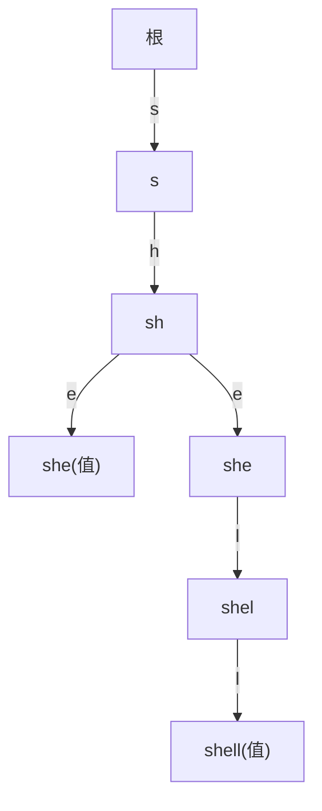

# 第 5 章（5.2）：单词查找树（Trie）

- **难度**：★★☆ | **预估学时**：2.5 小时 | **前置**：ch03b（BST）

## 学习目标
学完本节，你能：
1. 说清**单词查找树（trie）**：边代表字符、路径拼出键；
2. 写出 get/put：沿字符走树；
3. 理解它的成本与三向单词查找树的折中。

## 一句话核心
trie = 把字符串按键的字符逐段拆开存进树，查一个键只走它的长度，与总键数无关。

## 零基础讲解

### 概念 1：定义（难度：基础）
**单词查找树（trie / 字典树）**：根无字符，每条边标一个字符。从根到某节点的路径拼出一个键。节点可存值。
例：插入 "she"、"shell"——共享前缀 "sh" 的路径。

### 概念 2：get/put（难度：进阶）
- get：从根出发，按 key 的字符逐边走；走到底且节点有值 → 命中；中途断边 → 不存在。
- put：沿路走，缺边就建新节点；最后在末端节点存值。
**成本**：查找/插入正比于**键长**，与键总数 N 无关——这是它相对 BST 的最大优势。

### 概念 3：痛点与三向单词查找树（难度：高难）
标准 trie 每个节点有 R 条边（字母表大小），**空间浪费大**。
**三向单词查找树（TST）**：每个节点只分三条边（小于/等于/大于当前字符），折中了空间与速度，工程常用。

## 图示

**看图说明**："she" 和 "shell" 共享路径 s→h→e——公共前缀只存一份，省空间。

## 类比与实例
- **类比**：拼音输入法联想——打 "sh" 就列出所有以 sh 开头的词，因为它们在 trie 里共用一条前缀路径。*失效边界*：字符表很大（如 Unicode）时，每节点 R 条边的内存爆炸，得用三向 TST。
- **实例**：查 "she"：根→s→h→e，节点有值 → 命中。

## 常见误解
- **别以为** trie 和 BST 一样——实际上 trie 按字符边走，BST 按整键比较；trie 查找成本只看键长。
- **别以为** trie 省空间——实际上标准 trie 节点 R 条边很费内存；三向 TST 才是折中。
- **别以为** trie 只能查完整键——实际上它天然支持前缀匹配（列出某前缀下所有键）。

## 自测题（答案）
1. trie 的边代表什么？（答案：一个字符；解析：路径拼出键。）
2. trie 查找一个键的成本取决于？（答案：键长，与键总数无关；解析。）
3. 三向单词查找树解决什么问题？（答案：标准 trie 每节点 R 边太费内存；解析。）
4. trie 天然支持什么 BST 不擅长的操作？（答案：前缀匹配/前缀遍历；解析。）

## 复习锚点
- trie：边=字符，路径=键。
- 查找成本=键长，与 N 无关。
- 标准 trie 费内存；三向 TST 折中。
