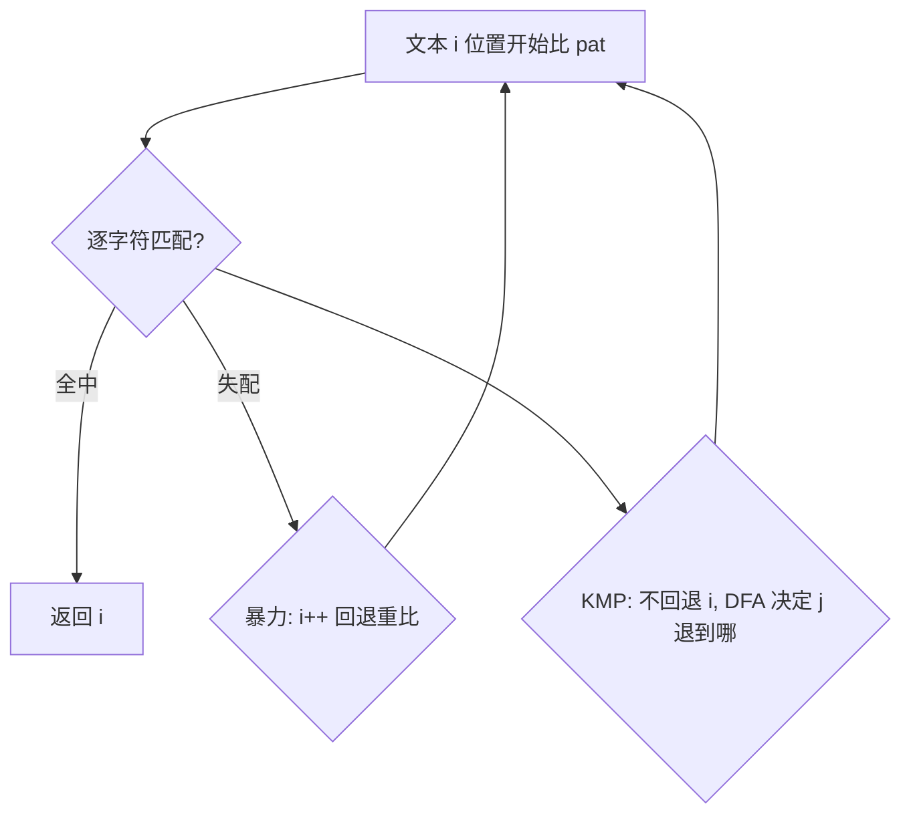

# 第 5 章（5.3）：子字符串查找——暴力、KMP、Boyer-Moore、Rabin-Karp

- **难度**：★★★ | **预估学时**：3.5 小时 | **前置**：ch01a

## 学习目标
学完本节，你能：
1. 说清子串查找问题：在文本中找模式串首次出现位置；
2. 讲出**暴力查找**为什么会回退；
3. 理解 **KMP** 的核心：不回退文本指针，用 DFA 记住已匹配部分。

## 一句话核心
在长文本里找短模式串；暴力法每次失配就退回重比，KMP 靠预计算"失配后从哪继续"避免回退。

## 零基础讲解

### 概念 1：问题定义（难度：基础）
**子字符串查找**：文本 txt 中找模式串 pat 首次出现的起点。例：在 "ababac" 找 "abac"。

### 概念 2：暴力查找（难度：基础）
从文本位置 i 开始逐字符比 pat；失配则 i++ 重新比。最坏 O(NM)（N 文本长、M 模式长）——文本指针会**回退**。

### 概念 3：KMP（Knuth-Morris-Pratt，难度：高难）
**KMP**：失配时**不回退文本指针 i**，而是用一个预计算的 DFA（确定有限状态自动机）决定"模式指针 j 该退到哪"。
核心洞察：已匹配的前缀里可能藏着"下次可以直接复用"的部分，不必从头再来。
预计算 DFA 只需 O(M)，查找 O(N)，总 O(N+M)。

### 概念 4：Boyer-Moore 与 Rabin-Karp（难度：高难）
- **Boyer-Moore**：从模式右端向左比，失配时按"坏字符"规则**跳过一大段**，实践常最快。
- **Rabin-Karp**：把模式串当成大整数做**散列指纹**，文本窗口滚动散列，指纹相等再逐字符确认。O(N+M) 期望。

## 图示

**看图说明**：差别全在"失配后怎么办"——暴力退回，KMP 不退回。

## 类比与实例
- **类比**：对答案时，暴力法每错一个字就从头对；KMP 像记住"前三个字已经对过"，错了只需从中间某字继续。*失效边界*：KMP 的优势在模式串有重复前缀时最明显；极短模式串暴力就够。
- **实例**：pat="ababac"，文本失配时 KMP 用已匹配的 "abab" 前缀信息决定 j 不退回 0。

## 常见误解
- **别以为** KMP 是最快的——实际上它是"最坏保证好"，实践中 Boyer-Moore 常更快。
- **别以为** KMP 很难——实际上核心就一句：失配不回退文本指针，用预计算表决定模式指针位置。
- **别以为** Rabin-Karp 逐字符比——实际上它先比散列指纹，指纹撞了才细看。

## 自测题（答案）
1. 暴力子串查找最坏复杂度？（答案：O(NM)；解析：文本 N、模式 M。）
2. KMP 的关键改进是什么？（答案：失配不回退文本指针，用 DFA 决定模式指针位置；解析。）
3. Rabin-Karp 用什么加速？（答案：滚动散列指纹；解析。）
4. Boyer-Moore 从模式哪端开始比？（答案：右端向左；解析。）

## 复习锚点
- 子串查找：文本中找模式串。
- 暴力 O(NM) 会回退。
- KMP 不回退，O(N+M)。
