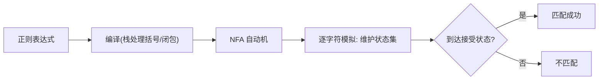

# 第 5 章（5.4）：正则表达式与 NFA

- **难度**：★★★ | **预估学时**：3 小时 | **前置**：ch05c

## 学习目标
学完本节，你能：
1. 说清正则表达式的三种运算：连接、或（|）、闭包（*）；
2. 理解**NFA（非确定有限状态自动机）**：从正则表达式构造自动机模拟匹配；
3. 说出 NFA 模拟的时间 ~3NM。

## 一句话核心
正则表达式是描述模式的语言；本书把它编译成一台 NFA 自动机，模拟它跑一遍就知道文本是否匹配。

## 零基础讲解

### 概念 1：正则表达式语法（难度：基础）
三种基本运算：
- **连接**：AB 表示 A 后紧跟 B；
- **或**：A|B 表示 A 或 B；
- **闭包**：A* 表示 A 重复零次或多次。
加括号分组。例：`(A|B)(C|D)*` 匹配 "ACCD" 这类。

### 概念 2：NFA（难度：高难）
**NFA（Nondeterministic Finite Automaton，非确定有限状态自动机）**：状态机，有 ε-转移（不读字符就能跳）。本书做法：
1. 把正则表达式**编译**成 NFA（用栈处理括号和闭包）；
2. **模拟** NFA 读文本：维护"当前所有可能状态集合"，逐字符推进；
3. 若读完文本时能到达接受状态 → 匹配成功。

**时间**：~3NM（N 文本长、M 正则长度）。

### 概念 3：NFA vs DFA（难度：高难）
- **DFA**（确定）：每状态每字符唯一转移——就是 KMP 用的那种；
- **NFA**：允许 ε 转移和多分支，模拟时维护状态集。
本书用 NFA 是因为它能直接从正则表达式构造，比 DFA 灵活。

## 图示

**看图说明**：正则 → 编译成自动机 → 模拟运行。这就是 grep/正则引擎的骨架。

## 类比与实例
- **类比**：正则表达式像"乐谱"，NFA 是"演奏它的机器"——把乐谱编译成可执行的演奏过程。*失效边界*：NFA 模拟维护状态集，正则极复杂时状态爆炸，工程引擎会做优化。
- **实例**：正则 `A*B` 编译成 NFA：A 可自循环，遇到 B 进接受态。文本 "AAAB" 模拟通过。

## 常见误解
- **别以为**正则表达式就是通配符——实际上它是有形式语法的语言（连接/或/闭包）。
- **别以为** NFA 和 DFA 能力不同——实际上正则表达能力等价，只是 NFA 构造更直接。
- **别以为** NFA 模拟很快——实际上 ~3NM，正则长时状态集膨胀。

## 自测题（答案）
1. 正则表达式的三种基本运算？（答案：连接、或(|)、闭包(*)；解析。）
2. NFA 模拟维护什么？（答案：当前所有可能状态的集合；解析。）
3. NFA 模拟匹配的时间约为？（答案：~3NM；解析：N 文本长、M 正则长。）
4. 本书从正则表达式构造什么来做匹配？（答案：NFA 自动机；解析。）

## 复习锚点
- 正则三运算：连接、或、闭包。
- 正则 → 编译成 NFA → 模拟匹配。
- NFA ~3NM。
