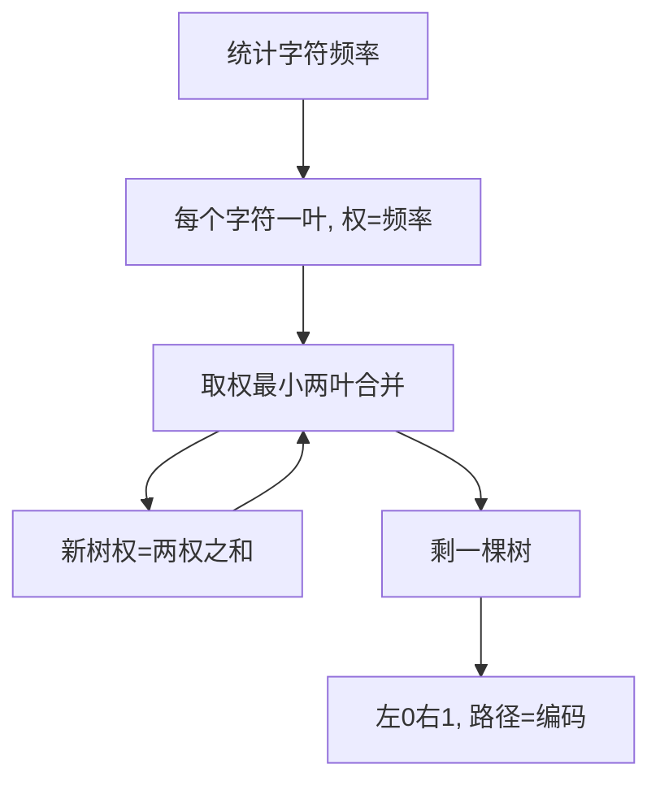

# 第 5 章（5.5）：数据压缩——游程编码与霍夫曼压缩

- **难度**：★★☆ | **预估学时**：2.5 小时 | **前置**：ch03d（散列）、ch05b

## 学习目标
学完本节，你能：
1. 说清数据压缩的"游戏规则"：压缩率、无损/有损；
2. 理解**游程编码**：连续重复值计数；
3. 写出**霍夫曼压缩**：频率高的字符用短编码（前缀编码）。

## 一句话核心
压缩 = 给常见字符短编码、少见字符长编码；霍夫曼用贪心树实现最优前缀编码。

## 零基础讲解

### 概念 1：游戏规则（难度：基础）
- **压缩率**：压缩后大小 / 原大小；
- **无损压缩**：能完整还原（本书主题）；**有损**：允许失真（图片/视频）。

### 概念 2：游程编码（run-length encoding，难度：基础）
**游程编码**：连续重复的值用"值+重复次数"表示。例：`AAAAA` → `5A`。适合重复多的数据（如基因组、单色图像）。

### 概念 3：霍夫曼压缩（Huffman，难度：高难）
**霍夫曼编码**：统计字符频率，频率高的字符分配短二进制码。要求**前缀编码**（任一编码不是另一编码的前缀），才能无歧义解码。
构造（贪心）：
1. 每个字符做成叶节点，权=频率；
2. 每次取权最小的两个合并成新树，权=两者之和；
3. 重复到只剩一棵树；
4. 左 0 右 1，从根到叶的路径即该字符编码。
频率越高的字符离根越近 → 编码越短。

## 图示

**看图说明**：霍夫曼 = 反复合并最小权节点。高频字符自然靠近根、编码短。

## 类比与实例
- **类比**：摩尔斯电码——常见字母 E 用最短的 "."，少见字母用长码。霍夫曼就是按实际文本频率自动定这套长短码。*失效边界*：霍夫曼要存编码表（树），极短文本可能压缩后反而变大。
- **实例**：文本 "aab"，频率 a=2、b=1。合并 a、b 成树，a 编码 0、b 编码 1（或反之），压缩为 "001"。

## 常见误解
- **别以为**霍夫曼是无损压缩的唯一方法——实际上还有 LZ 系列（gzip），霍夫曼是经典入门。
- **别以为**霍夫曼编码任意——实际上它是**最优前缀编码**（贪心证明）。
- **别以为**压缩总能变小——实际上随机数据不可压缩，霍夫曼对它可能反而膨胀。

## 自测题（答案）
1. 游程编码把 "AAAAA" 编成什么？（答案：5A；解析。）
2. 霍夫曼编码为什么要前缀编码？（答案：否则解码时一个码可能是另一个码的前缀，产生歧义；解析。）
3. 霍夫曼树合并时每次取哪两个节点？（答案：权最小的两个；解析：贪心。）
4. 频率高的字符在霍夫曼树中离根更近还是更远？（答案：更近，编码更短；解析。）

## 复习锚点
- 游程编码：重复值计数。
- 霍夫曼：高频短码，贪心建树，前缀编码。
- 随机数据不可压缩。
