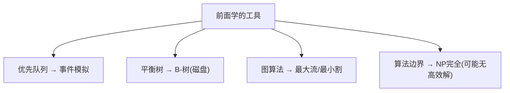

# 第 6 章：背景——事件模拟、B-树、网络流与 NP 完全性

- **难度**：★★☆ | **预估学时**：2 小时 | **前置**：第 1~5 章

## 学习目标
学完本章，你能：
1. 说出优先队列的一个大应用：**事件驱动模拟**；
2. 理解 **B-树**：为磁盘/外部存储设计的平衡树；
3. 知道**最大流-最小割定理**与 **NP 完全性**的大致含义（入门地图，不深究）。

## 一句话核心
本章是"拓展视野"：把前面的工具用到事件模拟、磁盘索引、网络流，并告诉你哪些问题（NP 完全）可能根本没有高效算法。

## 零基础讲解

### 概念 1：事件驱动模拟（难度：进阶）
用**优先队列**按"事件发生时间"排序。每次取出最近事件，处理它，可能产生新事件再入队。例：粒子碰撞模拟——碰撞事件按时间排队。这是优先队列的经典工业应用。

### 概念 2：B-树（B-tree，难度：高难）
**B-树**：为**磁盘/外部存储**设计的平衡多路搜索树。每个节点存很多键（一页），树很矮——因为磁盘读一页很贵，要尽量减少读盘次数。数据库索引的核心结构。

### 概念 3：最大流-最小割（难度：高难）
**最大流问题**：网络中从源到汇最多能送多少"流量"。**最大流-最小割定理**：最大流的值 = 最小割的容量。应用：配对问题、带宽分配。

### 概念 4：NP 完全性（难度：高难）
**P**：多项式时间可解；**NP**：多项式时间可验证答案；**NP 完全**：NP 中最难的一类（如旅行商、可满足性）。若找到一个 NP 完全问题的多项式算法，则所有 NP 问题都多项式可解（P=NP）。目前普遍猜测 P≠NP——即这些问题**可能没有高效算法**，工程上只能用近似或指数算法。

## 图示

**看图说明**：本章把工具推向应用，并标出"哪些问题算不动"的边界。

## 类比与实例
- **类比（B-树）**：查字典不逐页翻，而是按"章节"大块定位——B-树就是为"大块读取便宜、小块读取贵"的磁盘设计的。*失效边界*：内存中 BST/红黑树比 B-树更快，B-树只在外部存储占优。
- **类比（NP 完全）**：有些问题像"在所有围棋棋局里找最优"——组合爆炸，可能永远算不完。

## 常见误解
- **别以为** NP 完全 = "没法解"——实际上它能解，只是**可能没有多项式高效算法**，小规模仍可算。
- **别以为** B-树是红黑树的改进版——实际上它是为**磁盘页**设计的不同结构，不是内存树的升级。
- **别以为**最大流就是最短路径——实际上它求"网络吞吐上限"，目标完全不同。

## 自测题（答案）
1. 事件驱动模拟用什么数据结构？（答案：优先队列（按事件时间）；解析。）
2. B-树为什么设计得很矮？（答案：磁盘读一页贵，减少读盘次数；解析。）
3. 最大流-最小割定理说什么？（答案：最大流值 = 最小割容量；解析。）
4. NP 完全问题的含义？（答案：NP 中最难的一类，可能无多项式高效算法；解析。）

## 复习锚点
- 优先队列 → 事件模拟。
- B-树 → 磁盘索引。
- 最大流=最小割；NP 完全 = 可能算不动。
