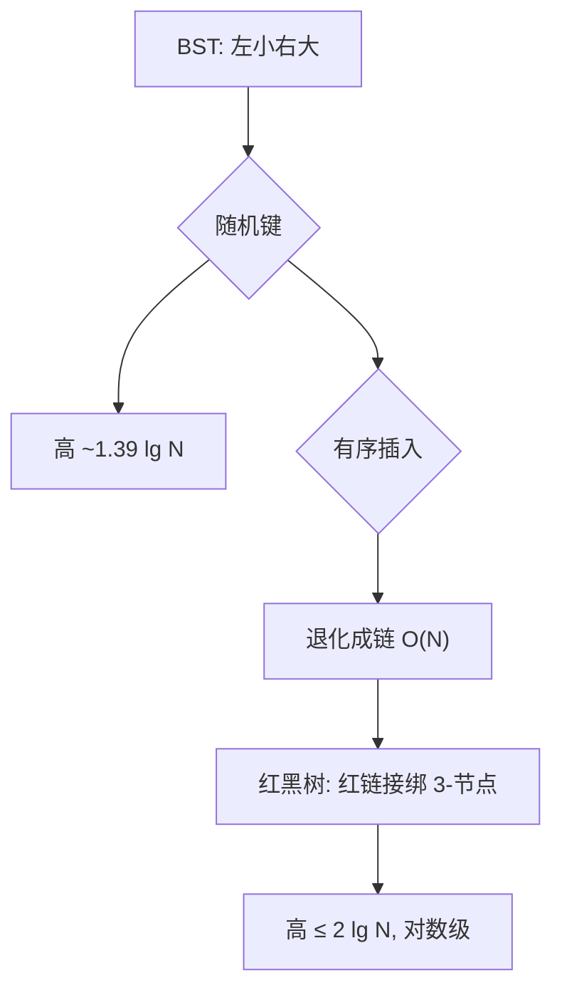

# 二叉查找树与平衡树

- **难度**：进阶 | **涉及章节**：第 3.2、3.3 节

## 一句话定义
BST（左小右大）让查找像二分、插入只需挂新叶；但有序插入会让它退化成链，于是用红黑树（平衡树）强制它不歪。

## 为什么重要
这是"动态有序集合"的标准解法——Java 的 TreeMap/TreeSet、Linux 内核都用红黑树。理解它就理解了"为什么查找既能快又能插"。

## 图示

**看图说明**：BST 的弱点（长歪）正是平衡树要治的病。

## 详解
- BST：查找/插入 = 走根到叶一条路，成本=树高。
- 红黑树 = 2-3 树的二叉编码，靠左旋/右旋/颜色反转保持平衡。
- **类比**：家谱树若按身高顺序加人会歪成一队；红黑树像随时扶正，保证树矮胖。*失效边界*：红黑不是完美平衡，只是足够平衡。

## 常见误解
- 别以为 BST 查找保证 log N——只有随机键平均成立，最坏 O(N)。
- 别以为红链接是数据——它只是标记，不改键顺序。

## 在书中出现的脉络
| 章节 | 语境 | 关键结论 |
|---|---|---|
| 3.2 | BST | 随机键 ~1.39 lg N |
| 3.3 | 红黑树 | 高 ≤ 2 lg N |

## 相关概念
- 前置：递归、有序数组；后续：符号表有序操作。
