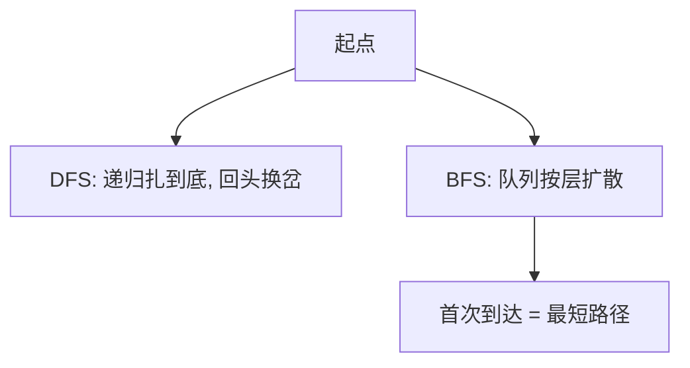

# 图遍历（DFS 与 BFS）

- **难度**：进阶 | **涉及章节**：第 4.1、4.2 节

## 一句话定义
DFS（深度优先，栈）一条路扎到底；BFS（广度优先，队列）一圈圈扩散——BFS 首次到达某点的路就是最短路径。

## 为什么重要
它们是图算法的总开关：连通性、路径、环、拓扑排序、强连通全建立在这两种遍历之上。

## 图示

**看图说明**：同一张图，DFS 走法像迷宫，BFS 走法像水波纹。

## 详解
- 邻接表存图，空间 O(V+E)。
- BFS 求最短；DFS 求路径/环/拓扑序。
- **类比**：DFS=走迷宫死胡同才回头；BFS=池塘波纹外扩。*失效边界*：BFS 要存整层队列，大图内存大。

## 常见误解
- 别以为 DFS 能求最短——只有 BFS 保证最短。
- 别以为两者只是写法差——一个栈一个队列，顺序本质不同。

## 在书中出现的脉络
| 章节 | 语境 | 关键结论 |
|---|---|---|
| 4.1 | 无向图 | BFS 最短路径 |
| 4.2 | 有向图 | DFS 判环/拓扑 |

## 相关概念
- 前置：栈/队列；后续：MST、最短路径。
