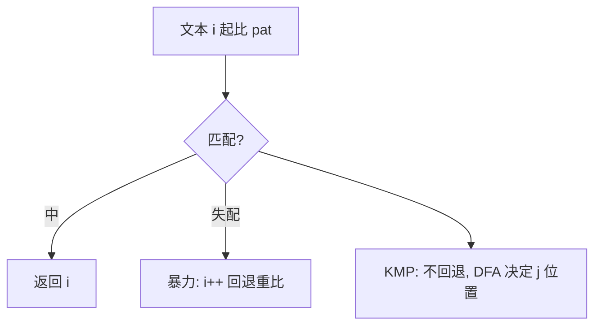

# 字符串匹配（子串查找）

- **难度**：高难 | **涉及章节**：第 5.3、5.4 节

## 一句话定义
在长文本中找短模式串首次出现的位置；KMP 靠预计算避免失配回退，把 O(NM) 降到 O(N+M)。

## 为什么重要
它是文本编辑器查找、grep、生物信息序列比对的基础。理解"失配后不回退"是串算法的精髓。

## 图示

**看图说明**：差别全在"失配后"——暴力退回，KMP 不退回。

## 详解
- 暴力 O(NM)；KMP O(N+M)。
- Boyer-Moore 从右端比、坏字符跳段；Rabin-Karp 用滚动散列指纹。
- **类比**：对答案错一个字，暴力从头对；KMP 记住"前三字已对"，从中间继续。*失效边界*：极短模式串暴力就够。

## 常见误解
- 别以为 KMP 最快——它是最坏保证好，实践 Boyer-Moore 常更快。
- 别以为 Rabin-Karp 逐字比——先比散列指纹。

## 在书中出现的脉络
| 章节 | 语境 | 关键结论 |
|---|---|---|
| 5.3.2 | 暴力 | O(NM) |
| 5.3.3 | KMP | O(N+M) |

## 相关概念
- 前置：二分查找；后续：正则 NFA、数据压缩。
