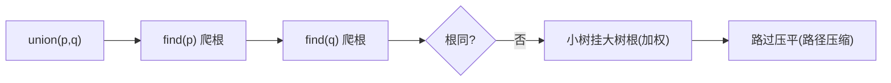

# 并查集（Union-Find）

- **难度**：进阶 | **涉及章节**：第 1.5 节、第 4.3 节（Kruskal）

## 一句话定义
维护"一群点的连通关系"的数据结构，支持 union（连通两点）与 find（查两点是否同组），经优化后近乎常数。

## 为什么重要
它是 Kruskal 最小生成树、连通性问题、图像处理分区的底层工具。用极小的代价回答"这两块是不是已经连起来了"。

## 图示

**看图说明**：两个优化叠加——树天然矮 + 被走过的路压短。

## 详解
演化链：quick-find（union O(N)）→ quick-union（可能退化链）→ **加权 quick-union**（树高 ≤ lg N）→ **+路径压缩**（近似常数）。
- **类比**：氏族合并——小族并入大族，年轻人每次报到就把户口本直接写族长名。*失效边界*：不存边顺序，只维护连通性。

## 常见误解
- 别以为它存图——它故意不存边，只存连通分组，所以轻量。
- 别以为加权就是"按数量"——是按**树大小**挂小到大。

## 在书中出现的脉络
| 章节 | 语境 | 关键结论 |
|---|---|---|
| 1.5 | 动态连通性案例 | 加权 QU 深度 ≤ lg N |
| 4.3 | Kruskal 判断两端连通 | 并查集近常数 |

## 相关概念
- 前置：栈/队列；后续：最小生成树 Kruskal。
