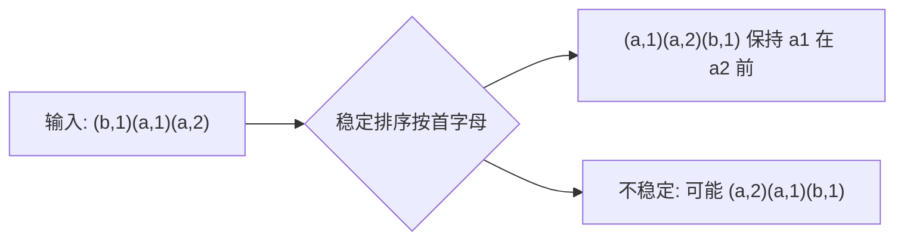

# 排序稳定性

- **难度**：基础 | **涉及章节**：第 2 章（尤其 2.2、2.5）

## 一句话定义
若两个相等键在排序后保持它们排序前的相对顺序，则该排序算法是**稳定的**。

## 为什么重要
多级排序（先按姓名排、再按成绩排）时，稳定性保证第二级排序不破坏第一级已排好的同组顺序。Java 对引用类型用归并排序，正是因为它稳定。

## 图示

**看图说明**：两个 a 相等，稳定算法保住它们原来的先后。

## 详解
- **稳定**：插入排序、归并排序。
- **不稳定**：选择排序、希尔排序、快速排序、堆排序（交换会跨过相等元素）。
- **类比**：按学号排好队，再按身高重排——稳定算法让同身高的人仍按学号站。*失效边界*：若你不在乎相等键的先后，稳定性无所谓。

## 常见误解
- 别以为"快排很稳所以Java用它"——实际上 Java 对引用类型用归并（稳），对原始类型才用三向快排。
- 别以为稳定性无关紧要——多级排序时它是正确性关键。

## 在书中出现的脉络
| 章节 | 语境 | 关键结论 |
|---|---|---|
| 2.2 | 归并排序 | 稳定 |
| 2.5.2 | 选型表 | 引用排序要稳定 |

## 相关概念
- 前置：排序；后续：符号表多级键。
