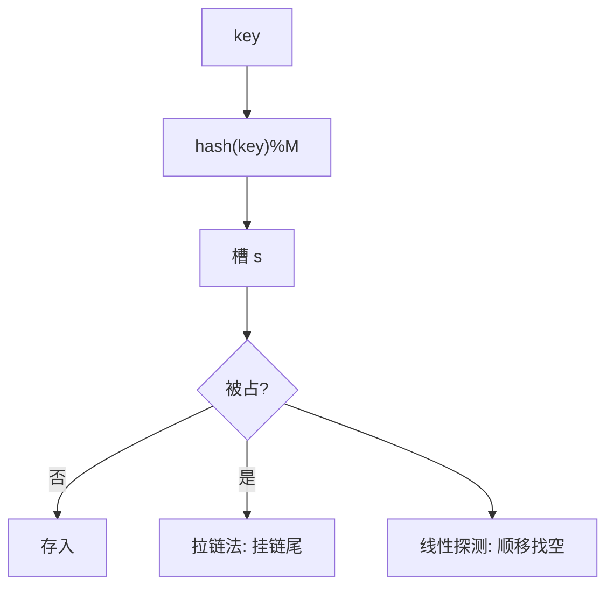

# 散列（哈希）

- **难度**：进阶 | **涉及章节**：第 3.4 节

## 一句话定义
把 key 通过散列函数直接算成数组下标，理想查找/插入常数时间；代价是失去键的有序性。

## 为什么重要
它是最快的符号表实现（HashMap），数据库、缓存、去重全靠它。理解它就理解了"为什么查字典有时 O(1)"。

## 图示

**看图说明**：散列是入口，碰撞两策决定"撞了往哪走"。

## 详解
- 散列函数：快 + 均匀。
- 装载因子 α=N/M ≤ 1/2，超了就扩容重散列。
- **类比**：旅馆按姓氏首字母分房；同姓多了加床（拉链）或顺延空房（线性探测）。*失效边界*：α→1 时找房要走长走廊。

## 常见误解
- 别以为散列表总 O(1)——只有低装载、均匀散列才成立。
- 别以为它支持 min/rank——它打乱键序，无有序操作。

## 在书中出现的脉络
| 章节 | 语境 | 关键结论 |
|---|---|---|
| 3.4.2 | 拉链法 | 链长 N/M |
| 3.4.3 | 线性探测 | α ≤ 1/2 |

## 相关概念
- 前置：符号表；后续：稀疏向量、缓存。
