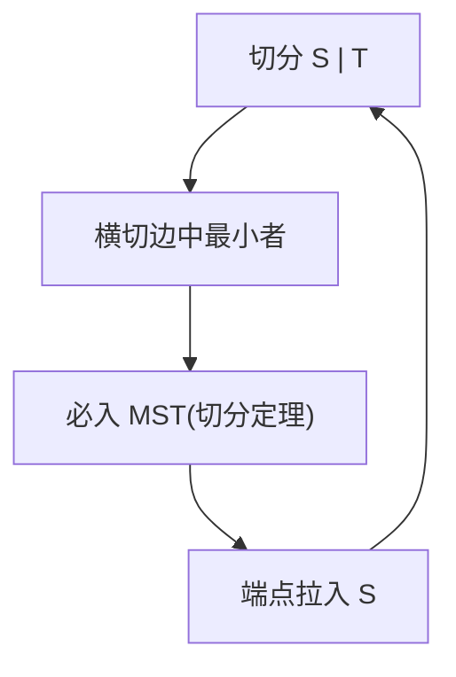

# 最小生成树（MST）

- **难度**：高难 | **涉及章节**：第 4.3 节

## 一句话定义
在连通加权无向图中选 V-1 条边连起所有顶点，使总权重最小。

## 为什么重要
它是"最低成本连网"问题——修路、铺光缆、电路布线的数学模型。切分定理是它的理论心脏。

## 图示

**看图说明**：Prim 的循环——每轮靠切分定理安全加一条边。

## 详解
- **切分定理**：最小横切边必入 MST。
- **Prim**：从点长出去，优先队列，E log V。
- **Kruskal**：边按权排序，并查集判连通，E log E。
- **类比**：从首都修最便宜地铁线往外扩。*失效边界*：图必须连通才存在 MST。

## 常见误解
- 别以为 MST 是最短路径树——它最小化总边权，不是两点距离。
- 别以为 MST 唯一——权并列时可能多解，但总权最小。

## 在书中出现的脉络
| 章节 | 语境 | 关键结论 |
|---|---|---|
| 4.3.4 | Prim | E log V |
| 4.3.6 | Kruskal | 并查集 |

## 相关概念
- 前置：图遍历、优先队列、并查集；后续：最短路径。
