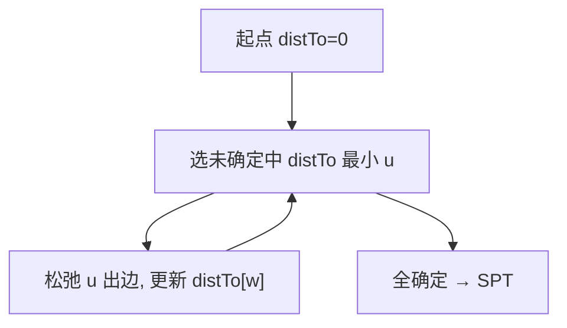

# 最短路径

- **难度**：高难 | **涉及章节**：第 4.4 节

## 一句话定义
从起点到图中各顶点的"最便宜路径"集合（最短路径树 SPT）；Dijkstra 在非负权下用 E log V 求解。

## 为什么重要
它是导航、网络路由、任务调度的核心。松弛（relaxation）是所有最短路径算法的统一动作。

## 图示

**看图说明**：Dijkstra = 反复"锁定最近点 + 松弛边"。

## 详解
- **松弛**：经 v 到 w 更短就更新 distTo[w]。
- **Dijkstra**：边权非负，优先队列，E log V。
- **DAG**：拓扑序松弛，线性求最短/最长。
- **类比**：导航先锁定当前最近路口再往外探。*失效边界*：有负权边时 Dijkstra 会错，得用 Bellman-Ford。

## 常见误解
- 别以为 Dijkstra 适用任何图——要求边权非负。
- 别以为它用普通队列——用的是优先队列。

## 在书中出现的脉络
| 章节 | 语境 | 关键结论 |
|---|---|---|
| 4.4.4 | Dijkstra | E log V |
| 4.4.5 | DAG 最短 | 线性 |

## 相关概念
- 前置：图遍历、优先队列；后续：网络流。
