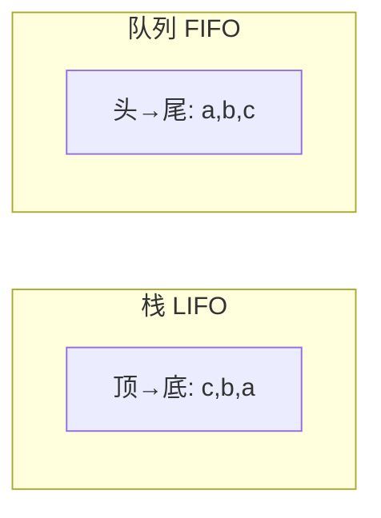

# 栈、队列与递归

- **难度**：基础 | **涉及章节**：第 1.3 节，贯穿第 2、4 章

## 一句话定义
栈（后进先出）与队列（先进先出）是两种最基础的存取规则；递归是方法自我调用，靠"调用栈"实现。

## 为什么重要
它们是树遍历（DFS 用栈）、BFS（用队列）、表达式求值、归并/快排递归的底层积木。

## 图示

**看图说明**：栈从顶取（c 先出），队列从头取（a 先出）。

## 详解
- 栈 = 弹夹/浏览器后退；队列 = 排队打饭。
- 递归两铁律：有基准条件；子问题不相交。
- **类比**：调用栈像摞盘子——调用新函数压盘，返回时撤盘。*失效边界*：递归太深会栈溢出。

## 常见误解
- 别以为栈和队列"都能随机访问"——它们只能端点操作。
- 别以为递归比循环高级——它只是循环的另一种表达，不当会爆栈。

## 在书中出现的脉络
| 章节 | 语境 | 关键结论 |
|---|---|---|
| 1.3 | 数组/链表实现栈队列 | 动态数组均摊常数 |
| 4.1 | DFS 用栈、BFS 用队列 | 决定遍历顺序 |

## 相关概念
- 前置：无；后续：图遍历、递归排序。
