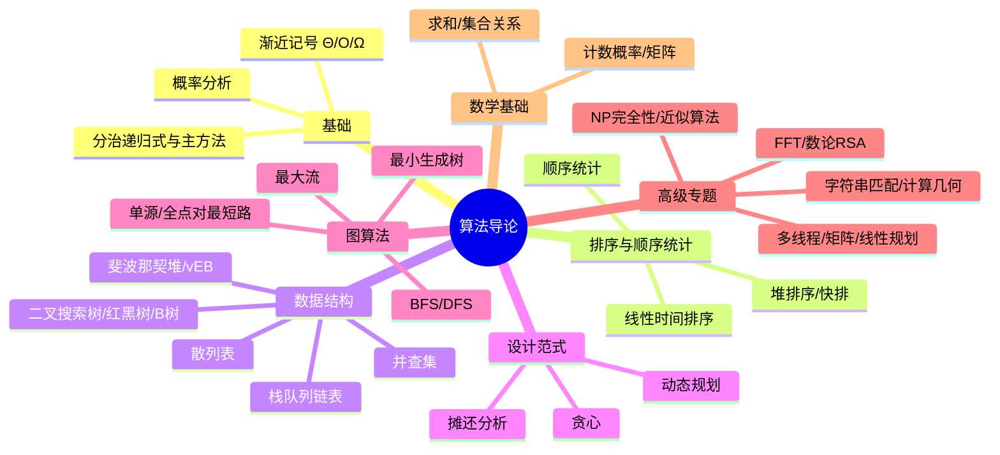

# 《算法导论（原书第 3 版）》点化学习系统

## 这本书在讲什么
算法不是「一堆聪明题解」，而是一整套「如何用计算机高效解决问题」的方法论：先用渐近记号度量增长（第 3 章），再用分治（第 4 章）、动态规划（第 15 章）、贪心（第 16 章）三大范式设计算法，用堆、树、散列、并查集等数据结构支撑，最后落到图算法（最短路、最大流）、数论（RSA）、字符串匹配、计算几何，并用 NP 完全性（第 34 章）回答「哪些问题可能根本没有高效算法」。

## 全书心智模型

## 学习路径（拓扑序 + 检查点）

| 步骤 | 章节 | 主题 | 前置 | 检查点 |
|---|---|---|---|---|
| 01 | ch01 | 算法在计算中的作用 | 无 | ch01 自测 |
| 02 | ch02 | 算法基础（插入排序/归并） | ch01 | ch02 自测 |
| 03 | ch03 | 函数的增长 | ch02 | ch03 自测 |
| 04 | ch04 | 分治策略与主方法 | ch03 | ch04 自测 |
| 05 | ch05 | 概率分析与随机算法 | ch03 | ch05 自测 |
| 06 | ch06 | 堆排序与优先队列 | ch02 | ch06 自测 |
| 07 | ch07 | 快速排序 | ch06 | ch07 自测 |
| 08 | ch08 | 线性时间排序 | ch07 | ch08 自测 |
| 09 | ch09 | 中位数与顺序统计 | ch07 | ch09 自测 |
| 10 | ch10 | 基本数据结构 | ch02 | ch10 自测 |
| 11 | ch11 | 散列表 | ch10 | ch11 自测 |
| 12 | ch12 | 二叉搜索树 | ch10 | ch12 自测 |
| 13 | ch13 | 红黑树 | ch12 | ch13 自测 |
| 14 | ch14 | 数据结构的扩张 | ch13 | ch14 自测 |
| 15 | ch15 | 动态规划 | ch04 | ch15 自测 |
| 16 | ch16 | 贪心算法 | ch15 | ch16 自测 |
| 17 | ch17 | 摊还分析 | ch03 | ch17 自测 |
| 18 | ch18 | B 树 | ch13 | ch18 自测 |
| 19 | ch19 | 斐波那契堆 | ch06,ch17 | ch19 自测 |
| 20 | ch20 | van Emde Boas 树 | ch18 | ch20 自测 |
| 21 | ch21 | 不相交集合 | ch10 | ch21 自测 |
| 22 | ch22 | 图的基本算法 | ch10 | ch22 自测 |
| 23 | ch23 | 最小生成树 | ch16,ch21,ch22 | ch23 自测 |
| 24 | ch24 | 单源最短路径 | ch06,ch22 | ch24 自测 |
| 25 | ch25 | 所有结点对最短路 | ch24 | ch25 自测 |
| 26 | ch26 | 最大流 | ch22 | ch26 自测 |
| 27 | ch27 | 多线程算法 | ch04 | ch27 自测 |
| 28 | ch28 | 矩阵运算 | 附录D | ch28 自测 |
| 29 | ch29 | 线性规划 | ch28 | ch29 自测 |
| 30 | ch30 | 多项式与 FFT | ch04,附录A | ch30 自测 |
| 31 | ch31 | 数论算法 | 附录C | ch31 自测 |
| 32 | ch32 | 字符串匹配 | ch31 | ch32 自测 |
| 33 | ch33 | 计算几何学 | ch08 | ch33 自测 |
| 34 | ch34 | NP 完全性 | ch22 | ch34 自测 |
| 35 | ch35 | 近似算法 | ch23,ch34 | ch35 自测 |
| 36 | ch36 | 附录 A 求和 | ch03 | ch36 自测 |
| 37 | ch37 | 附录 B 集合关系函数图树 | ch22 | ch37 自测 |
| 38 | ch38 | 附录 C 计数与概率 | ch05 | ch38 自测 |
| 39 | ch39 | 附录 D 矩阵 | ch28 | ch39 自测 |

建议节奏：先按 01→09 走完「基础与排序」，再 10→14「数据结构」，再 15→17「设计范式」，最后 18→39 高级专题。附录可随时回查。

## 章节索引（含难度）

- 第 1 章 算法在计算中的作用（★☆☆）→ chapters/ch01-算法在计算中的作用.md
- 第 2 章 算法基础（★☆☆）→ chapters/ch02-算法基础.md
- 第 3 章 函数的增长（★★☆）→ chapters/ch03-函数的增长.md
- 第 4 章 分治策略（★★☆）→ chapters/ch04-分治策略.md
- 第 5 章 概率分析和随机算法（★★☆）→ chapters/ch05-概率分析和随机算法.md
- 第 6 章 堆排序（★★☆）→ chapters/ch06-堆排序.md
- 第 7 章 快速排序（★★☆）→ chapters/ch07-快速排序.md
- 第 8 章 线性时间排序（★★☆）→ chapters/ch08-线性时间排序.md
- 第 9 章 中位数和顺序统计量（★★☆）→ chapters/ch09-中位数和顺序统计量.md
- 第 10 章 基本数据结构（★☆☆）→ chapters/ch10-基本数据结构.md
- 第 11 章 散列表（★★☆）→ chapters/ch11-散列表.md
- 第 12 章 二叉搜索树（★★☆）→ chapters/ch12-二叉搜索树.md
- 第 13 章 红黑树（★★★）→ chapters/ch13-红黑树.md
- 第 14 章 数据结构的扩张（★★☆）→ chapters/ch14-数据结构的扩张.md
- 第 15 章 动态规划（★★★）→ chapters/ch15-动态规划.md
- 第 16 章 贪心算法（★★☆）→ chapters/ch16-贪心算法.md
- 第 17 章 摊还分析（★★★）→ chapters/ch17-摊还分析.md
- 第 18 章 B 树（★★☆）→ chapters/ch18-B树.md
- 第 19 章 斐波那契堆（★★★）→ chapters/ch19-斐波那契堆.md
- 第 20 章 van Emde Boas 树（★★★）→ chapters/ch20-vanEmdeBoas树.md
- 第 21 章 不相交集合（★★☆）→ chapters/ch21-用于不相交集合的数据结构.md
- 第 22 章 基本的图算法（★★☆）→ chapters/ch22-基本的图算法.md
- 第 23 章 最小生成树（★★☆）→ chapters/ch23-最小生成树.md
- 第 24 章 单源最短路径（★★★）→ chapters/ch24-单源最短路径.md
- 第 25 章 所有结点对最短路径（★★☆）→ chapters/ch25-所有结点对的最短路径.md
- 第 26 章 最大流（★★★）→ chapters/ch26-最大流.md
- 第 27 章 多线程算法（★★☆）→ chapters/ch27-多线程算法.md
- 第 28 章 矩阵运算（★★★）→ chapters/ch28-矩阵运算.md
- 第 29 章 线性规划（★★★）→ chapters/ch29-线性规划.md
- 第 30 章 多项式与 FFT（★★★）→ chapters/ch30-多项式与快速傅里叶变换.md
- 第 31 章 数论算法（★★★）→ chapters/ch31-数论算法.md
- 第 32 章 字符串匹配（★★☆）→ chapters/ch32-字符串匹配.md
- 第 33 章 计算几何学（★★★）→ chapters/ch33-计算几何学.md
- 第 34 章 NP 完全性（★★★）→ chapters/ch34-NP完全性.md
- 第 35 章 近似算法（★★☆）→ chapters/ch35-近似算法.md
- 附录 A 求和（★☆☆）→ chapters/ch36-附录A-求和.md
- 附录 B 集合关系函数图树（★☆☆）→ chapters/ch37-附录B-集合关系函数图树.md
- 附录 C 计数与概率（★★☆）→ chapters/ch38-附录C-计数与概率.md
- 附录 D 矩阵（★☆☆）→ chapters/ch39-附录D-矩阵.md

## 前置知识缺口（零基础补讲）

| 缺口 | 对应补讲位置 | 学完标志 |
|---|---|---|
| 不会读 Θ/O/Ω | ch03 + concepts/渐近记号.md | 能说出 f(n)=n²+100n 是 Θ(n²) |
| 不会解递归式 | ch04 + concepts/递归式与分治.md | 能用主方法定 T(n)=2T(n/2)+n 的阶 |
| 没学过概率 | ch05 + 附录 C | 能算期望、用指示器随机变量 |
| 没学过矩阵 | 附录 D + ch28 | 能做矩阵乘法、判 det≠0 |
| 不熟离散数学 | 附录 B | 能说清等价关系/双射/树定义 |

## 入口
- 术语表：glossary.md
- 模式库：patterns.md
- 速查表：cheatsheet.md
- 测验：quiz.md
- 抽认卡：flashcards.md
