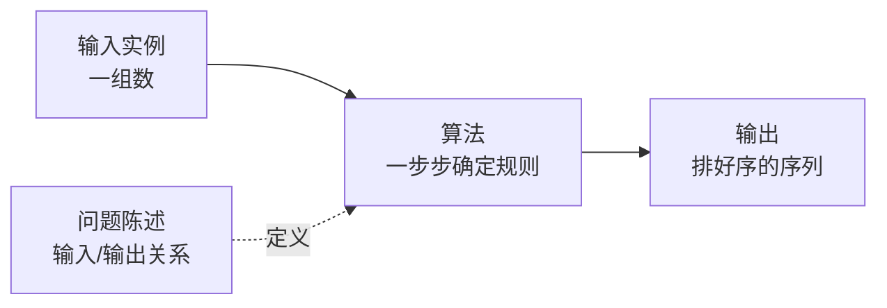

# 第 1 章：算法在计算中的作用

- **难度**：★☆☆ | **预估学时**：1 小时 | **前置**：无（全书入口）

## 学习目标
学完本章，你能：
1. 用一句话说清「算法（algorithm）」的形式定义，并区分「问题」与「问题实例」。
2. 解释为什么效率是算法研究的核心，并说出插入排序与归并排序在 n=100 万时的运行时间差距量级。
3. 列举算法在真实世界中的至少两个应用场景。

## 一句话核心
**算法是解决问题的一步步确定化计算过程；当计算机不是无限快、存储不是免费时，「选对算法」和「用好硬件」同等重要。**

## 零基础讲解

### 概念 1：算法（algorithm）是什么（难度：基础）
**算法**就是任何良定义的计算过程，它取某个值或值的集合作为**输入**，并产生某个值或值的集合作为**输出**。换句话说：算法是把输入一步步变换成输出的、有明确规则的操作序列。

以书中反复用的**排序问题**为例：
- **输入**：n 个数的一个序列 ⟨a₁, a₂, …, aₙ⟩。
- **输出**：输入序列的一个排列 ⟨a₁′, a₂′, …, aₙ′⟩，满足 a₁′ ≤ a₂′ ≤ … ≤ aₙ′。

例如输入 ⟨31, 41, 59, 26, 41, 58⟩，排序算法返回 ⟨26, 31, 41, 41, 58, 59⟩。这组具体的输入，在书中叫作该问题的一个**实例（instance）**——即满足问题陈述所加各种约束的具体输入。

### 概念 2：正确性（难度：基础）
若对每个输入实例，算法都以正确的输出停机，则称该算法是**正确的**。注意：书中默认我们只关心正确算法；但第 31 章会看到带可控错误率的随机化素数测试——错误率可控的算法在实践中也很有用。

### 概念 3：算法为什么重要（难度：基础）
书中 §1.2「作为一种技术的算法」用了一个「效率故事」锚定：
- **插入排序**：排序 n 个数大约需要 c₁n² 时间（c₁ 是不依赖 n 的常数）。
- **归并排序**：大约需要 c₂n lg n 时间（lg n = log₂n）。
- 当 n 从 1000 涨到 100 万时：n² 膨胀到 10¹² 量级，而 n lg n 只有 10⁷×20 ≈ 2×10⁸ 量级。即使插入排序跑在快 CPU、归并排序跑在慢 CPU 上，输入足够大时归并排序也会赢。

**结论**：硬件速度翻倍只能线性改善常数，而算法复杂度的阶（n² 对 n lg n）随 n 增长几个数量级——算法效率是和硬件、网络、对象系统并列的「技术」。

### 概念 4：应用全景（难度：基础）
书中点名的场景：人类基因工程（30 亿个碱基对的测序与匹配）、互联网（海量数据的路由、检索、加密）、电子商务（公钥加密与数字签名）、制造业与零售业（优化运输路径、调度）。这些都依赖本书后面章节的排序、图、数论、动态规划等技术。

## 图示

**看图说明**：箭头从左到右是「数据流过算法」；虚线表示问题陈述规定了算法必须实现的输入输出关系。重点：算法是「过程」，问题是「关系」，实例是「具体一批输入」，三者不要混。

## 类比与实例
- **类比**：算法像菜谱——输入是食材，输出是菜，每一步操作（切、炒、加盐）都明确无歧义。**失效边界**：菜谱做完菜就结束，算法还要处理「无限多可能的输入」，所以必须证明对所有合法输入都正确。
- **实例**：对输入 ⟨5, 2, 4, 6, 1, 3⟩ 执行排序，输出必须是 ⟨1, 2, 3, 4, 5, 6⟩。任何把 6 漏排到最后的算法，都没有正确解决这个实例。

## 常见误解
- **别以为「能跑就行，快不快无所谓」**——实际上 n 很大时（数据库、基因组、网络路由），n² 与 n lg n 的差距是成千上万倍，硬件再快也补不回来。
- **别以为「算法就是数学题」**——实际上算法是工程对象：要用伪代码描述、要分析正确性、要在真实机器上衡量资源（时间+空间）。

## 自测题（答案）
1. （单选）下列哪一项最符合书中「算法」的定义？（答案：C；解析：算法是良定义的计算过程，有输入有输出、对每个实例正确停机；A 只是数据结构、B 只是编程语言特征、D 把算法等同于具体程序，程序只是算法的一种实现）
   - A. 一种在内存中存数据的方式
   - B. 任何一门编程语言
   - C. 把输入经确定步骤变换为正确输出的计算过程
   - D. 一份可以直接编译运行的源码文件
2. （单选）对排序问题 ⟨31, 41, 59, 26, 41, 58⟩，正确输出是？（答案：B；解析：非降序排列且保持重复值，26, 31, 41, 41, 58, 59）
   - A. ⟨59, 41, 41, 31, 26, 58⟩
   - B. ⟨26, 31, 41, 41, 58, 59⟩
   - C. ⟨26, 31, 41, 58, 59⟩
   - D. ⟨1, 2, 3, 4, 5, 6⟩
3. （填空）插入排序运行时间约为 c₁n²，归并排序约为 c₂n__n（用 lg 形式填）。（答案：lg；解析：书中明确归并排序为 c₂n lg n，lg n = log₂ n）
4. （简答）为什么书中说「算法是一项技术」？（答案：当计算机不是无限快、存储器不是免费时，好算法能节省时间与空间，与硬件、网络等技术并列影响系统性能；n 越大，复杂度阶的优势越压倒常数因子）

## 复习锚点
- 算法 = 良定义计算过程：输入 → 确定步骤 → 正确输出。
- 效率故事：插入排序 n²，归并排序 n lg n；规模一大，阶决定胜负。
- 算法渗透在基因工程、互联网、电商加密等真实系统中。
