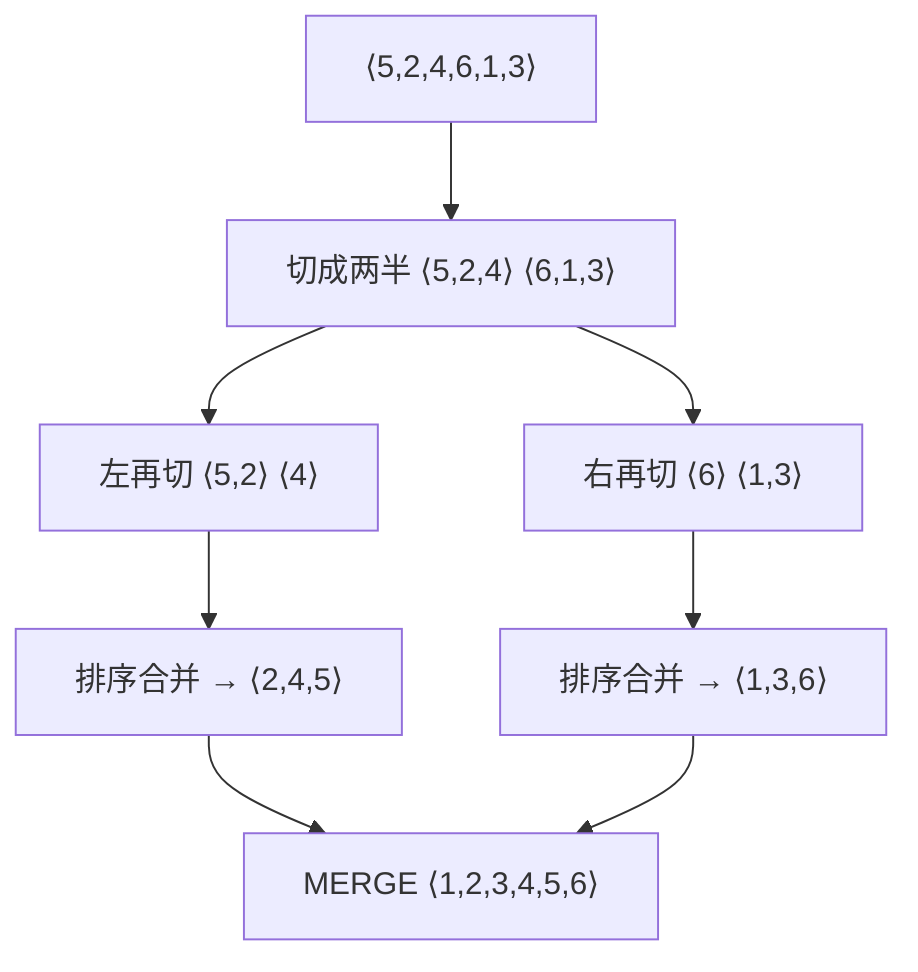

# 第 2 章：算法基础

- **难度**：★☆☆ | **预估学时**：2 小时 | **前置**：第 1 章

## 学习目标
学完本章，你能：
1. 用伪代码写出插入排序，并说出它最坏/最好情况的运行时间。
2. 用「循环不变式」三条性质（初始化、保持、终止）解释算法为什么正确。
3. 用分治思想描述归并排序，并画出递归树、读出 T(n) = 2T(n/2) + cn 的解为 Θ(n lg n)。

## 一句话核心
**先动手写第一个算法（插入排序），再学会用「循环不变式」证明它、用「增长量级」抽象它，最后用「分治」造出更快的归并排序。**

## 零基础讲解

### 概念 1：伪代码（pseudocode）约定（难度：基础）
本书伪代码类似 C/C++/Java/Python 的精简写法，核心约定（来自书中 §2.1）：
- 缩进表示块结构（类似 Python）。
- `for / while / if` 用缩进管作用域，不用大括号。
- 数组元素用 `A[i]`、属性用 `A.length`、对象属性用「点」访问（`x.f`）。
- 参数按值传递；`return` 可以一次返回多个值；`and/or` 是短路求值；遇到异常情况用 `error` 表示。

### 概念 2：插入排序（INSERTION-SORT）（难度：基础）
**插入排序**：像打扑克牌——左手已排好的牌，从牌堆摸一张，从右往左比，插到正确位置。
```
INSERTION-SORT(A)
1  for j = 2 to A.length        // A[1..j-1] 始终已排好序
2      key = A[j]
3      // 将 A[j] 插入已排序的 A[1..j-1]
4      i = j - 1
5      while i > 0 and A[i] > key
6          A[i+1] = A[i]          // 比 key 大的牌右挪一位
7          i = i - 1
8      A[i+1] = key              // 插入正确位置
```
对 A = ⟨5, 2, 4, 6, 1, 3⟩：j=2 时把 2 插到 5 前；j=3 时把 4 插到 5 前；……最终 ⟨1,2,3,4,5,6⟩。

**运行时间**：最好情况（已排好序）内层 while 一次不转，Θ(n)；最坏情况（逆序）每轮都从 j-1 比较到 1，总比较次数 ≈ n(n-1)/2，Θ(n²)。

### 概念 3：循环不变式（loop invariant）（难度：进阶）
**循环不变式**是循环每次转完都成立的断言。以上面为例：「在循环的每次迭代开始时，子数组 A[1..j-1] 由原 A[1..j-1] 中的元素按序组成」。要证明它成立，验三条：
1. **初始化**：第一次迭代前（j=2 时），A[1..1] 当然已排好。
2. **保持**：若 A[1..j-1] 已排序，一轮把 A[j] 插入正确位置后 A[1..j] 仍排序。
3. **终止**：循环在 j = n+1 时结束，此时 A[1..n] 排序——算法正确。

类比数学归纳法：初始化=归纳基例，保持=归纳步。

### 概念 4：增长量级（order of growth）（难度：进阶）
书中 §2.2 引入「渐近分析」的雏形：只保留运行时间中**最高阶项**（如插入排序最坏时的 an²+bn+c 里只留 n²），并丢掉最高阶项的常数系数。记作 Θ(n²)。当 n 足够大时，低阶项与常数项相对不重要——这为第 3 章的渐近记号铺路。

### 概念 5：分治法（divide and conquer）与归并排序（难度：进阶）
**分治**：把问题分解成若干规模更小的同类子问题，递归求解，再合并结果。归并排序 MERGE-SORT：
1. **分解**：把 A[p..r] 从中间 q 切成两半 A[p..q] 与 A[q+1..r]。
2. **解决**：递归地对两半排序。
3. **合并**：MERGE(A, p, q, r)——把两个已排序的子数组合成一个已排序数组。书中 MERGE 用「哨兵」技巧：L、R 末尾各放一个 ∞，这样比较时永远不用先判「哪半先耗尽」。

**递归式**：T(n) = Θ(1)（n 够小）；否则 T(n) = 2T(n/2) + Θ(n)。
**递归树读法**（书中图 2-5）：树有 lg n 层；每层合并代价都是 cn；总代价 cn·lg n + cn = Θ(n lg n)。

## 图示

**看图说明**：自上而下是「分解」，自下而上是「合并」。每一层的合并代价都是 cn（扫描一遍），树高 lg n，所以总量是 cn lg n——这就是 Θ(n lg n) 的来源。

## 类比与实例
- **类比**：插入排序像新手理牌，每次摸一张插到位；归并排序像「分两摞各自理好，再像归拢扑克牌一样一叠一叠挑最小的放一起」。**失效边界**：合并需要额外的 O(n) 临时空间，插入排序是原地的——空间换时间。
- **实例**：MERGE(⟨2,4,7,∞⟩, ⟨1,2,3,6,∞⟩) 从左到右挑最小：1,2,2,3,4,6,7，最后哨兵 ∞ 收尾——一轮线性扫描合并完成。

## 常见误解
- **别以为「插入排序最坏 Θ(n²) 就不能用」**——实际上 n 很小（打牌、小数组）时常数小、原地、缓存友好，工程里常作为快排/归并的小数组兜底。
- **别以为「归并排序更快所以总是它」**——实际上合并要 O(n) 辅助空间；对内存受限场景要权衡。
- **别以为「循环不变式是玄学」**——它就是归纳法在循环上的翻译，三条件逐条核对即可。

## 自测题（答案）
1. （单选）插入排序在数组已完全有序时的运行时间是？（答案：A；解析：内层 while 一次不执行，外层 n 次 = Θ(n)）
   - A. Θ(n)   B. Θ(n lg n)   C. Θ(n²)   D. Θ(lg n)
2. （多选）循环不变式需要验证哪几条性质？（答案：A、B、C；解析：初始化/保持/终止缺一不可；D 是递归式性质）
   - A. 初始化   B. 保持   C. 终止   D. 递归基例
3. （填空）归并排序的递归式 T(n) = 2T(n/2) + Θ(n)，其解为 Θ(n__)。（答案：lg n；解析：每层 cn，共 lg n 层）
4. （简答）MERGE 为什么要在 L、R 末尾放哨兵 ∞？（答案：免去「哪一半先耗尽」的判断，每次比较都能挑出更小者；哨兵保证一旦有一方耗尽，另一方的剩余元素自然成为最小并被取走，简化代码且仍是线性时间）

## 复习锚点
- 插入排序：打牌式插入，最坏 Θ(n²)、最好 Θ(n)。
- 循环不变式三条件：初始化、保持、终止。
- 分治 = 分解 + 解决 + 合并；归并排序 T(n)=2T(n/2)+Θ(n) ⇒ Θ(n lg n)。
