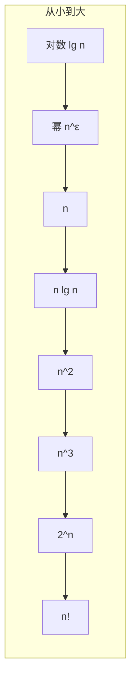

# 第 3 章：函数的增长

- **难度**：★★☆ | **预估学时**：2.5 小时 | **前置**：第 2 章

## 学习目标
学完本章，你能：
1. 用数学定义解释 Θ（紧确界）、O（上界）、Ω（下界）、o（非紧上界）、ω（非紧下界）五种渐近记号。
2. 判断 f(n) 与 g(n) 增长快慢（多项式 vs 对数 vs 指数）。
3. 熟记书中常用函数：lg n、n!、lg(n!)、对数换底与 e^x 级数。

## 一句话核心
**渐近记号只关心「n 足够大时函数在哪个量级」——丢掉常数与低阶项，让我们看清算法之间的本质差距。**

## 零基础讲解

### 概念 1：Θ（g(n)）——渐近紧确界（难度：进阶）
**Θ(g(n))**：若存在正常量 c₁、c₂ 和 n₀，使对所有 n ≥ n₀，有 0 ≤ c₁g(n) ≤ f(n) ≤ c₂g(n)，则 f(n) ∈ Θ(g(n))。白话：n 足够大时，f(n) 被夹在 g(n) 的两个常数倍之间——g(n) 是 f(n) 的**渐近紧确界（asymptotically tight bound）**。

书中实例：证明 (1/2)n² − 3n = Θ(n²)。用 n² 除：c₁ ≤ 1/2 − 3/n ≤ c₂。取 c₂ = 1/2（n ≥ 1 时右不等式成立），c₁ = 1/14（n ≥ 7 时左不等式成立），n₀ = 7。于是 n ≥ 7 时不等式成立——证毕。

### 概念 2：O(g(n))——渐近上界（难度：进阶）
**O(g(n))**：存在正常量 c、n₀，使 n ≥ n₀ 时 0 ≤ f(n) ≤ c·g(n)。白话：f 「至多」像 g 增长。O 是上界，但**不一定紧**：2n² = O(n³) 在数学上成立（n 大时 n³ 更大），虽然不紧——能写 Θ 就别只写 O。

### 概念 3：Ω(g(n))——渐近下界（难度：进阶）
**Ω(g(n))**：存在正常量 c、n₀，使 n ≥ n₀ 时 0 ≤ c·g(n) ≤ f(n)。白话：f 「至少」像 g 增长。书中定理：f(n)=Θ(g(n)) 当且仅当 f=O(g) 且 f=Ω(g)。

### 概念 4：o 与 ω——非紧确记号（难度：高难）
- **o(g(n))**：对任意正常量 c，存在 n₀，使 n ≥ n₀ 时 0 ≤ f(n) < c·g(n)。白话：f 相对 g「可以任意小」——g 比 f 高一个量级。例：2n = o(n²)（因为 2n/n² → 0）。
- **ω(g(n))**：与 o 对称，f 比 g 高一个量级。例：n²/2 = ω(n)。

记忆法：Θ/O/Ω 用「存在某个 c」；o/ω 用「对任意 c」——后者刻画的是严格的阶差。

### 概念 5：标准记号（难度：基础）
书中 §3.2 给出的常用关系（已从书页核对）：
- **lg n = log₂ n**，**ln n = logₑ n**，**lgᵏ n = (lg n)ᵏ**。
- 换底：log_b a = log_c a / log_c b——换底只乘一个常数因子，所以 O 记号里底数不重要，直接写 lg n。
- 多项式 vs 指数：对任意底 a > 1 的指数函数，nᵏ = o(aⁿ)——指数碾压多项式。
- 对数不等式：对 x > −1，x/(1+x) ≤ ln(1+x) ≤ x。
- eˣ 级数：eˣ = 1 + x + x²/2! + …，且 eˣ ≥ 1+x。
- 极限：lim(1 + x/n)ⁿ = eˣ。

## 图示

**看图说明**：从左到右增长越来越快。算法复杂度落在左边的好，落在右边的坏。o 记号刻画「严格在左边」：lg n = o(n)，n lg n 比 n 高一截、比 n² 低一截。

## 类比与实例
- **类比**：渐近记号像估算城市人口——「几十万」对「几十亿」，不关心精确到个位，只关心量级。**失效边界**：对 n 很小的场景（n=5），常数项和低阶项可能主导，渐近结论不适用。
- **实例**：插入排序最坏 Θ(n²)、归并排序 Θ(n lg n)——n lg n = o(n²)，所以 n 一大归并就碾压。

## 常见误解
- **别以为 O(n²) 就表示「恰好 n²」**——实际上 O 只是上界；说「恰好」必须用 Θ。
- **别以为换对数底会改变复杂度**——实际上换底只乘常数 1/ln 2，O 记号里底数无关，统一写 lg。
- **别以为「n² 比 n³ 慢是显然的」**——慢是慢，但书中用定义严格证明 2n² = o(n³)，靠的是比值趋向 0，不是「感觉」。

## 自测题（答案）
1. （单选）(1/2)n² − 3n 用渐近记号最紧的写法是？（答案：B；解析：书中证明它属于 Θ(n²)）
   - A. O(n³)   B. Θ(n²)   C. Ω(n³)   D. o(n²)
2. （多选）下列哪些正确（可多选）？（答案：A、B、C；解析：2n=O(n²) 上界成立；n²/2=ω(n) 比值→∞；lg n = o(n)；D 错，n! 比 2ⁿ 还快，2ⁿ ≠ ω(n!)）
   - A. 2n = O(n²)   B. n²/2 = ω(n)   C. lg n = o(n)   D. 2ⁿ = ω(n!)
3. （填空）换底公式 log_b a = log_c a / __c b。（答案：log；解析：log_b a = log_c a / log_c b）
4. （简答）为什么书中说「对任意底 a>1，nᵏ = o(aⁿ)」？（答案：多项式比值 nᵏ/aⁿ → 0，所以多项式严格低于指数——任何多项式再高次也追不上任何底数>1的指数）

## 复习锚点
- Θ 紧确、O 上界、Ω 下界、o/ω 严格阶差。
- 增长率梯队：lg n < n < n lg n < n² < 2ⁿ < n!。
- 换底只乘常数，O 里底数随便写。
