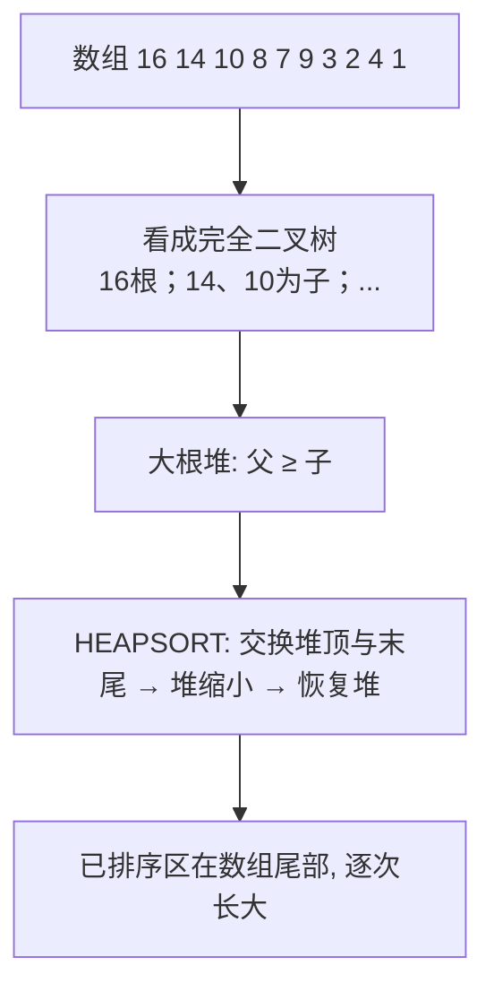

# 第 6 章：堆排序

- **难度**：★★☆ | **预估学时**：2 小时 | **前置**：第 2、3 章

## 学习目标
学完本章，你能：
1. 说出二叉堆的数组表示（PARENT/LEFT/RIGHT 下标公式）与大根堆性质。
2. 描述 MAX-HEAPIFY、BUILD-MAX-HEAP、HEAPSORT 的流程与复杂度。
3. 用堆实现优先队列的 INSERT / MAXIMUM / EXTRACT-MAX / INCREASE-KEY。

## 一句话核心
**堆是一个被看成「近似完全二叉树」的数组：父 ≥ 子（大根堆），于是堆顶永远是最大值——排序与优先队列都靠它。**

## 零基础讲解

### 概念 1：二叉堆（binary heap）（难度：基础）
**二叉堆**是一个数组，可以看成一棵近似的**完全二叉树**：除最底层外全满，且从左向右填充。树上每个结点对应数组一个元素，树根是 A[1]。下标关系（书页已核对）：
- PARENT(i) = ⌊i/2⌋
- LEFT(i) = 2i
- RIGHT(i) = 2i+1

堆有两个属性：A.length（数组总长）和 A.heap-size（堆里实际存了多少元素，0 ≤ heap-size ≤ length）。
**大根堆（max-heap）性质**：对每个结点 i ≠ 1，A[PARENT(i)] ≥ A[i]——父节点值不小于子节点。所以堆顶 A[1] 是全堆最大。（小根堆反之，堆顶最小。）

### 概念 2：MAX-HEAPIFY（难度：进阶）
作用：假设 LEFT(i)、RIGHT(i) 为根的两棵子树已是大根堆，但 A[i] 可能比孩子小——把 A[i]「下沉」到正确位置。伪代码（书页已核对）：
```
MAX-HEAPIFY(A, i)
1  l = LEFT(i);  r = RIGHT(i)
2  if l ≤ A.heap-size and A[l] > A[i]
3      largest = l
4  else largest = i
5  if r ≤ A.heap-size and A[r] > A[largest]
6      largest = r
7  if largest ≠ i
8      exchange A[i] with A[largest]
9      MAX-HEAPIFY(A, largest)
```
递归式 T(n) ≤ T(2n/3) + Θ(1)（最坏情况发生在树最底层恰好半满时），由主方法读出 **T(n) = O(lg n)**。

### 概念 3：建堆与堆排序（难度：进阶）
- **BUILD-MAX-HEAP**：从最后一个非叶结点 ⌊n/2⌋ 往前到 1，逐个 MAX-HEAPIFY。复杂度 Θ(n)（不是 O(n lg n)）。
- **HEAPSORT**：建好大根堆后，堆顶 A[1] 是最大——把它与 A[heap-size] 交换、堆 size 减 1、对新堆顶 MAX-HEAPIFY 恢复堆性质。重复 n-1 次。总复杂度 **O(n lg n)**，原地。

### 概念 4：优先队列（priority queue）（难度：进阶）
**最大优先队列**维护一组带关键字的元素，支持（书页 §6.5 已核对）：
- INSERT(S, x)：插入 x（O(lg n)）。
- MAXIMUM(S)：返回最大关键字元素（O(1)）。
- EXTRACT-MAX(S)：去掉并返回最大元素（O(lg n)，堆顶与末尾交换后 MAX-HEAPIFY）。
- INCREASE-KEY(S, x, k)：把 x 的关键字增到 k——从 x 向上「上浮」与父交换（O(lg n)）。

典型应用：共享计算机的**作业调度**——最高优先级作业先跑（EXTRACT-MAX），新作业随时插入（INSERT）。

## 图示

**看图说明**：上半是「数组怎么变成树」；下半是排序循环——每轮把当前最大值固定到数组尾部，堆不断缩小。

## 类比与实例
- **类比**：大根堆像公司组织架构——总裁（根）工资最高，往下逐层降；新来的人涨工资（INCREASE-KEY）就沿层级往上「上浮」到合适位置。**失效边界**：堆只能保证「父 ≥ 子」，不保证兄弟之间有序，所以堆不是排序好的数组。
- **实例**：A = ⟨4, 1, 3, 2, 16, 9, 10, 14, 8, 7⟩，BUILD-MAX-HEAP 后变成 ⟨16, 14, 10, 8, 7, 9, 3, 2, 4, 1⟩——这正是书页图 6-1 的例子。

## 常见误解
- **别以为「BUILD-MAX-HEAP 是 O(n lg n)」**——实际上是 Θ(n)：叶子本来就满足堆性质，只有前半部分结点要下沉，总代价摊下来线性。
- **别以为「堆是垃圾回收」**——书中特意澄清：本书的「堆」指堆数据结构，不是 Java/Lisp 的垃圾回收堆。
- **别以为「堆排序比快排快」**——实际上快排常数小、缓存友好；堆排序的价值是最坏保证 O(n lg n) + 原地 + 优先队列应用。

## 自测题（答案）
1. （单选）LEFT(i) 与 RIGHT(i) 的下标是？（答案：C；解析：书中 LEFT=2i, RIGHT=2i+1）
   - A. i+1, i+2   B. 2i+1, 2i+2   C. 2i, 2i+1   D. ⌊i/2⌋, ⌈i/2⌉
2. （单选）MAX-HEAPIFY 的递归式 T(n) ≤ T(2n/3)+Θ(1)，其解是？（答案：B；解析：主方法情况 2，树高 lg n）
   - A. Θ(1)   B. O(lg n)   C. Θ(n)   D. Θ(n lg n)
3. （多选）下列哪些是最大优先队列支持的操作？（答案：A、B、C、D；解析：书中 §6.5 列了 INSERT/MAXIMUM/EXTRACT-MAX/INCREASE-KEY 四个）
   - A. INSERT   B. MAXIMUM   C. EXTRACT-MAX   D. INCREASE-KEY
4. （简答）HEAPSORT 为什么原地且 O(n lg n)？（答案：建堆 Θ(n)；之后 n-1 轮，每轮交换 O(1) + MAX-HEAPIFY O(lg n)，共 O(n lg n)；所有操作都在原数组内，不另开数组）

## 复习锚点
- 堆 = 数组看成完全二叉树；父≥子；LEFT=2i, RIGHT=2i+1。
- MAX-HEAPIFY O(lg n)；BUILD-MAX-HEAP Θ(n)；HEAPSORT O(n lg n) 原地。
- 优先队列：作业调度；EXTRACT-MAX 与 INCREASE-KEY 是堆的经典应用。
