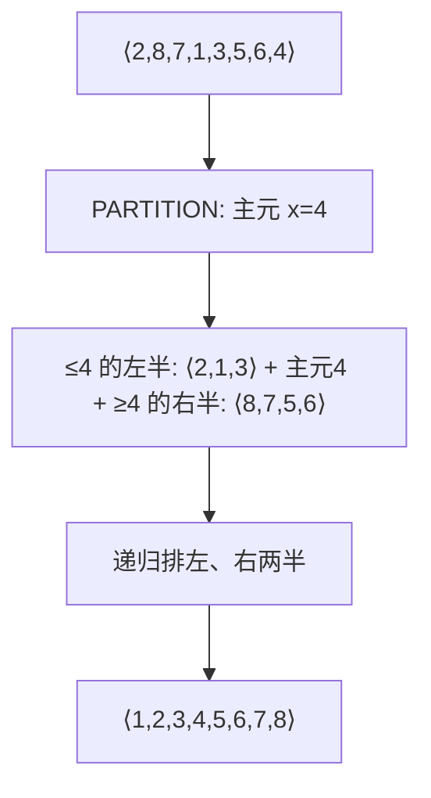

# 第 7 章：快速排序

- **难度**：★★☆ | **预估学时**：2.5 小时 | **前置**：第 2、5 章

## 学习目标
学完本章，你能：
1. 写出 QUICKSORT 与 PARTITION 的伪代码，说出主元（pivot）的作用。
2. 说出快速排序最坏 Θ(n²)、期望 Θ(n lg n) 的原因。
3. 解释为什么随机化版本能消除「特定输入触发最坏」。

## 一句话核心
**选一个主元把数组劈成「小的一半」和「大的一半」，再递归排两边——平均极快，最坏靠随机化主元来防。**

## 零基础讲解

### 概念 1：分治三步（书页 §7.1 已核对）
对 A[p..r]：
1. **分解**：用 PARTITION 把 A[p..r] 切成 A[p..q-1]（全 ≤ A[q]）与 A[q+1..r]（全 ≥ A[q]）。
2. **解决**：递归 QUICKSORT(A, p, q-1) 与 QUICKSORT(A, q+1, r)。
3. **合并**：因为子数组已原地排好，无需合并——整段自然有序。

```
QUICKSORT(A, p, r)
1  if p < r
2      q = PARTITION(A, p, r)
3      QUICKSORT(A, p, q-1)
4      QUICKSORT(A, q+1, r)
```

### 概念 2：PARTITION（书页已核对）
选 x = A[r] 作主元（pivot，枢纽元素）。维护 i 使 A[p..i] 全 ≤ x：
```
PARTITION(A, p, r)
1  x = A[r]
2  i = p - 1
3  for j = p to r-1
4      if A[j] ≤ x
5          i = i + 1
6          exchange A[i] with A[j]
7  exchange A[i+1] with A[r]
8  return i+1
```
一趟扫描 Θ(n)，把主元 x 放到最终正确位置 q。

### 概念 3：性能分析（难度：进阶）
- **最坏划分**：每次主元都是最大或最小——切成 0 和 n-1 两块。递归式 T(n) = T(n-1) + T(0) + Θ(n) ⇒ **T(n) = Θ(n²)**。什么时候发生？数组已（逆）序且总选 A[r] 当主元。
- **最好划分**：每次对半切 ⇒ T(n) = 2T(n/2) + Θ(n) = Θ(n lg n)。
- **平衡划分**：哪怕 9:1 切，递归式仍是 O(n lg n)——只要不是每次都极端偏一边。
- **随机化版本**：把 `x = A[r]` 换成随机选一个元素与 A[r] 交换（RANDOMIZED-PARTITION）。这样没有「专门触发最坏的输入」——期望运行时间 **Θ(n lg n)**，常数因子很小，是实际排序首选。

## 图示

**看图说明**：每一趟 PARTITION 只干一件事——把主元放到它在最终排序里的正确位置 q，并保证左边都 ≤ 它、右边都 ≥ 它。

## 类比与实例
- **类比**：快速排序像「按体重分队」——随便挑一人当「秤」，比他轻的站左、比他重的站右，然后左右各自再找人当秤。**失效边界**：如果每次挑的「秤」都是全队最轻或最重（有序数组），就退化成一个超长队和一个空队，Θ(n²)。
- **实例**：A = ⟨2, 8, 7, 1, 3, 5, 6, 4⟩，x = A[8] = 4。扫描后交换，q = 5，得到左 ⟨2,1,3⟩ + 4 + 右 ⟨8,7,5,6⟩——主元 4 已在最终位置。

## 常见误解
- **别以为「快排最坏 Θ(n²) 所以不能用」**——实际上期望 Θ(n lg n) 且常数小、缓存友好，是 C++ sort 等的默认实现；随机化后没有恶意输入能稳定触发最坏。
- **别以为「快排是稳定排序」**——实际上 PARTITION 的远距离交换会打乱相等元素的相对顺序，快排不稳定。
- **别以为「主元选最后一个元素是算法的一部分」**——实际上选谁当主元都行，只是教科书默认 A[r]；随机化主元是关键改进。

## 自测题（答案）
1. （单选）快排最坏划分下的递归式是？（答案：A；解析：切出 0 和 n-1，T(n)=T(n-1)+Θ(n)=Θ(n²)）
   - A. T(n) = T(n-1) + Θ(n)
   - B. T(n) = 2T(n/2) + Θ(n)
   - C. T(n) = T(9n/10) + T(n/10) + Θ(n)
   - D. T(n) = 2T(n-1)
2. （单选）RANDOMIZED-QUICKSORT 的期望运行时间是？（答案：B；解析：书中证明期望 Θ(n lg n)）
   - A. Θ(n²)   B. Θ(n lg n)   C. Θ(n)   D. Θ(lg n)
3. （填空）PARTITION 选 x = A[__] 作主元（教科书默认）。（答案：r；解析：最后一个元素）
4. （简答）为什么「9:1 划分」仍然是 O(n lg n)？（答案：递归树每层总代价仍是 cn，树高 ≈ log_{10/9} n = O(lg n)；只要比例固定不为 1:0，深度就是对数级，总代价 O(n lg n)）

## 复习锚点
- 快排 = PARTITION 分边 + 递归；主元一趟放到最终位置。
- 最坏 Θ(n²)（有序数组）、最好/平衡 Θ(n lg n)。
- 随机化主元消除恶意输入，期望 Θ(n lg n)。
