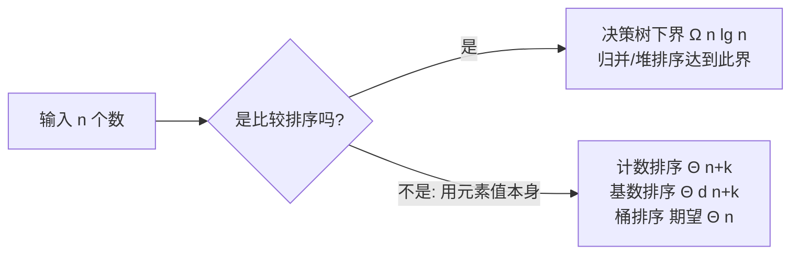

# 第 8 章：线性时间排序

- **难度**：★★☆ | **预估学时**：2 小时 | **前置**：第 3、6、7 章

## 学习目标
学完本章，你能：
1. 用决策树证明「任何比较排序最坏 Ω(n lg n)」。
2. 说清计数排序、基数排序、桶排序各自适用条件与复杂度。
3. 解释为什么线性时间排序能绕过 Ω(n lg n) 下界。

## 一句话核心
**只要还在「两两比较」，排序就快不过 n lg n；但计数/基数/桶排序不比较元素大小，所以能在线性时间跑完。**

## 零基础讲解

### 概念 1：比较排序的下界（定理 8.1）（难度：进阶）
**比较排序**：只通过比较 aᵢ 与 aⱼ 的大小获取次序信息。把一次排序抽象成一棵**决策树**：内部结点 = 一次比较 i:j，叶结点 = 一个排列 π(1),…,π(n)。
- n 个元素有 n! 种排列，决策树至少要有 n! 个可达叶结点。
- 高度 h 的二叉树最多 2^h 个叶结点 ⇒ n! ≤ 2^h。
- 两边取对数：h ≥ lg(n!) = Ω(n lg n)（用斯特林近似或 A.2 求和）。

**结论**：任何比较排序在最坏情况下都要 Ω(n lg n) 次比较（定理 8.1）。**推论 8.2**：堆排序和归并排序是渐近最优的比较排序。

### 概念 2：计数排序（counting sort）（难度：基础）
**前提**：n 个输入元素都是 0 到 k 区间内的整数，且 k = O(n)。
**思想**：对每个元素 x，数「小于等于 x 的元素有几个」，直接把 x 放到输出数组的正确位置。
```
COUNTING-SORT(A, B, k)
1  let C[0..k] be a new array
2  for i = 0 to k: C[i] = 0
3  for j = 1 to A.length: C[A[j]] += 1      // C[v] = 值 v 的个数
4  for i = 1 to k: C[i] = C[i] + C[i-1]     // C[v] = ≤ v 的个数
5  for j = A.length downto 1:               // 倒着扫,保稳定
6      B[C[A[j]]] = A[j]
7      C[A[j]] -= 1
```
复杂度 Θ(k + n) = Θ(n)（k = O(n) 时）。**稳定**：相同值元素在输出里保持输入里的相对顺序——这是基数排序依赖它的关键。

### 概念 3：基数排序（radix sort）（难度：基础）
**思想**：像老式卡片排序机——按**最低有效位**到最高有效位逐位排，每一位用稳定排序（通常就是计数排序）。书中例子：d 位十进制数，从个位开始排一轮、十位再排一轮……共 d 轮。
复杂度：d 位、每位值域 0..k，用计数排序 ⇒ Θ(d(n+k))。当 d 是常数、k = O(n) 时为 Θ(n)。**关键**：每一轮必须是稳定的，否则高位排完会被低位洗回去。

### 概念 4：桶排序（bucket sort）（难度：进阶）
**前提**：输入均匀分布在 [0,1)。
**思想**：把 [0,1) 切成 n 个等宽「桶」，元素按值扔进对应桶；每个桶内部用插入排序；最后按桶序串起来。因均匀分布，每桶元素期望 O(1)，总期望 **Θ(n)**。

## 图示

**看图说明**：分水岭在「要不要两两比较」。比较派被 Ω(n lg n) 卡死；不比较派靠「元素值的额外信息」突破。

## 类比与实例
- **类比**：计数排序像「成绩单分类」——已知分数都在 0~100，直接开 101 个格子，每考分扔进对应格子，再按格子顺序倒出来。**失效边界**：分数若是 0~10⁹ 的任意整数，k 远大于 n，开格子就不划算。
- **实例**：基数排序排 ⟨329, 457, 657, 839, 436, 720, 355⟩——先按个位（9,7,7,9,6,0,5）稳定排，再按十位，最后按百位，三轮后全局有序（书中图 8-3）。

## 常见误解
- **别以为「线性排序比快排好」**——实际上它们只在「元素值域小/分布均匀」的特定条件下成立；通用排序仍靠快排/归并。
- **别以为「计数排序不稳定就不能用」**——实际上基数排序依赖它稳定；若自己写漏了第 5 行的「downto」倒扫，基数排序结果就错。
- **别以为「Ω(n lg n) 下界是算法无能」**——它是对「只靠比较」这一模型的信息论下界；要突破必须利用元素的额外信息（值域、分布）。

## 自测题（答案）
1. （单选）决策树下界证明 n! ≤ 2^h 推出 h ≥ ?（答案：B；解析：h ≥ lg(n!) = Ω(n lg n)）
   - A. Θ(n)   B. Ω(n lg n)   C. Ω(n²)   D. Ω(lg n)
2. （单选）计数排序适用条件是？（答案：C；解析：元素为 0..k 整数且 k=O(n)）
   - A. 任意实数   B. 字符串   C. 值域小的整数且 k=O(n)   D. 已部分有序
3. （填空）基数排序从最__有效位往最__有效位逐位排，每轮用__排序。（答案：低；高；稳定（计数）；解析：书中明确最低位先排、每轮稳定）
4. （简答）基数排序为什么每一轮必须稳定？（答案：高位排序后，低位的次序会被保留；若每轮不稳定，相同高位元素之间刚排好的低位顺序就被打乱，多轮累积后整体就错了）

## 复习锚点
- 比较排序下界 Ω(n lg n)（决策树 n! 叶）。
- 计数排序：值域小、Θ(n+k)、稳定。
- 基数排序：低位到高位、d 轮稳定排序、Θ(d(n+k))。
- 桶排序：均匀分布、期望 Θ(n)。
