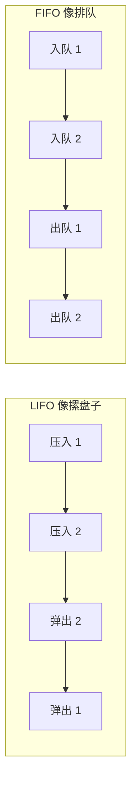

# 第 10 章：基本数据结构

- **难度**：★☆☆ | **预估学时**：1.5 小时 | **前置**：第 2 章

## 学习目标
学完本章，你能：
1. 说出栈（LIFO）与队列（FIFO）的区别与数组实现。
2. 用数组/链表表示动态集合，理解指针与对象的实现方式。
3. 用左孩子右兄弟法表示有根树。

## 一句话核心
**栈「后进先出」、队列「先进先出」——它们是一切复杂数据结构的积木；指针和对象只是把数组里的位置串起来。**

## 零基础讲解

### 概念 1：栈（stack）（难度：基础）
**栈**是只在一端（栈顶）操作的动态集合：INSERT 叫**压入 PUSH**，DELETE 叫**弹出 POP**。它是**后进先出（LIFO, last-in first-out）**——像餐厅摞起来的弹簧盘子，只能取最上面那个。
数组实现：用 S[1..n] 和一个属性 S.top 指向最新元素。S.top = 0 表示空；对空栈 POP 叫**下溢 underflow**，S.top 超过 n 叫**上溢 overflow**。
```
STACK-EMPTY(S): if S.top == 0 then TRUE else FALSE
PUSH(S, x): S.top = S.top + 1; S[S.top] = x
POP(S):     if STACK-EMPTY(S): error else S.top = S.top - 1; return S[S.top+1]
```

### 概念 2：队列（queue）（难度：基础）
**队列**是**先进先出（FIFO）**：INSERT 叫**入队 ENQUEUE**，DELETE 叫**出队 DEQUEUE**——删的是队列中存在最久的元素。数组实现用 head（队头）与 tail（队尾）两个指针；当 tail 走到末尾就绕回开头（循环队列）。

### 概念 3：链表（linked list）（难度：基础）
**链表**中每个对象有 key、next（指向后继）、prev（指向前驱，双向链）。SEARCH 线性扫描 O(n)；INSERT 挂到表头 O(1)；DELETE 按指针 O(1)。**哨兵（sentinel）**是一个哑对象，简化边界判断——红黑树那章会用到。

### 概念 4：指针与对象的实现（难度：进阶）
书中 §10.3 说明：对象不必用语言自带指针，用多个数组（key 数组、next 数组、prev 数组）按下标关联即可——「指针」就是数组下标。这是把「对象」翻译成连续内存的办法。

### 概念 5：有根树的表示（难度：基础）
- 二叉树：left、right 两个指针。
- 任意树（孩子数不定）：**左孩子右兄弟**表示法——每个结点存 left-child 与 right-sibling，把任意度的树压成二叉树形状。

## 图示

**看图说明**：栈里「后压入的先弹出」；队列里「先入队的先出队」。这两种相反的取出顺序决定了它们分别用于「回溯」（栈）与「排队」（队列）。

## 类比与实例
- **类比**：栈 = 浏览器后退（最后打开的页面先退）；队列 = 打印机任务（先提交先打印）。**失效边界**：栈不能「取中间的元素」，队列不能「插队」——要这种灵活性就得用更复杂的结构（优先队列）。
- **实例**：依次 PUSH 9、4、2，POP 一次返回 2；依次 ENQUEUE 9、4、2，DEQUEUE 一次返回 9。

## 常见误解
- **别以为「栈和堆（内存）是一回事」**——本书这里的栈是数据结构 LIFO；与 Java 垃圾回收的「堆」无关。
- **别以为「链表查找快」**——实际上链表只能从头扫，SEARCH 是 O(n)，数组随机访问才 O(1)。
- **别以为「队列删除队头要搬移」**——循环队列用 head/tail 指针绕回，不搬移元素。

## 自测题（答案）
1. （单选）栈的取出顺序是？（答案：B；解析：LIFO 后进先出）
   - A. FIFO   B. LIFO   C. 随机   D. 按优先级
2. （单选）队列的取出顺序是？（答案：A；解析：FIFO 先进先出）
   - A. FIFO   B. LIFO   C. 按大小   D. 逆序
3. （填空）栈用 S[1..n] 与属性 S.__ 指向最新元素。（答案：top；解析：书中数组实现）
4. （简答）哨兵（sentinel）有什么用？（答案：一个哑对象充当边界，使链表/树操作不必每次判「是否为空」，把边界情况统一成普通情况，简化代码）

## 复习锚点
- 栈 LIFO（PUSH/POP），队列 FIFO（ENQUEUE/DEQUEUE）。
- 链表 O(1) 插删、O(n) 查找；哨兵简化边界。
- 任意树用左孩子右兄弟压成二叉树表示。
