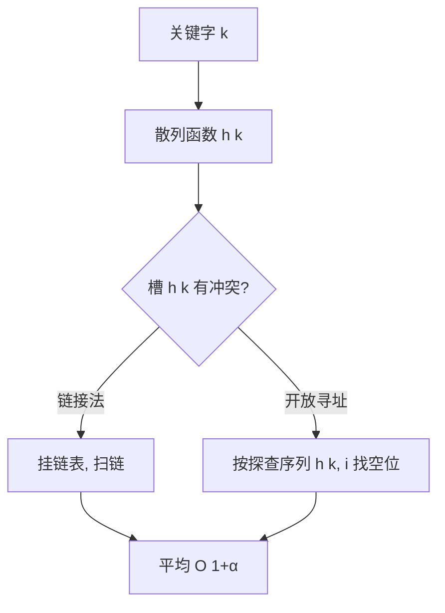

# 第 11 章：散列表

- **难度**：★★☆ | **预估学时**：2.5 小时 | **前置**：第 10 章、第 5 章

## 学习目标
学完本章，你能：
1. 解释「直接寻址」与「散列」的区别，说出**冲突（collision）**是什么。
2. 用链接法与开放寻址法（线性/二次/双重探查）解决冲突。
3. 说出均匀散列假设下，SEARCH 的期望时间 O(1)，以及全域散列为什么不怕恶意输入。

## 一句话核心
**散列表 = 用散列函数把关键字「压缩」成数组下标，平均 O(1) 完成插入/查找/删除——冲突靠链接或探查来化解。**

## 零基础讲解

### 概念 1：直接寻址 vs 散列（难度：基础）
**直接寻址表** T[0..m-1]：关键字 k 直接当下标，T[k] 存元素。问题：当关键字全域 U 很大（如所有字符串），开 m 个槽根本不现实。
**散列表**：槽数 m 与「实际存储的关键字数 n」成比例，用**散列函数 h(k)** 把 k 映射到 0..m-1。两个不同关键字 k₁≠k₂ 但 h(k₁)=h(k₂) 叫**冲突（collision）**。

### 概念 2：链接法（chaining）（难度：基础）
每个槽 T[j] 挂一个链表，所有散列到 j 的元素都串在这条链上。SEARCH 时先算 h(k)、再扫那条链。
- 装填因子 α = n/m（每个槽期望挂几个元素）。
- 均匀散列假设下：不成功查找期望 O(1+α)，成功查找也 O(1+α)。α 是常数 ⇒ O(1)。最坏（全冲突）Θ(n)。

### 概念 3：散列函数（难度：进阶）
好的散列函数要「近似均匀」——每个关键字等可能落到任一槽。书中介绍：
- **除法散列**：h(k) = k mod m（m 别取 2 的幂附近、别取太巧的数）。
- **乘法散列**：h(k) = ⌊m(kA mod 1)⌋，0 < A < 1。
- **全域散列（universal hashing）**：运行时从一簇函数里**随机挑一个** h。定理 11.3：k 不在表中时含 k 的链期望长度 ≤ α；在表中时 ≤ 1+α。推论 11.4：对手无法预先构造「总让你冲突」的输入——因为散列函数是随机选的。

### 概念 4：开放寻址法（open addressing）（难度：进阶）
不挂链表：所有元素直接存在散列表里。冲突时按一个**探查序列**往下找空位。三种探查（书页已核对）：
- **线性探查**：h(k, i) = (h'(k) + i) mod m。问题：**一次群集（primary clustering）**——连续被占的槽越来越长。
- **二次探查**：h(k, i) = (h'(k) + c₁i + c₂i²) mod m。仍有轻度**二次群集**。
- **双重散列**：h(k, i) = (h₁(k) + i·h₂(k)) mod m——探查序列既依赖起始位置又依赖步长，是开放寻址里最好的方法之一（h₂(k) 要与 m 互素）。

均匀散列假设：每个关键字的探查序列是 (0,1,…,m-1) 的 m! 种排列之一。不成功探查期望 O(1/(1−α))。

### 概念 5：完全散列（perfect hashing）（难度：高难，了解）
关键字集合静态（不再增删）时，用两层散列做到**最坏 O(1)** 查找——第一层散列，第二层对每个槽再开一个小散列表并保证无冲突。

## 图示

**看图说明**：先把 k 压缩成下标，冲突时要么串链（链接法），要么按序列往下找（开放寻址）。两条路平均都是常数。

## 类比与实例
- **类比**：散列函数像「按姓氏首字母分到 26 个班」——冲突（同姓）靠「同班的坐一张长凳」（链接法）或「往下找空位」（开放寻址）。**失效边界**：若散列函数极差（全挤一个班），就退化成链表 Θ(n)；全域散列就是「随机换一种分班规则」防有人故意全报同姓。
- **实例**：m=9，关键字 10, 22, 33 经 h(k)=k mod 9：10→1、22→4、33→6，各落各槽；若再来 4（mod 9=4）与 22 冲突，链接法就在槽 4 挂 ⟨22, 4⟩。

## 常见误解
- **别以为「散列表最坏也是 O(1)」**——实际上最坏 Θ(n)（全冲突）；只有均匀散列假设下期望 O(1)。
- **别以为「开放寻址法不占额外空间就一定省」**——实际上它装填因子 α 必须控制在 < 1，表要留空，否则探查序列会失效。
- **别以为「双重散列 h₂(k) 可以随便取」**——实际上 h₂(k) 要与 m 互素（m 取素数或 h₂ 总返回奇数），否则探查序列走不到所有槽。

## 自测题（答案）
1. （单选）装填因子 α 的定义是？（答案：A；解析：α = n/m，平均每槽元素数）
   - A. n/m   B. m/n   C. n·m   D. n+m
2. （多选）开放寻址法常用的探查技术有？（答案：A、B、C；解析：书中列线性/二次/双重三种）
   - A. 线性探查   B. 二次探查   C. 双重散列   D. 二分探查
3. （填空）双重散列公式 h(k,i) = (h₁(k) + i·__(k)) mod m。（答案：h₂；解析：书中公式）
4. （简答）为什么要全域散列？（答案：固定散列函数时，对手可构造总冲突的关键字；运行时从一簇函数随机选一个，使任何输入的期望链长都 ≤ 1+α，从根上免疫恶意输入）

## 复习锚点
- 散列 = h(k) 把关键字压成下标；冲突不可避免。
- 链接法：期望 O(1+α)；开放寻址：线性/二次/双重探查。
- 全域散列随机选函数，最坏免疫；完全散列静态集合最坏 O(1)。
