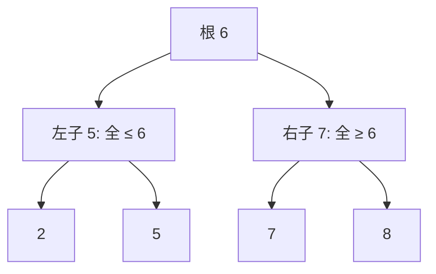

# 第 12 章：二叉搜索树

- **难度**：★★☆ | **预估学时**：2 小时 | **前置**：第 10 章

## 学习目标
学完本章，你能：
1. 写出二叉搜索树（BST）的性质，并据此查找 MINIMUM/MAXIMUM/SUCCESSOR。
2. 描述 BST 的 INSERT 与 DELETE 过程。
3. 解释为什么 BST 操作时间与树高成正比，以及随机 BST 的期望高度。

## 一句话核心
**左子树全 ≤ 根、右子树全 ≥ 根——这条性质让「查找/插入/删除」都只走一条从根到叶的路径，时间等于树高。**

## 零基础讲解

### 概念 1：BST 性质（书页 §12.1 已核对）
对任意结点 x：左子树中所有结点 y 满足 y.key ≤ x.key；右子树中所有结点 y 满足 y.key ≥ x.key。这叫**二叉搜索树性质**。直接推论：**中序遍历**（左→根→右）输出的是按 key 排好序的序列。

### 概念 2：基本操作（难度：基础）
所有操作从根出发，沿一条路径下滑，代价 = 树高 h：
- **SEARCH(x, k)**：从根开始，k < 当前 key 走左、k > 当前 key 走右。O(h)。
- **MINIMUM**：一路往左到最左结点。O(h)。
- **MAXIMUM**：一路往右到最右结点。O(h)。
- **SUCCESSOR(x)**：x 有右子树 → 右子树的最左；否则往上找到「第一个把 x 放在其左子树里的祖先」。O(h)。
- **INSERT**：SEARCH 找到该插入的叶子空位，挂上。O(h)。
- **DELETE**（分三种情况）：
  1. 无子：直接删。
  2. 一个子：用子顶替。
  3. 两个子：找后继（右子树最左）y，用 y.key 顶替 x，再删 y（y 至多一个子）。O(h)。

### 概念 3：树高问题（难度：进阶）
- 完全平衡树：h = Θ(lg n)，操作都快。
- 最坏：插入有序序列 ⇒ 树退化成 n 个结点的链，h = Θ(n)，操作与链表一样慢。
- **随机构造的 BST**（§12.4）：期望高 O(lg n) ⇒ 操作平均 Θ(lg n)。

这就是第 13 章红黑树要解决的问题：用颜色约束保证 h = O(lg n)。

## 图示

**看图说明**：每个结点都比左子树所有值大、比右子树所有值小。查找 7：从 6 起，7>6 走右，命中。查找 2：2<6 走左、2<5 走左，命中。每次只走一条路径。

## 类比与实例
- **类比**：BST 像「按字典序分叉的目录树」——在每个分叉点，左边是 smaller half、右边是 larger half。**失效边界**：如果插入顺序不幸（1,2,3,4,5…），树就成了一条斜链，失去二分优势。
- **实例**：书上例图 12-1：根 6，左子 5（再左 2、右 5），右子 7（再右 8）。中序遍历输出 2, 5, 5, 6, 7, 8——排好序。

## 常见误解
- **别以为「BST 操作都是 O(lg n)」**——实际上操作时间 = 树高；树退化时是 O(n)。
- **别以为「删结点就直接摘掉」**——两个子时必须用后继顶替，保持 BST 性质。
- **别以为「中序遍历是排序的副产品」**——它恰恰是 BST 性质的直接体现：左根右 = 升序。

## 自测题（答案）
1. （单选）BST 的中序遍历输出是？（答案：B；解析：左→根→右 = 升序）
   - A. 降序   B. 升序   C. 随机   D. 按插入序
2. （单选）BST 上 SEARCH 的时间是？（答案：C；解析：从根到叶一条路径，= O(h)，平衡时 O(lg n)）
   - A. O(1)   B. O(n)   C. O(h)   D. O(n²)
3. （填空）x 有右子树时，x 的后继是右子树的最__结点。（答案：左；解析：SUCCESSOR 规则）
4. （简答）按 1,2,3,4,5 顺序插入 BST 会怎样？（答案：每个新结点都比前一个大，全挂在右链上，树退化成高度 Θ(n) 的链，查找变成线性扫描——这就是需要红黑树的原因）

## 复习锚点
- BST 性质：左 ≤ 根 ≤ 右；中序 = 升序。
- SEARCH/MIN/MAX/SUCCESSOR/INSERT/DELETE 都是 O(h)。
- 退化 BST = 链；随机 BST 期望 O(lg n)；红黑树保证最坏 O(lg n)。
