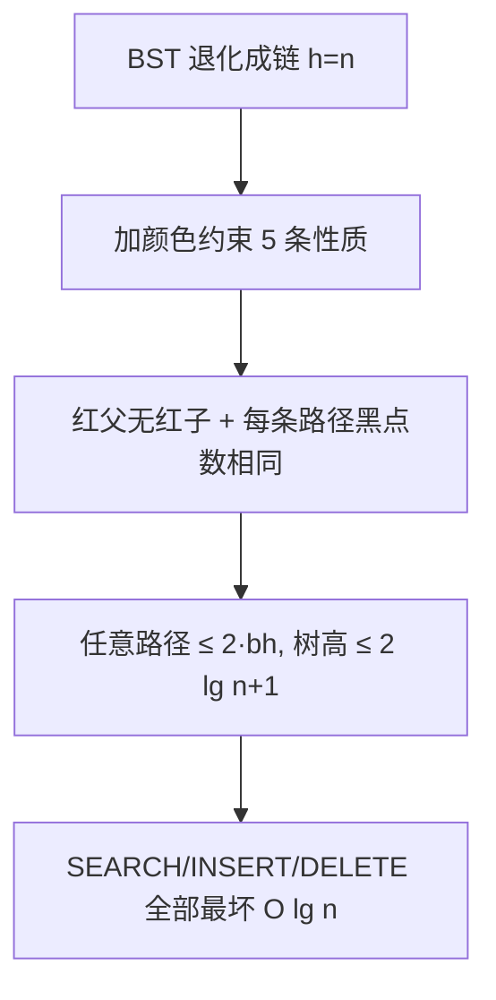

# 第 13 章：红黑树

- **难度**：★★★ | **预估学时**：3 小时 | **前置**：第 12 章

## 学习目标
学完本章，你能：
1. 列出红黑树的五条性质，并解释它们为什么保证树高 O(lg n)。
2. 说出「旋转（rotation）」在保持 BST 性质的同时怎么改变结构。
3. 描述 RB-INSERT 后用 RB-INSERT-FIXUP（重新着色 + 旋转）恢复性质的思路。

## 一句话核心
**给 BST 的每个结点涂红或黑，用「红父不能有红子」和「每条路径黑点数相同」两条约束，把树死死摁在近似平衡——高度 ≤ 2 lg(n+1)。**

## 零基础讲解

### 概念 1：五条红黑性质（书页 §13.1 已核对）
1. 每个结点或是红色，或是黑色。
2. 根结点是黑色。
3. 每个叶结点（NIL 哨兵）是黑色。
4. 如果一个结点是红色的，则它的两个子结点都是黑色（**红父无红子**）。
5. 对每个结点，从该结点到其所有后代叶结点的简单路径上，黑结点数相同——这个数叫该结点的**黑高 bh(x)**。

### 概念 2：为什么高是 O(lg n)（难度：进阶）
**引理 13.1**：有 n 个内部结点的红黑树高度至多为 2 lg(n+1)。
白话推理：由性质 4，任意路径上红结点不能相邻 ⇒ 黑结点至少占一半。由性质 5，黑高 bh 的子树至少有 2^{bh} − 1 个内部结点。于是 n ≥ 2^{bh} − 1，bh ≥ lg(n+1)；而树高 ≤ 2·bh（红黑相间最多让高度翻倍）⇒ h ≤ 2 lg(n+1)。**所以所有 BST 操作最坏 O(lg n)**。

### 概念 3：旋转（rotation）（难度：进阶）
**左旋 LEFT-ROTATE(T, x)**：把 x 与其右子 y 「转一下」——y 上位、x 下位、y 的左子变成 x 的右子。旋转保持 BST 性质（key 大小关系不变），只改变树结构。旋转是 O(1) 局部操作，插入/删除后用它「扶正」被破坏的平衡。

### 概念 4：插入与修复（难度：高难）
**RB-INSERT**：像普通 BST 一样插入 z，然后**把 z 着成红色**（着红才不改变黑高，否则整棵树黑高+1 代价太大）。但红 z 可能导致「红父红子」——调用 **RB-INSERT-FIXUP**：按「叔叔结点」的颜色分情况，重新着色 + 旋转，直到性质恢复。书页给出的 FIXUP 结构：
- 情况 1：叔叔是红 → 父、叔变黑，祖父变红，z 上移到祖父。
- 情况 2/3：叔叔是黑 → 按方向旋转，完成修复。

整轮插入 O(lg n)。

## 图示

**看图说明**：红黑树的本质是「给 BST 上保险」——用颜色把树锁在平衡区间，不让它退化成链。

## 类比与实例
- **类比**：红黑树像「交通灯管制」——红灯（红结点）不能连红灯（红父无红子），每条路从根到灯杆要经过的黑灯数一样（黑高相同）。**失效边界**：颜色规则只保证「近似平衡」，不保证绝对平衡——允许一边比另一边深一倍。
- **实例**：书中图 13-1 的红黑树：黑根、黑叶、红结点的子都是黑的。插入一个红结点后可能出现「红爷爷红爸爸」，FIXUP 把爷爷转黑、爸爸转红、再旋转——像重新洗牌。

## 常见误解
- **别以为「红黑树就是完全平衡」**——实际上它只保证 h ≤ 2 lg(n+1)，允许左右高度差一倍。AVL 树更严格，但红黑树插入旋转次数更少，工程（如 Linux 进程调度、Java TreeMap）更爱用。
- **别以为「插入把新结点着黑更省事」**——实际上着黑会改变黑高，整棵树都要修；着红只可能破坏「红父无红子」一条，FIXUP 范围小。
- **别以为「旋转会破坏 BST 性质」**——实际上旋转只换父子关系，key 大小顺序在中序遍历里完全不变。

## 自测题（答案）
1. （多选）下列哪些是红黑树的性质？（答案：A、B、C；解析：书中 5 条——根黑、红父无红子、每条路径黑点数相同；D 错，不要求左右等高）
   - A. 根结点是黑的
   - B. 红结点的两个子都是黑的
   - C. 从任意结点到叶的所有路径黑点数相同
   - D. 左右子树高度必须相等
2. （单选）引理 13.1 给出 n 个内部结点红黑树的高度上界是？（答案：C；解析：书中 h ≤ 2 lg(n+1)）
   - A. Θ(1)   B. Θ(lg n)   C. 2 lg(n+1)   D. Θ(n)
3. （填空）新插入的结点 z 被着成__色，以免改变树的黑高。（答案：红；解析：着黑会让黑高+1）
4. （简答）旋转为什么不破坏 BST 性质？（答案：旋转只调整父子指针，中序遍历的 key 顺序完全不变；左旋后 y 上位、x 下位、y 的左子挪给 x，key 的大小关系仍满足左≤根≤右）

## 复习锚点
- 5 条性质核心：红父无红子 + 黑高相同。
- 引理：h ≤ 2 lg(n+1) ⇒ 所有操作 O(lg n)。
- 旋转 O(1) 扶正；插入着红 + FIXUP 着色旋转恢复性质。
