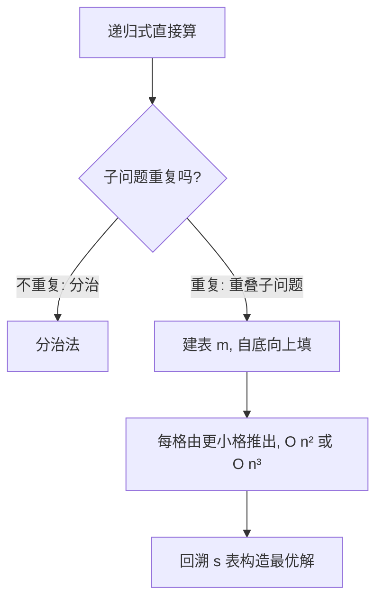

# 第 15 章：动态规划

- **难度**：★★★ | **预估学时**：4 小时 | **前置**：第 2、4 章

## 学习目标
学完本章，你能：
1. 说出动态规划适用的两个特征：**最优子结构**与**重叠子问题**。
2. 用四步法解钢条切割、矩阵链乘法、LCS、最优二叉搜索树。
3. 区分「自底向上填表」与「带备忘的自顶向下」两种实现。

## 一句话核心
**递归会反复算同一个子问题——把它算一次存进表，下次直接查表：最优解 = 表中一格一格推出来的。**

## 零基础讲解

### 概念 1：DP 适用的两个特征（难度：基础）
书页 §15.3：能用动态规划（DP）的问题必须有：
- **最优子结构（optimal substructure）**：问题的最优解由相关子问题的最优解组合而成。
- **重叠子问题（overlapping subproblems）**：递归过程反复遇到同一个子问题（不是像分治那样每次生成全新子问题）。

### 概念 2：DP 四步法（书页 §15 已核对）
1. 刻画一个最优解的结构特征。
2. 递归地定义最优解的值。
3. 自底向上计算最优值。
4. 利用算出的信息构造最优解。

### 概念 3：钢条切割（难度：基础）
长度 n 英寸钢条，价格表 pᵢ（长度 i 的售价）。求切割方案使总收益 rₙ 最大。
递归式：rₙ = max_{1≤i≤n}(pᵢ + r_{n−i})——第一刀切下长度 i 卖 pᵢ，剩下 n−i 递归最优。
朴素递归是指数级；**自底向上**填表 r[0..n] 后 O(n²)。书页价格例：长度 1..10 价格 [1,5,8,9,10,17,17,20,24,30]。

### 概念 4：矩阵链乘法（难度：进阶）
给矩阵链 A₁A₂…Aₙ（Aᵢ 尺寸 p_{i−1}×pᵢ），求最优括号化使标量乘法次数最少。
递归式（书页 eq 15.7）：
```
m[i,j] = 0                                    若 i=j
m[i,j] = min_{i≤k<j}(m[i,k] + m[k+1,j] + p_{i−1}p_k p_j)   若 i<j
```
s[i,j] 记录最优分割点 k。子问题共 Θ(n²) 个，填表 O(n³)。

### 概念 5：最长公共子序列 LCS（难度：进阶）
X = ⟨x₁..xₘ⟩，Y = ⟨y₁..yₙ⟩。定理 15.1（最优子结构，书页已核对）：
- 若 xₘ = yₙ，则 LCS = xₘ + LCS(X_{m−1}, Y_{n−1})；
- 若不等，则 max(LCS(X_{m−1}, Y), LCS(X, Y_{n−1}))。
填表 c[i,j] = LCS 长度，O(mn)，并回溯构造序列。书页例：X=⟨A,B,C,B,D,A,B⟩，Y=⟨B,D,C,A,B,A⟩，LCS=⟨B,C,B,A⟩ 长 4。

### 概念 6：最优二叉搜索树（难度：高难，了解）
已知各关键字查找概率，构造期望查找代价最小的 BST。递归式 e[i,j] = min_{i≤k≤j}(e[i,k−1]+e[k+1,j]+w(i,j))，O(n³)。

## 图示

**看图说明**：判断要不要用 DP 的关键是「递归是不是在反复算同一个子问题」。是 → 建表；不是 → 普通分治就够。

## 类比与实例
- **类比**：DP 像「背公式表做题」——同一道中间题只算一次，把答案写在草稿表上，后面再遇到直接翻表。**失效边界**：若子问题不重叠（每次都是全新），建表反而浪费空间，直接递归即可。
- **实例**：钢条 n=4，价格 p=[1,5,8,9]。r₁=1，r₂=max(2·1,5)=5，r₃=max(1+r₂,5+r₁,8)=8，r₄=max(1+r₃,5+r₂,8+r₁,9)=10（切 2+2）。

## 常见误解
- **别以为「DP 就是递归」**——实际上朴素递归遇到重叠子问题是指数级；DP 的本质是「算一次存起来」。
- **别以为「最优子结构到处都成立」**——实际上不是所有问题都有；比如求最短路有，求最长简单路就没有（会失效）。
- **别以为「自顶向下一定慢」**——带备忘（memoized）的自顶向下与自底向上同阶，只是只算用到的子问题，有时更省。

## 自测题（答案）
1. （多选）动态规划适用的两个特征是？（答案：A、C；解析：最优子结构 + 重叠子问题）
   - A. 最优子结构   B. 贪心选择性质   C. 重叠子问题   D. 线性可分
2. （单选）矩阵链乘法 m[i,j] 递归式中分割点 k 的取值范围是？（答案：B；解析：i≤k<j）
   - A. 1≤k≤n   B. i≤k<j   C. i<k≤j   D. k=i 或 k=j
3. （填空）LCS 问题 X 长 m、Y 长 n，填表复杂度 O(__)。（答案：mn；解析：m×n 表）
4. （简答）钢条切割 rₙ 递归式为什么是 max(pᵢ + r_{n−i})？（答案：第一刀无论切在哪，都是「卖第一刀那段 + 剩下段的最优切割」；枚举所有切法取最大，就是最优子结构的直接体现）

## 复习锚点
- DP = 最优子结构 + 重叠子问题；四步走。
- 钢条切割 O(n²)；矩阵链 O(n³)；LCS O(mn)。
- 自底向上填表 vs 带备忘自顶向下。
