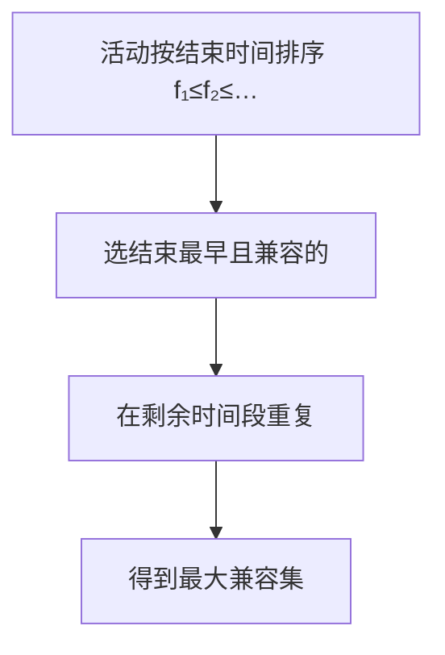

# 第 16 章：贪心算法

- **难度**：★★☆ | **预估学时**：2.5 小时 | **前置**：第 15 章

## 学习目标
学完本章，你能：
1. 说出贪心算法「每步选当前最优」与 DP 的区别。
2. 用活动选择问题证明：按结束时间最早贪心选，得到最大兼容活动集。
3. 用赫夫曼算法构造最优前缀码。

## 一句话核心
**当问题有「贪心选择性质」时，不必枚举所有子问题——每步选眼前最好的，全局最优自然出现。**

## 零基础讲解

### 概念 1：贪心 vs 动态规划（难度：基础）
书页 §16 开篇：动态规划对很多优化问题是「杀鸡用牛刀」。**贪心算法**每一步都做出当时看起来最优的选择（局部最优），期望由此得到全局最优。
- DP：每步综合所有子问题的最优解再选。
- 贪心：每步直接选当前最好的，不再回溯。

### 概念 2：活动选择问题（难度：进阶）
n 个活动共享资源（如阶梯教室），每个活动 aᵢ 有开始 sᵢ、结束 fᵢ。选**最大兼容活动集**（互不重叠）。
**贪心策略**：把活动按**结束时间 fᵢ 单调递增**排序，然后反复选「结束最早且与已选兼容」的活动。
书页例子：a₁,a₄,a₈,a₁₁ 是一个最大兼容集（4 个活动）。
**为什么正确**：选结束最早的活动，给剩下的时间留最多——任何最优解里第一个活动都能换成结束最早的那个，而不损失后续选择。这叫**贪心选择性质**。

### 概念 3：贪心算法的两个要素（难度：进阶）
1. **贪心选择性质**：全局最优可以通过一系列局部贪心选择得到（不必等子问题解完再选）。
2. **最优子结构**：选了之后，剩下的仍是同类子问题。

书页预告：最小生成树（第 23 章）、Dijkstra 单源最短路（第 24 章）都是贪心。

### 概念 4：赫夫曼编码（Huffman coding）（难度：进阶）
**最优前缀码**：频率高的字符用短码、频率低的用长码，且没有任何码是另一个码的前缀（避免歧义）。
**赫夫曼算法**（书页已核对）：
1. 每个字符作为一个叶结点放入最小优先队列 Q（按频率 freq）。
2. 重复 n−1 次：取出频率最低的两个 x、y，合并成新结点 z，z.freq = x.freq + y.freq，x、y 作 z 的左右孩子，z 入队。
3. 最后剩下的根就是编码树。

书页例：6 个字符 f:5, e:9, c:12, b:13, d:16, a:45。5 次合并后得到最优前缀码，平均码长最短。

## 图示

**看图说明**：每步只做「结束最早」这一个局部决策，不回溯；这正是贪心比 DP 快的原因。

## 类比与实例
- **类比**：贪心像「赶飞机前收拾包」——永远先拿眼下最紧要的，不去枚举所有打包方案。**失效边界**：不是所有问题都能这么干；比如背包问题（0-1 背包）贪心就错，必须 DP。
- **实例**：活动集书页表格 s=[1,3,0,5,3,5,6,8,8,2,12], f=[4,5,6,7,9,9,10,11,12,14,16]。贪心选 a₁(f=4)、a₄(f=7)、a₈(f=11)、a₁₁(f=16)——4 个，最大。

## 常见误解
- **别以为「贪心总能得到最优」**——实际上只有具备贪心选择性质的问题才行；0-1 背包就是反例。
- **别以为「赫夫曼编码就是短码」**——实际上它让高频字符短、低频字符长，整体平均码长最短，而不是每个字符都短。
- **别以为「活动选择按开始时间贪心」**——实际上按开始时间贪心会被「长活动」坑；必须按结束时间。

## 自测题（答案）
1. （单选）活动选择问题的正确贪心策略是？（答案：B；解析：按结束时间最早选）
   - A. 开始最早   B. 结束最早   C. 时长最短   D. 开始最晚
2. （单选）赫夫曼算法每次从优先队列取出几个结点合并？（答案：B；解析：取频率最低的两个）
   - A. 1 个   B. 2 个   C. 3 个   D. 全部
3. （填空）赫夫曼合并 n 个字符需要 __ 次合并。（答案：n−1；解析：每次合并减少一个结点）
4. （简答）为什么 0-1 背包不能用贪心？（答案：0-1 背包每样物品要么整件拿要么不拿，按「价值/重量」贪心会漏掉组合更优的装法；书中明确它需用动态规划，贪心只对「分数背包」有效）

## 复习锚点
- 贪心 = 每步局部最优；前提是贪心选择性质 + 最优子结构。
- 活动选择：按结束时间贪心，最大兼容集。
- 赫夫曼：每次合并频率最低两个，最优前缀码。
