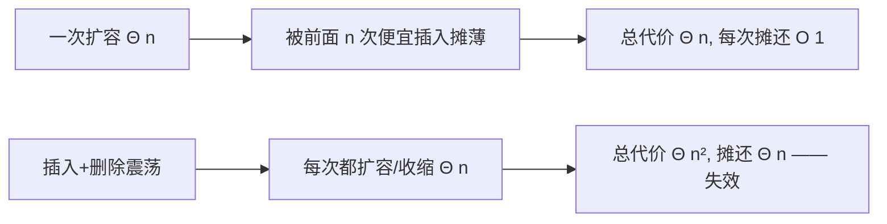

# 第 17 章：摊还分析

- **难度**：★★★ | **预估学时**：2.5 小时 | **前置**：第 10 章

## 学习目标
学完本章，你能：
1. 说出摊还分析与平均情况分析的区别（不涉及概率）。
2. 用三种方法（聚合、核算、势能）证明 MULTIPOP 栈与动态表的摊还代价。
3. 解释动态表「加倍扩张」的摊还代价为什么是 O(1)，以及「对半收缩」为什么会失效。

## 一句话核心
**单次操作可能很贵，但把一整串操作的代价摊到每次头上，平均下来是常数——这就是摊还分析。**

## 零基础讲解

### 概念 1：摊还分析（amortized analysis）是什么（难度：基础）
书页 §17：对一个操作序列求**所有操作的总时间**，再评价每个操作的平均代价。关键：**不涉及概率**——它保证最坏情况下每个操作的平均性能。这是与「期望运行时间」（随机算法那套）的本质区别。

### 概念 2：三种方法（难度：进阶）
1. **聚合分析（aggregate analysis）**：直接证明 n 个操作总代价 T(n)，摊还代价 = T(n)/n。
2. **核算法（accounting method）**：对不同类型操作赋不同「摊还代价」，多收的部分作为**预付信用（prepaid credit）**存起来，补贴以后便宜的操作。要求总信用非负。
3. **势能法（potential method）**：把信用当作数据结构整体的「势能 Φ」。第 i 个操作的摊还代价 ĉᵢ = cᵢ + Φᵢ − Φᵢ₋₁。势能越高，说明「以前多存的钱」越多。

### 概念 3：例子——MULTIPOP 栈（难度：基础）
普通 PUSH/POP 都是 O(1)。新加 MULTIPOP(S, k)：一次弹出 k 个。最坏一次 MULTIPOP 是 O(n)。但 n 个操作的序列：每个元素压入后最多弹出一次 ⇒ 总代价 O(n) ⇒ **每个操作摊还 O(1)**。

### 概念 4：动态表（dynamic table）（难度：进阶）
**TABLE-INSERT**：表满时**加倍**扩容（分配两倍内存、搬元素）。虽然单次 INSERT 偶尔 Θ(n)（扩容那次），但势能法（书页图 17-3）证明：连续 n 次 INSERT 总代价 Θ(n)，**摊还 O(1)**——因为「贵的扩容」被「前面一堆便宜插入」摊薄了。
**TABLE-DELETE** 麻烦：如果简单地「利用率低于 1/2 就对半收缩」，会出现「插入→扩容→删除→收缩→插入→扩容…」的震荡，每次 Θ(n)，总 Θ(n²)。正确做法：让收缩触发阈值比 1/2 更低（如 1/4），留出缓冲区。

## 图示

**看图说明**：左边是「加倍」的良性摊还；右边是「对半」的恶性震荡——阈值设计决定摊还成败。

## 类比与实例
- **类比**：摊还像「健身房年卡」——单次去一次很亏（Θ(n) 扩容），但一年 100 次平摊到每次就便宜（O(1)）。**失效边界**：如果你今天来、明天走、后天又来（震荡），前台每次都为你重开卡，年卡就不划算了。
- **实例**：动态表 n=1 起插入 16 个元素：1,2,4,8,16 次扩容，每次搬 1,2,4,8 元素，总搬移 = 1+2+4+8 = 15 次 ≈ n，摊还每次约 1 次。

## 常见误解
- **别以为「摊还分析就是算期望」**——实际上摊还是确定性总代价除以次数，不含概率。
- **别以为「单次 O(n) 的操作就不能用」**——实际上只要它出现得稀，摊还下来就是 O(1)（如动态表扩容）。
- **别以为「删除时利用率低就该立刻对半收缩」**——实际上那会引起扩容/收缩震荡，摊还变 Θ(n)；应把阈值放宽。

## 自测题（答案）
1. （单选）摊还分析与平均情况分析的关键区别是？（答案：B；解析：摊还不涉及概率，是确定性总代价）
   - A. 摊还用概率   B. 摊还不涉及概率，是确定性总代价   C. 两者一样   D. 摊还是最坏单次
2. （多选）书中介绍的摊还分析三种技术是？（答案：A、B、D；解析：聚合/核算/势能）
   - A. 聚合分析   B. 核算法   C. 蒙特卡洛   D. 势能法
3. （填空）势能法中第 i 个操作摊还代价 ĉᵢ = cᵢ + __ᵢ − Φᵢ₋₁。（答案：Φ；解析：势能变化）
4. （简答）动态表为什么「加倍扩张」摊还是 O(1)，「对半收缩」却失效？（答案：加倍时扩容被前面一连串便宜插入摊薄，总代价 Θ(n)；但简单对半收缩会在「满→删一半→再插入」间反复触发搬移，每次 Θ(n)，总 Θ(n²)。正确做法是把收缩阈值放宽到 1/4 左右）

## 复习锚点
- 摊还 = 一整串操作总代价除以次数，不含概率。
- 三法：聚合 T(n)/n、核算预付信用、势能 Φ。
- 动态表加倍 O(1) 摊还；对半收缩会震荡，需放宽阈值。
