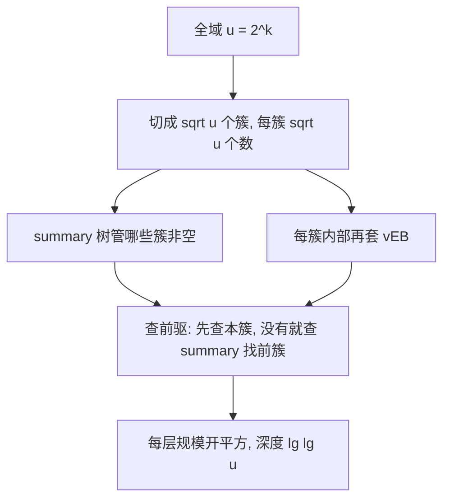

# 第 20 章：van Emde Boas 树

- **难度**：★★★ | **预估学时**：1.5 小时（了解为主） | **前置**：第 11、13 章

## 学习目标
学完本章，你能：
1. 说出 vEB 树解决的问题域（在大小为 u 的全域上做前驱/后继查找）。
2. 理解「分块 + 递归」的核心思想，记住各操作 O(lg lg u) 的复杂度。
3. 知道它与散列表、平衡树各自的适用边界。

## 一句话核心
**当关键字来自大小 u 的有限全域时，vEB 树用「分层递归分块」把查找/插入/前驱压到 O(lg lg u)——比 O(lg u) 还低一截。**

## 零基础讲解

### 概念 1：它解决什么（难度：基础）
问题：维护一个来自全域 U = {0, 1, …, u−1} 的动态集合，支持 MEMBER、MINIMUM、MAXIMUM、PREDECESSOR（前驱）、SUCCESSOR（后继）、INSERT、DELETE。
- 散列表：MEMBER O(1)，但**前驱/后继**做不到。
- 平衡树（红黑树）：所有操作 O(lg n)，n 是实际元素数。
- **vEB 树**：所有操作 **O(lg lg u)**——用的是全域大小 u，不是元素数 n。当 u 是 2^k 时，lg lg u = k/2，极小。

### 概念 2：核心思想（难度：高难，了解）
把大小 u 的全域切成 √u 个「簇」，每簇 √u 个数。vEB 树结点分两层：
- **summary（摘要）**：一个「簇级」vEB 树，记录哪些簇非空。
- **cluster[1..√u]**：每个簇又是一个 vEB 树。
查前驱 x：先看 x 所在簇里有没有比 x 小的；没有就去 summary 找「前一个非空簇」，再去那个簇找最大元素。
每层把问题规模开平方 ⇒ 递归深度 lg lg u。

### 概念 3：复杂度（难度：进阶）
所有操作 O(lg lg u)。空间若直接实现是 O(u)，用「紧凑存储」可降到 O(u) 内合理范围（工程中常只在 u=2^16、2^32 这种位域场景下用）。

## 图示

**看图说明**：vEB 的精髓是「把 u 不断开平方」——从 u 到 √u 到 u^1/4… 只要 lg lg u 层。

## 类比与实例
- **类比**：查字典先翻「部首目录」（summary），再翻「该部首所在页范围」（簇），两层定位。**失效边界**：只在「全域 u 不大且固定」时划算；若 u 是 2^64，空间代价就太大，不如散列/平衡树。
- **实例**：u = 2^16 = 65536，lg lg u = lg 16 = 4。查前驱最多递归 4 层，比红黑树的 lg n 次比较快一截。

## 常见误解
- **别以为「vEB 树通用最优」**——实际上它要求关键字来自固定小全域 u；任意大的字符串关键字用不上。
- **别以为「lg lg u 与 lg n 哪个快」要看场景**——u 大（如 2^64）时 vEB 空间爆炸；n 远小于 u 时红黑树 O(lg n) 可能更省。
- **别以为「散列表能查前驱」**——实际上散列只支持 O(1) 等值查询，不支持有序前驱/后继。

## 自测题（答案）
1. （单选）vEB 树所有操作的复杂度是？（答案：B；解析：O(lg lg u)）
   - A. O(1)   B. O(lg lg u)   C. O(lg n)   D. O(u)
2. （单选）vEB 树最适合下列哪种场景？（答案：A；解析：关键字来自固定小全域 u，需要前驱/后继）
   - A. 关键字来自 0..65535 的动态集合，需查前驱
   - B. 任意字符串的等值查询
   - C. 全排序
   - D. 栈操作
3. （填空）vEB 把全域 u 切成 __u 个簇，每簇 __u 个数。（答案：√；√；解析：开平方分块）
4. （简答）vEB 树相比红黑树的优势与代价是什么？（答案：优势是前驱/后继等操作 O(lg lg u)，比红黑树 O(lg n) 低；代价是要求关键字来自固定全域 u 且空间 O(u)，u 太大就不划算）

## 复习锚点
- vEB = 全域上分块递归，前驱/后继 O(lg lg u)。
- summary 记哪些簇非空；每层规模开平方。
- 适用于 u 固定且不太大的位域场景。
