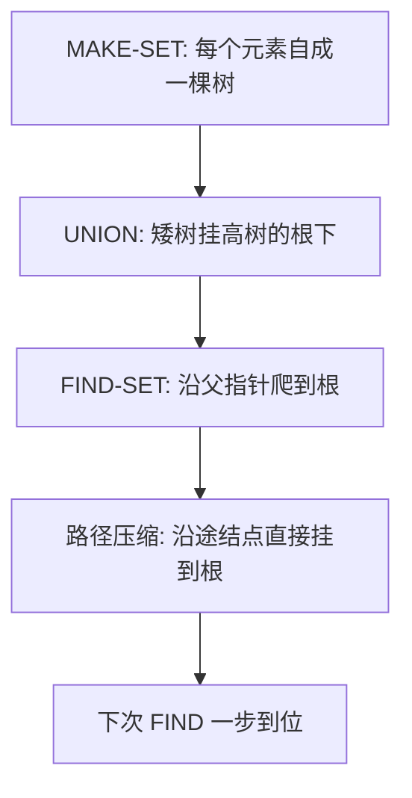

# 第 21 章：用于不相交集合的数据结构

- **难度**：★★☆ | **预估学时**：2.5 小时 | **前置**：第 10 章

## 学习目标
学完本章，你能：
1. 说出不相交集合的三个操作 MAKE-SET / UNION / FIND-SET。
2. 用「按秩合并 + 路径压缩」把并查集操作压到近似线性 O(m α(n))。
3. 解释它在「无向图连通分量」中的应用。

## 一句话核心
**并查集（union-find）给每个集合选一个代表：按秩合并让矮树挂高树上，路径压缩让查找时把结点直接挂到根——操作近似 O(1)。**

## 零基础讲解

### 概念 1：三个操作（书页 §21.1 已核对）
维护一组不相交动态集合 S = {S₁, S₂, …}，每个集合有一个**代表（representative）**。
- MAKE-SET(x)：建一个只含 x 的新集合，x 是代表。
- UNION(x, y)：把含 x 和 y 的两个集合合并（选一个新代表）。
- FIND-SET(x)：返回 x 所在集合的代表。

**应用**：判断无向图两个顶点是否在同一连通分量——先对每个顶点 MAKE-SET，每条边 UNION 两端点，最后 FIND-SET 相同即连通。

### 概念 2：链表实现（naive）
每个集合是一条链表，头是代表。UNION 要把两条链接起来——若总把短链接长链尾部要搬动短链所有元素，n 次 UNION 总代价 Θ(n lg n)。

### 概念 3：不相交集合森林（难度：进阶）
每棵树代表一个集合，树根是代表。每个结点存父指针 p。FIND-SET 沿父指针爬到根。
两个优化：
1. **按秩合并（union by rank）**：把**矮树的根挂到高树的根**下（rank = 树高上界），不让树无限长高。
2. **路径压缩（path compression）**：FIND-SET 爬到根后，把沿途每个结点的父指针直接改成根——下次查找一步到位。

### 概念 4：复杂度（难度：高难，了解结论）
书页 §21.4：m 个 MAKE-SET/UNION/FIND-SET 操作、n 个元素，用按秩合并+路径压缩，最坏总时间 **O(m α(n))**，其中 α 是「阿克曼函数的逆」——它增长慢到离谱（实际中 α(n) ≤ 4）。所以工程上可视为**近似线性 O(m)**。

## 图示

**看图说明**：按秩合并控制树高，路径压缩把「长路」摊平成「直挂根」。两者合起来让每次查找近乎 O(1)。

## 类比与实例
- **类比**：并查集像「家族族谱认亲」——找「我们是不是一家人」就找共同始祖（代表）；路径压缩就是「以后干脆都直接写始祖名字，不用一层层往上数」。**失效边界**：它只回答「同集合吗」，不维护集合内部顺序，也不能高效枚举集合元素。
- **实例**：图连通分量：顶点 1..6 各自 MAKE-SET；边 (1,2)(2,3)(4,5) 分别 UNION；FIND-SET(1) 与 FIND-SET(3) 相同 ⇒ 1 与 3 连通；FIND-SET(1) 与 FIND-SET(4) 不同 ⇒ 不连通。

## 常见误解
- **别以为「并查集能做任意集合运算」**——实际上它只支持「合并」和「找代表」，不能分裂集合。
- **别以为「路径压缩会破坏树结构」**——实际上它只改父指针、不改变集合归属，下次查找更快。
- **别以为「α(n) 是普通对数」**——实际上它是逆阿克曼函数，实际 ≤ 4，可当作常数。

## 自测题（答案）
1. （多选）不相交集合支持的操作有？（答案：A、B、C；解析：MAKE-SET/UNION/FIND-SET）
   - A. MAKE-SET   B. UNION   C. FIND-SET   D. SPLIT
2. （单选）按秩合并 + 路径压缩后，m 个操作、n 个元素的总时间是？（答案：C；解析：O(m α(n))，α 逆阿克曼，实际近似线性）
   - A. O(m lg n)   B. O(m n)   C. O(m α(n))   D. O(1)
3. （填空）UNION(x,y) 把__树的根挂到__树的根下。（答案：矮（低秩）；高（高秩）；解析：按秩合并）
4. （简答）路径压缩做了什么？（答案：FIND-SET 沿父指针爬到根后，把沿途每个结点的父指针直接改为根；这样下次同一结点的查找一步直达，摊平树高）

## 复习锚点
- 并查集：MAKE-SET/UNION/FIND-SET，树根为代表。
- 按秩合并控树高，路径压缩摊平。
- 总时间 O(m α(n)) ≈ 近似线性；应用：连通分量。
