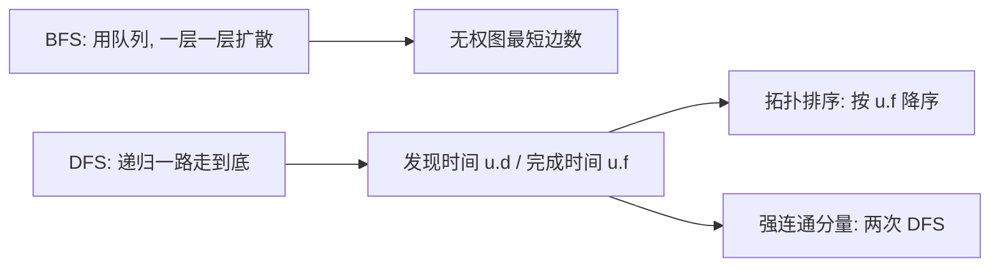

# 第 22 章：基本的图算法

- **难度**：★★☆ | **预估学时**：2.5 小时 | **前置**：第 10 章

## 学习目标
学完本章，你能：
1. 用邻接链表与邻接矩阵表示图，并说出各自的空间与适用场景。
2. 描述 BFS 与 DFS 的流程，说出颜色标记、发现/完成时间。
3. 用 DFS 做拓扑排序与求强连通分量。

## 一句话核心
**图的搜索（BFS 按层扩展、DFS 一路走到底）是所有图算法的骨架——先摸清图长什么样，再谈最短路、连通性。**

## 零基础讲解

### 概念 1：图的两种表示（书页 §22.1 已核对）
- **邻接链表**：数组 Adj[|V|]，每个顶点一条链表，挂它的所有邻居。空间 Θ(V+E)。**稀疏图**（|E| ≪ |V|²）首选。
- **邻接矩阵**：n×n 矩阵 W，W[i][j] = 边 (i,j) 的权重（无边为 ∞）。空间 Θ(V²)。**稠密图**或要快速判断「i,j 之间有没有边」时用。
有向图邻接链表总长 |E|；无向图总长 2|E|。

### 概念 2：广度优先搜索 BFS（难度：进阶）
从源 s 出发，按「离 s 的边数」一层一层扩展（书页 §22.2）：
- 每个结点三态：白（未发现）、灰（在队列里）、黑（已处理）。
- 属性：u.d = 从 s 到 u 的**最少边数**，u.π = 前驱。
- 用 FIFO 队列 Q 管理灰色结点。
- 定理：BFS 算出的 u.d 就是无权图从 s 到 u 的**最短路径边数**。
总时间 O(V+E)。

### 概念 3：深度优先搜索 DFS（难度：进阶）
一路走到底、走不通再回溯（书页 §22.3）：
- 白色→灰色（发现）→黑色（完成）。
- 属性：u.d = **发现时间戳**，u.f = **完成时间戳**，1 ≤ u.d < u.f ≤ 2|V|。
- 递归：DFS-VISIT 把当前结点涂灰、时间戳+1，递归访问所有白色邻居，回溯时涂黑、记完成时间。
总时间 O(V+E)。

DFS 边的分类：**树边 / 回边（back） / 前向边 / 交叉边**——这套分类是后面很多算法的依据。

### 概念 4：两个应用（难度：进阶）
- **拓扑排序**（§22.4）：对有向无环图（DAG），按 DFS 完成时间 u.f **从大到小**排列——得到的就是拓扑序（所有边从左指向右）。
- **强连通分量**（§22.5）：在有向图中，先 DFS 记完成时间，把图边反向，再按完成时间从大到小 DFS 反图，每次得到的一棵 DFS 树就是一个强连通分量（任意两顶点互相可达）。

## 图示

**看图说明**：BFS 像水波扩散（按层）；DFS 像走迷宫（扎到底再退）。DFS 的两个时间戳是拓扑排序与强连通分量的钥匙。

## 类比与实例
- **类比**：BFS = 水滴扩散（先碰近的）；DFS = 走迷宫（先扎一条路，死胡同再退回）。**失效边界**：BFS 只算「边数」最短，带权重的图要用 Dijkstra（第 24 章）。
- **实例**：课程先修关系图（A 是 B 的先修），拓扑排序给出「先修完 A 再学 B」的合法顺序。

## 常见误解
- **别以为「BFS 能算带权图最短路」**——实际上 BFS 只算边数；带权要用 Dijkstra/Bellman-Ford。
- **别以为「DFS 拓扑排序按发现时间排」**——实际上按**完成时间 u.f 从大到小**排。
- **别以为「邻接链表存稠密图更省」**——实际上稠密图 |E|≈|V|²，链表反而浪费，邻接矩阵 Θ(V²) 更紧凑。

## 自测题（答案）
1. （单选）稀疏图首选哪种表示？（答案：A；解析：邻接链表 Θ(V+E)，E≪V² 时省）
   - A. 邻接链表   B. 邻接矩阵   C. 二维数组   D. 哈希表
2. （单选）BFS 算出的 u.d 是？（答案：B；解析：无权图从 s 到 u 的最少边数）
   - A. 带权最短   B. 最少边数   C. 任意路径   D. 入度
3. （填空）拓扑排序按 DFS 的 __ 时间从大到小排列。（答案：完成（u.f）；解析：书中拓扑排序规则）
4. （简答）BFS 与 DFS 的核心区别？（答案：BFS 用队列按层扩展，算边数最短路；DFS 用递归/栈一路扎到底，记发现/完成时间，用于拓扑排序与强连通分量）

## 复习锚点
- 邻接链表 Θ(V+E)；邻接矩阵 Θ(V²)。
- BFS 按层、无权最短路；DFS 扎到底、记时间戳。
- 拓扑排序按 u.f 降序；强连通分量两次 DFS。
