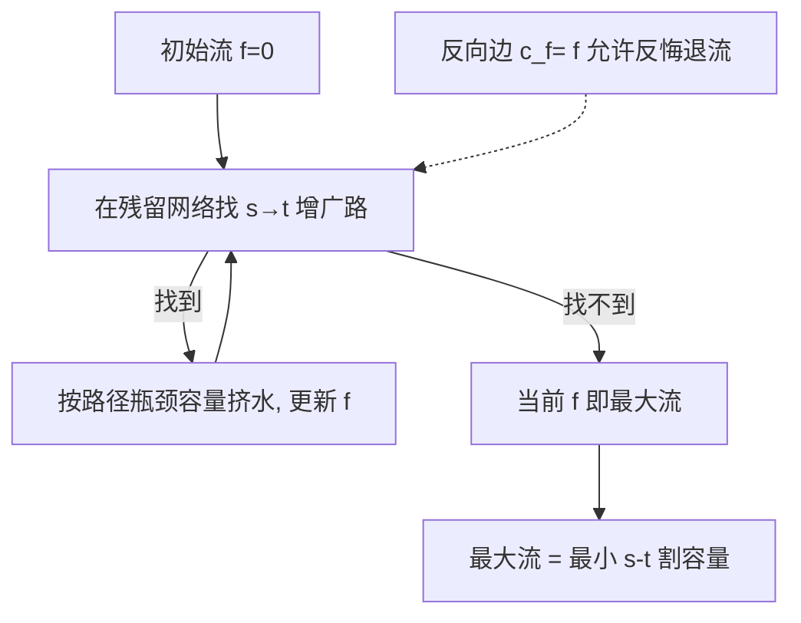

# 第 26 章：最大流

- **难度**：★★★ | **预估学时**：4 小时 | **前置**：第 22 章（图搜索）、第 24 章（最短路径思想）

## 学习目标
学完本章，你能：
1. 说出流网络、容量、流量守恒的定义，以及「割」是什么。
2. 用 Ford-Fulkerson（增广路）思想求最大流，解释残留网络与反向边的作用。
3. 复述最大流-最小割定理，并用它判断一个流是不是最大。

## 一句话核心
**不断在「残留网络」里找从源 s 到汇 t 的增广路、能挤多少挤多少，直到再也找不到路——这时达到的流量就是最大流，它等于切断 s 与 t 所需的最小割容量。**

## 零基础讲解

### 概念 1：流网络与流（难度：基础）
**流网络** G=(V,E)，每条边 (u,v) 有非负**容量** c(u,v)。两个特殊点：源 s、汇 t。
**流** f 是一个函数，满足：
- 容量限制：0 ≤ f(u,v) ≤ c(u,v)
- 流量守恒：对所有非 s、t 的顶点，流入 = 流出（物料只经过不堆积，等价于 Kirchhoff 电流定律）。
流的值 |f| = 从 s 流出的总量。**最大流问题**：在容量限制下最大化 |f|。

### 概念 2：残留网络与增广路（难度：进阶）
**残留容量** c_f(u,v) = c(u,v) − f(u,v)（还能再挤多少）。残留网络 G_f 由「还能前进的边」与「可以反悔后退的反向边」组成——反向边 c_f(v,u)=f(u,v) 表示「把已流过的水退回去」。
**增广路**：G_f 中一条 s→t 的路径。沿路径把每条边的流量加到其残留容量的瓶颈值，流的值就增大。

### 概念 3：Ford-Fulkerson 方法（难度：进阶）
```
初始化 f=0
while 残留网络 G_f 中存在 s→t 路径 p:
    沿 p 增广（挤到瓶颈容量）
return f
```
具体选路方式不同得到不同实现：用 BFS 选最短路即 **Edmonds-Karp**，复杂度 **O(V E²)**。
**最大流-最小割定理（定理 26.6）**：当残留网络中不再有 s→t 增广路时，当前流的值 = 所有 s-t 割中容量最小者。即「最大流 = 最小割」。

### 概念 4：最大二分匹配与推送-重贴标签（难度：高难）
- **最大二分匹配**：把「两边各一排人、可配对关系」建成源→左部→右部→汇的流网络，边容量全为 1，最大流即最大匹配（26.3）。
- **推送-重贴标签（push-relabel）**：不要求全局守恒，逐个顶点「把超出的水推向更低的邻居」，不行就「重贴标签（抬高高度）」。前置重贴标签实现复杂度 **O(V³)**，是更快的最大流算法。

## 图示

**看图说明**：核心循环是「找路→挤水→更新残留」；反向边保证算法能「反悔」之前的选择，从而收敛到最优。

## 类比与实例
- **类比**：最大流像水管网供水——每段管子有粗细（容量），你想让从水厂 s 到用户 t 的总流量最大。先随便通水，再看「哪些管还能加压、哪些接错了要退回来改道」。**失效边界**：容量为负或不允许流量守恒的场景不能直接套。
- **实例**：s→a 容量 3，a→t 容量 2，s→b 容量 5，b→t 容量 4。第一路 s→a→t 挤 2；第二路 s→b→t 挤 4；最大流 = 6。

## 常见误解
- **别以为「反向边是为了加新容量」**——实际上反向边是「撤销之前的流」的账本，让算法能改错。
- **别以为「最大流问题只在水管里有用」**——实际上二分匹配、航线调度、 bipartite 任务分配都能归约成最大流。
- **别以为「只要有路径就能无限增广」**——实际上每条增广受路径上最小残留容量（瓶颈）限制，且算法必在有限步停（整数容量时）。

## 自测题（答案）
1. （单选）流量守恒指的是？（答案：B；解析：非 s/t 顶点流入=流出）
   - A. 每条边流量相等   B. 中间顶点流入=流出   C. s 流出=0   D. t 流入任意
2. （单选）最大流-最小割定理说最大流等于？（答案：C；解析：最小 s-t 割的容量）
   - A. 边数   B. 顶点数   C. 最小割容量   D. 最大边容量
3. （填空）沿增广路一次能增广的量由路径上的__容量决定。（答案：瓶颈（最小残留）；解析：受最细那根管限制）
4. （简答）残留网络里反向边有什么用？（答案：表示可以把已经流过的流量退回去（f(u,v) 退成 0），从而允许算法修正之前的增广选择，最终收敛到最大流）

## 复习锚点
- 流网络：容量 c、守恒、源 s 汇 t。
- Ford-Fulkerson：反复在残留网络找增广路挤水；Edmonds-Karp=BFS 选路 O(VE²)。
- 最大流 = 最小割（找不到增广路即最优）。
