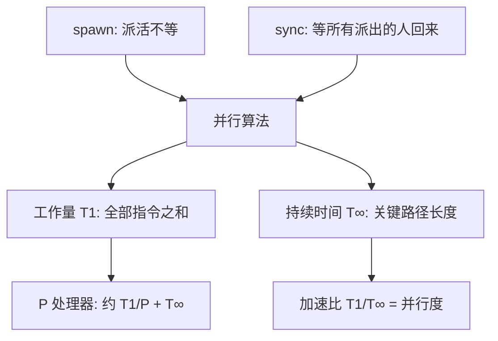

# 第 27 章：多线程算法

- **难度**：★★☆ | **预估学时**：2 小时 | **前置**：第 4 章（分治）、第 2 章（归并排序）

## 学习目标
学完本章，你能：
1. 说出「工作量」和「持续时间」两个指标，以及它们如何衡量并行算法好不好。
2. 用 spawn/sync 描述一个并行分治算法（如并行归并排序）。
3. 算出并行算法在 P 个处理器上的近似运行时间。

## 一句话核心
**并行不是越快越好——用「工作量 T₁」（全部活加起来）和「持续时间 T∞」（关键路径长度）两个数衡量，在 P 个处理器上大约 T₁/P 到 T∞ 之间，忙等待浪费要避免。**

## 零基础讲解

### 概念 1：动态多线程模型与 spawn/sync（难度：基础）
语言模型用两个关键字表达并行：
- **spawn**：调用一个子程序，但不等待它结束（可以并行起来）。
- **sync**：等待本函数之前 spawn 的所有子程序都完成，再继续。
白话：spawn 是「派出去干活不用盯着」，sync 是「出门前把派出去的人都收回来再走」。

### 概念 2：工作量 T₁、持续时间 T∞（难度：进阶）
- **工作量 T₁**：所有线程的指令总数之和（等于单处理器串行跑一遍的时间）。
- **持续时间 T∞**：假设处理器无限多时，沿着「必须等前一步」的关键路径算下来的最短时间。
**并行加速比** T₁/T∞ 越大说明可并行度越高；**并行度**就是这个比值。

### 概念 3：并行归并（难度：进阶）
归并两个已排好的数组：先二分定位「左数组中点」在右数组中的位置，把任务切成两块，spawn 出去并行归并，再 sync 合并。工作量 Θ(n)，持续时间 Θ(lg n)，并行度 Θ(n/lg n)。
同理可写**并行归并排序**：spawn 左右两半递归，sync 后并行归并。

### 概念 4：调度与近似运行时间（难度：基础）
在 P 个处理器上，贪心调度能保证运行时间在 T₁/P ~ T∞ 之间。**理想并行时间** ≈ T₁/P + T∞。
白话：P 个工人分总活 T₁，最好每个工人 T₁/P；但关键路径上的串行瓶颈 T∞ 无论多少工人都躲不掉。

## 图示

**看图说明**：T₁ 衡量「活有多少」，T∞ 衡量「瓶颈有多串行」；两者比值就是能吃多少个处理器。

## 类比与实例
- **类比**：做一桌菜——洗菜切菜可以多人并行（工作量是总工序），但「必须先切完才能炒、必须先炒完才能出锅」这条链是持续时间。**失效边界**：spawn 太碎会让派活/同步开销吃掉并行收益（粒度问题）。
- **实例**：并行归并 n 个元素：T₁=Θ(n)，T∞=Θ(lg n)。在 1000 个处理器上，n=10⁶ 时近似时间 ≈ n/1000 + lg n ≈ 1000 + 2000（单位），主要被 T∞ 拖住。

## 常见误解
- **别以为「处理器越多一定越快」**——实际上串行关键路径 T∞ 是天花板，超过并行度后加速比不再上升。
- **别以为「spawn 越多越好」**——实际上派活和 sync 有开销，粒度过小反而更慢。
- **别以为「工作量就是串行算法时间」**——在多线程模型里 T₁ 确实等于串行时间，但持续时间 T∞ 才是并行新引入的指标。

## 自测题（答案）
1. （单选）持续时间 T∞ 指的是？（答案：C；解析：处理器无限多时关键路径的长度）
   - A. 总指令数   B. 内存大小   C. 关键路径最短时间   D. 处理器个数
2. （单选）spawn 的语义是？（答案：A；解析：派出去并行执行，不阻塞等待）
   - A. 并行调用不等待   B. 必须立即返回   C. 同步等待   D. 终止线程
3. （填空）在 P 个处理器上，近似运行时间为 T₁/P + __。（答案：T∞；解析：关键路径躲不掉）
4. （简答）为什么并行归并的持续时间是 Θ(lg n) 而不是 Θ(n)？（答案：每次二分把任务切成两块并行，递归深度是 lg n，关键路径沿递归深度走）

## 复习锚点
- 两个指标：工作量 T₁、持续时间 T∞；并行度 = T₁/T∞。
- spawn 派活不等，sync 收齐再走。
- P 处理器近似时间 ≈ T₁/P + T∞。
