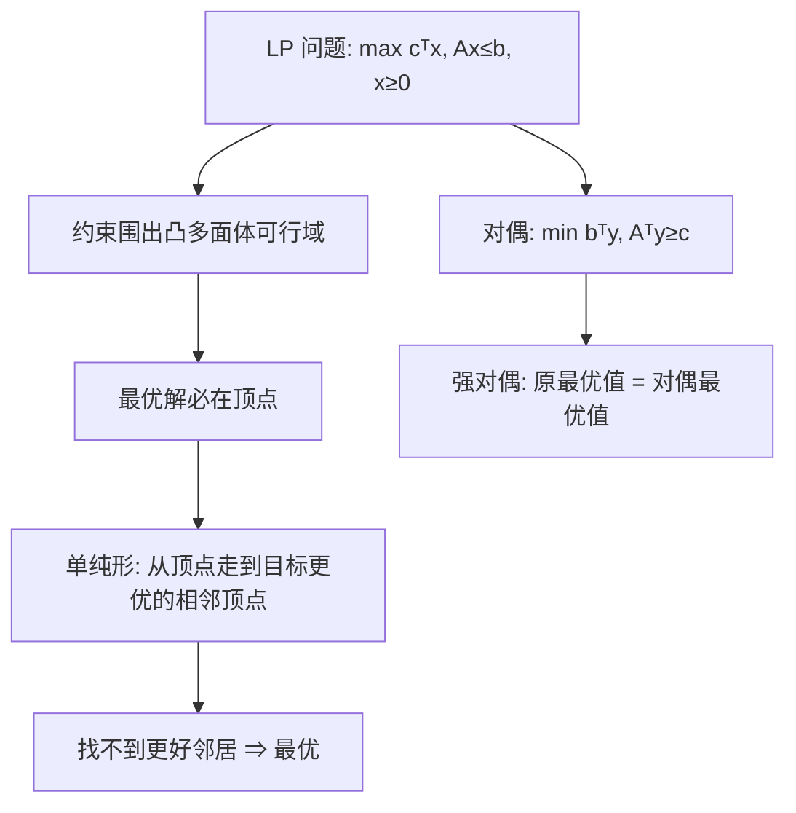

# 第 29 章：线性规划

- **难度**：★★★ | **预估学时**：3 小时 | **前置**：第 28 章（矩阵）、附录 C（概率直觉）

## 学习目标
学完本章，你能：
1. 把一个「资源分配/利润最大化」问题写成线性规划的标准型。
2. 说出可行域、顶点、目标函数等值面，并解释单纯形法为什么沿顶点走。
3. 复述对偶的概念，知道原问题和对偶问题的最优值相等（弱对偶/强对偶）。

## 一句话核心
**线性规划 = 在「一堆线性不等式」围出的多面体里，找一个点让线性目标函数最大；单纯形法从一个顶点出发，沿着能改善目标的边走到相邻顶点，直到没有更好的邻居。**

## 零基础讲解

### 概念 1：标准型与松弛型（难度：基础）
**标准型**：max cᵀx，约束 Ax ≤ b，x ≥ 0。（min 可加负号变 max；等式约束拆成两个 ≤）。
**松弛型**：引入松弛变量把不等式变等式——x₃ = b₁ − a₁x₁ − a₂x₂ ≥ 0。这样所有约束都成了「左边是基本变量、右边是非基本变量」的方程组，便于迭代。

### 概念 2：可行域与顶点（难度：基础）
约束 Ax ≤ b、x≥0 在 n 维空间围出一个凸多面体（**可行域**）。最优解一定能在某个**顶点（vertex）**取到（若存在有限最优）。两个顶点若共享 n−1 个约束面，叫**相邻**。

### 概念 3：单纯形法（难度：进阶）
```
从一个可行顶点出发:
  在非基本变量里挑一个「进基」: 它增大能让目标系数 c 改善
  按约束确定它最多能增到多大(某个松弛变量变 0)——那个变量「出基」
  换基(进基变量换出基变量), 得到相邻顶点
重复直到没有进基变量能改善目标
```
白话：在多面体的顶点上一步步「走下坡/上坡」，每次走到相邻且目标更优的顶点。
最坏情况指数级（Klee-Minty 立方体），但实际极快。

### 概念 4：对偶（难度：高难）
**对偶问题**：原问题 max cᵀx s.t. Ax≤b, x≥0 的对偶是 min bᵀy s.t. Aᵀy ≥ c, y≥0。
- **弱对偶**：任意可行 x 与 y，cᵀx ≤ bᵀy（原问题的值 ≤ 对偶的值）。
- **强对偶**：若原问题有有限最优解，则对偶也有，且最优值相等。
白话：原问题想「在不超过预算下多赚」，对偶问题想「给资源定价使总价值不低于任何产出」，两者最优值锁死相等。

## 图示

**看图说明**：单纯形法在「面」上爬；对偶从「定价」角度给出同样的最优值，两者互为验证。

## 类比与实例
- **类比**：LP 像「用有限预算（约束）安排生产组合（变量）最大化利润（目标）」。可行域是所有「不超预算」的组合构成的多边形；最优解一定在角上。**失效边界**：目标或约束一旦非线性（如 x²），就不是 LP 了，要用二次规划等。
- **实例**：两种产品 A(利润 $3)、B(利润 $5)，资源约束 2A+B≤10、A+2B≤8。顶点 (0,0)=0、(5,0)=15、(0,4)=20、(4,2)=22 ⇒ 最优 A=4,B=2，利润 22。

## 常见误解
- **别以为「单纯形法是多项式算法」**——它的最坏复杂度是指数的，但实际几乎总是极快；椭球法才是理论多项式算法。
- **别以为「最优解一定在内部」**——实际上线性目标在凸多面体上的最优总在某个顶点/边上面。
- **别以为「对偶问题只是附属品」**——实际上对偶能给出资源的影子价格，且强对偶是 LP 的核心定理。

## 自测题（答案）
1. （单选）线性规划的最优解一定在什么位置取到？（答案：C；解析：可行域的某个顶点）
   - A. 内部任意点   B. 边上中点   C. 顶点   D. 圆心
2. （单选）强对偶说的是？（答案：B；解析：原问题与对偶问题最优值相等）
   - A. 原问题无解   B. 原对偶最优值相等   C. 目标系数为 0   D. 约束全相等
3. （填空）把不等式约束变等式要引入__变量。（答案：松弛；解析：松弛变量≥0 把 ≤ 变等式）
4. （简答）单纯形法每一步在做什么？（答案：选一个能改善目标的非基变量进基，按最紧约束确定它的增量让某基变量出基，走到相邻顶点）

## 复习锚点
- 标准型 max cᵀx s.t. Ax≤b, x≥0；松弛型把不等式变等式。
- 单纯形法沿可行域顶点爬坡；最坏指数、实际极快。
- 强对偶：原最优值 = 对偶最优值。
