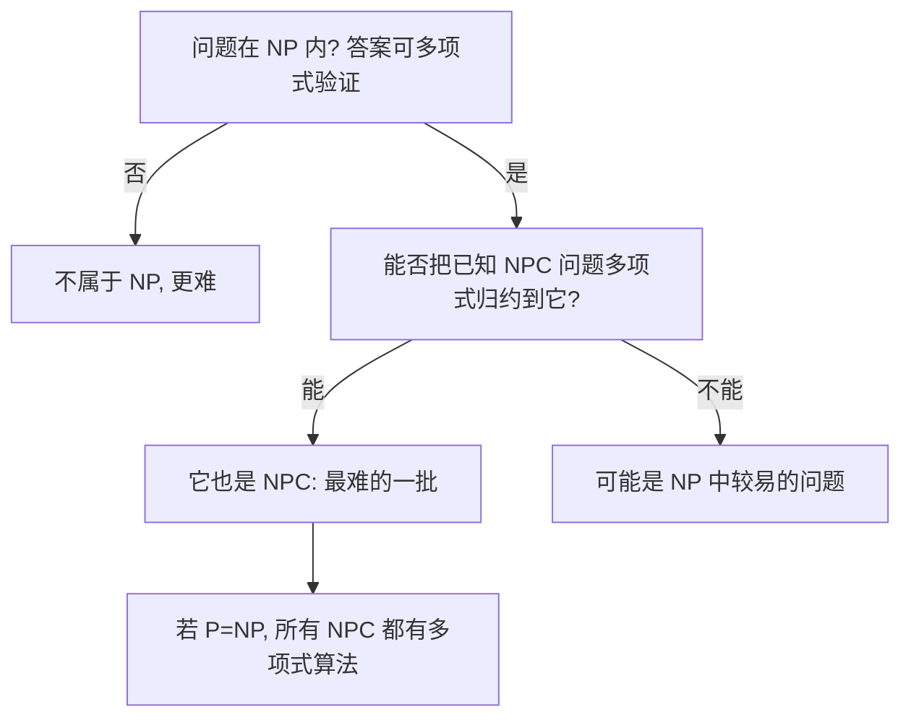

# 第 34 章：NP 完全性

- **难度**：★★★ | **预估学时**：4 小时 | **前置**：第 6 章（复杂度直觉）、图论基础

## 学习目标
学完本章，你能：
1. 说清 P、NP、NPC 三类问题的定义，以及「P=NP？」是什么意思。
2. 理解「多项式时间归约」为什么能证明「问题 A 不比问题 B 易」。
3. 说出 Cook-Levin 定理、以及团/顶点覆盖/哈密顿回路/子集和为什么是 NP 完全的。

## 一句话核心
**如果一个问题能「猜一个答案然后多项式时间验证」（NP），且能把某个已知难题多项式归约到它，它就是 NP 完全的——这类问题目前没人找到多项式算法，大家都相信 P≠NP。**

## 零基础讲解

### 概念 1：P、NP、NP 完全（难度：基础）
- **P**：能在多项式时间 O(nᵏ) 内**求解**的问题。
- **NP**：能在多项式时间内**验证一个给定答案**是否正确的问题（即「答案可以猜，验证很快」）。P ⊆ NP。
- **NP 完全（NPC）**：NP 中「最难」的那批——任何 NP 问题都能多项式归约到它。若 NPC 里任意一个问题有多项式算法，则 P=NP。
- **P=NP?**：理论计算机科学最大未决问题；主流猜想 P≠NP。

### 概念 2：多项式时间归约（难度：进阶）
**归约**：把问题 A 的输入，在多项式时间内变换成问题 B 的输入，使得 A 的答案能从 B 的答案读出。
白话：「我有一台解 B 的机器，能不能用它来解 A？」若能，说明 A 不比 B 难。
用途：已知 B 是 NPC，若 A 也满足「NP 内 + B 可归约到 A」，则 A 也是 NPC。

### 概念 3：Cook-Levin 与基本 NPC 问题（难度：高难）
**Cook-Levin 定理**：布尔公式可满足性（SAT）是 NP 完全的——这是第一个被证明的 NPC 问题，其他 NPC 证明都从它归约出来。
经典 NPC 谱系：
- **3-CNF-SAT**：每个子句恰含 3 个文字的布尔公式可满足。
- **团（Clique）**：图里是否存在 k 个两两相连的顶点。
- **顶点覆盖**：能否用 ≤k 个顶点覆盖所有边。
- **哈密顿回路**：是否存在经过每个顶点恰好一次的回路。
- **旅行商（TSP）**：在哈密顿回路基础上问「总权 ≤k」。
- **子集和**：是否有子集加起来恰好等于目标 t。

### 概念 4：怎么判断「这个问题是不是 NPC」（难度：进阶）
1. 先确认问题在 NP 内（给个答案能多项式验证）。
2. 选一个已知的 NPC 问题（如 3-CNF-SAT、团、顶点覆盖）。
3. 构造一个多项式归约：把那个问题的任意输入，变换成本问题的输入。
4. 若变换正确（等价），则本问题是 NPC。
白话：NPC 证明 = 「我把一个公认难题的输入翻译给你，你的问题能答，就说明你也不简单」。

## 图示

**看图说明**：判定路径是「先看是否 NP，再看能否归约到已知 NPC」；归约是 NPC 证明的唯一钥匙。

## 类比与实例
- **类比**：NPC 像「世界七大难题俱乐部」——入门条件是「能把任意一道 NP 难题翻译成你的问题」。Cook-Levin 是第一个拿到会员证的（SAT）。**失效边界**：归约必须多项式时间且等价；把输入指数放大就不算数。
- **实例**：顶点覆盖 → 团：图 G 的顶点覆盖 V' 与其补集 V−V' 在补图 Ḡ 中构成团。因此「G 有 k 顶点覆盖」等价于「Ḡ 有 n−k 团」——归约完成，故顶点覆盖是 NPC。

## 常见误解
- **别以为「NP 是『非多项式』的缩写」**——实际上 NP = Nondeterministic Polynomial（非确定性多项式），指「猜+验证」，不是「难」。
- **别以为「NPC 证明要自己设计多项式算法」**——实际上恰恰相反，NPC 证明是「证明它难」，靠归约而不是算法。
- **别以为「P=NP 已被证伪」**——实际上它既未被证明也未被证伪，只是主流猜想 P≠NP。

## 自测题（答案）
1. （单选）NP 类问题指的是？（答案：B；解析：答案可多项式验证的问题类）
   - A. 非多项式算法   B. 可多项式验证答案   C. 指数时间   D. 不可判定
2. （单选）Cook-Levin 定理证明了哪个问题是 NPC？（答案：A；解析：布尔公式可满足性 SAT）
   - A. SAT   B. 最短路径   C. 排序   D. 最大流
3. （填空）证明新问题是 NPC，需要把已知 NPC 问题__到它。（答案：多项式时间归约；解析：输入变换等价）
4. （简答）为什么「若某个 NPC 问题有多项式算法，则 P=NP」？（答案：因为所有 NP 问题都能多项式归约到该 NPC 问题，叠加多项式算法仍多项式，于是所有 NP 问题都有多项式算法）

## 复习锚点
- P=多项式求解；NP=多项式验证；NPC=NP 中最难。
- 归约是 NPC 证明的钥匙：已知 NPC → 归约到新问题。
- Cook-Levin：SAT 是第一个 NPC；经典成员：3-SAT、团、顶点覆盖、哈密顿、TSP、子集和。
