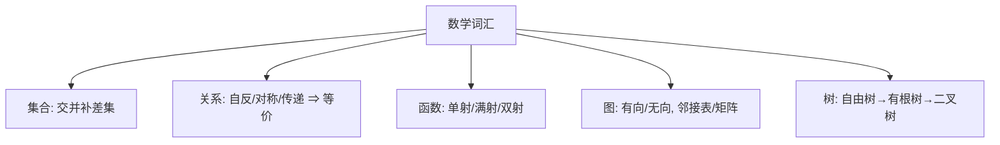

# 第 37 章：附录 B — 集合、关系、函数、图、树

- **难度**：★☆☆ | **预估学时**：1.5 小时 | **前置**：无（全书数学词汇表）

## 学习目标
学完本章，你能：
1. 说清集合运算（交/并/补）、关系的自反/对称/传递/等价、函数的单射/满射/双射。
2. 复述图的有向/无向、邻接表/邻接矩阵表示。
3. 区分「树」「有根树」「二叉树」的递归定义。

## 一句话核心
**这一章是全书的数学词汇表——集合怎么运算、关系有哪几种性质、函数是不是一一对应、图和树怎么递归定义，后面每一章都在复用这些词。**

## 零基础讲解

### 概念 1：集合与关系（难度：基础）
- **集合**：元素的无序集合。运算：并 ∪、交 ∩、补、差、幂集 2^S（所有子集）。
- **关系 R ⊆ A×A**：
  - **自反**：对所有 a，(a,a)∈R。
  - **对称**：(a,b)∈R ⇒ (b,a)∈R。
  - **传递**：(a,b),(b,c)∈R ⇒ (a,c)∈R。
  - **等价关系**：三者同时成立（如「模 n 同余」），按它把元素分成等价类。

### 概念 2：函数（难度：基础）
f: A→B 把每个 a∈A 映到唯一 f(a)∈B。
- **单射**：不同 a 映到不同 b。
- **满射**：每个 b 都被某个 a 映到。
- **双射**：既单又满（一一对应），这时存在逆函数 f⁻¹。
白话：单射是「不挤号」，满射是「不落下」，双射是「严丝合缝配对」。

### 概念 3：图（难度：基础）
- **有向图** G=(V,E)：E 是有序对集合。**无向图**：E 是无序对。
- **邻接**：(u,v)∈E。**度**：无向图中与该点相连的边数；有向图分入度、出度。
- 表示：邻接矩阵（|V|×|V| 0/1 矩阵）或邻接表（每个顶点挂一个链表）。
- **路径**：顶点序列 v₀,v₁,…,vₖ 使每条相邻边在 E 中。**连通**：任意两点间有路径。

### 概念 4：树（难度：进阶）
- **自由树**：连通无环无向图。等价性质：|E|=|V|−1、任意两点唯一路径。
- **有根树**：指定一个根 r，每条边从根向外延伸；每个非根顶点有唯一父节点。
- **二叉树**：每个结点最多两个子结点（左、右）。**完全二叉树**：所有层满、最后一层靠左。

## 图示

**看图说明**：这一页是全书反复使用的「基本原子」；后面每个数据结构、算法都是它们的组合。

## 类比与实例
- **类比**：关系的三种性质像「社交规则」——自反是「自己认识自己」、对称是「互相认识」、传递是「朋友的朋友」。等价关系就是能把人分成「朋友圈」的规则。**失效边界**：偏序关系（如「≤」）不自反对称但传递，不等价于等价。
- **实例**：整数集合上的「模 3 同余」是等价关系，把 Z 分成 {…,−3,0,3,…}、{…,−2,1,4,…}、{…,−1,2,5,…} 三个等价类。

## 常见误解
- **别以为「双射一定有逆函数」需要额外条件**——实际上双射定义本身就保证了逆的存在与唯一。
- **别以为「树就是二叉树」**——实际上树可以任意分叉；二叉树只是「每个结点最多两子」的特例。
- **别以为「有向图的度只算出去的边」**——实际上有向图分入度和出度，两者相加才是总度。

## 自测题（答案）
1. （单选）同时满足自反、对称、传递的关系叫？（答案：C；解析：等价关系）
   - A. 偏序   B. 函数   C. 等价关系   D. 空关系
2. （单选）自由树恰好有多少条边？（答案：B；解析：|V|−1）
   - A. |V|   B. |V|−1   C. 2|V|   D. |V|+1
3. （填空）既单射又满射的函数叫__。（答案：双射；解析：一一对应）
4. （简答）邻接表和邻接矩阵各自适合什么图？（答案：邻接表适合稀疏图（省空间），邻接矩阵适合稠密图（O(1) 判边是否存在））

## 复习锚点
- 关系三性质 → 等价关系；函数三性质 → 双射有逆。
- 图：有向/无向、邻接表 vs 矩阵。
- 树：自由树 |V|−1 边；有根树；二叉树。
