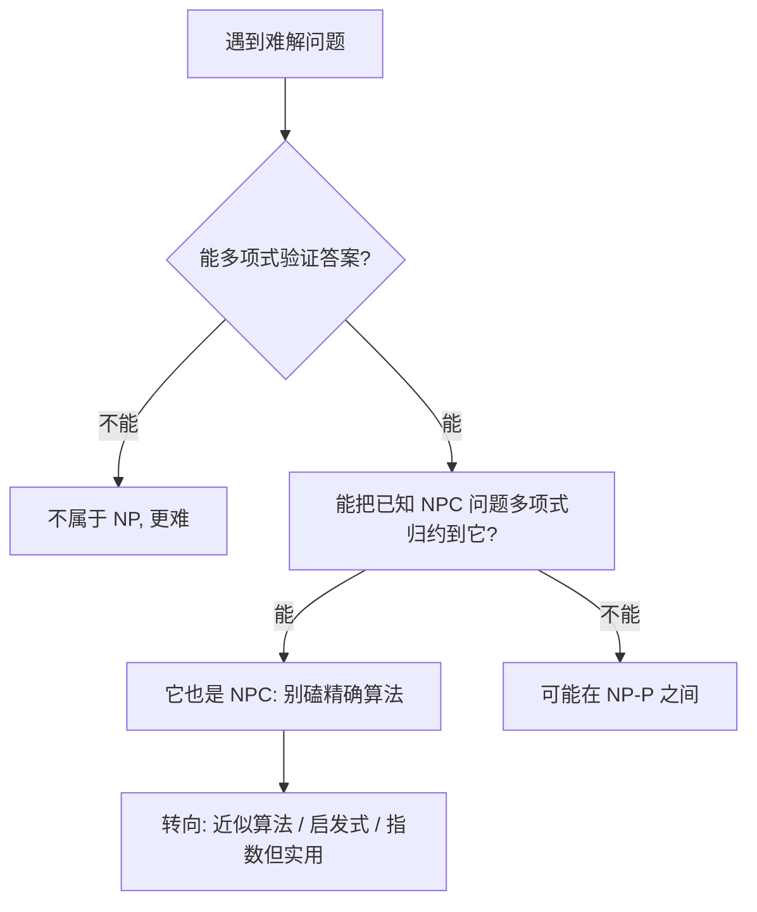

# NP 完全性

- **难度**：高难 | **涉及章节**：第 34、35 章

## 一句话定义
**能「猜答案并多项式验证」的问题叫 NP；其中最难的那批叫 NPC——任何 NP 问题都能多项式归约到它们；若任意一个 NPC 有多项式算法，则 P=NP（主流猜想 P≠NP）。**

## 为什么重要
当你遇到一个「怎么都设计不出多项式算法」的问题，先问它是不是 NPC：若是，就别再死磕精确算法，转用近似算法、启发式或指数级但实用的算法。这是「问题分类学」的实用价值。

## 图示

**看图说明**：判定路径是「先 NP 再归约」；归约是 NPC 证明的唯一钥匙。

## 详解
- **P**：多项式时间可解。
- **NP**：多项式时间可验证给定答案。P⊆NP。
- **NPC**：NP 中最难；所有 NP 问题可多项式归约到它。
- **Cook-Levin**：SAT 是第一个 NPC；3-CNF-SAT、团、顶点覆盖、哈密顿回路、TSP、子集和都是 NPC。
- **多项式归约**：把 A 的输入多项式变换成 B 的输入，A 的答案从 B 的答案读出。
- **P=NP?**：未决；主流猜想不等。

类比：NPC 像「难题俱乐部」——入门条件是「能把任意 NP 难题翻译成你的问题」。SAT 是第一个会员。失效边界：归约必须多项式时间且等价；指数放大不算。

## 常见误解
- 别以为「NP = 非多项式」——实际上 NP = Nondeterministic Polynomial（猜+验证）。
- 别以为「NPC 证明要设计多项式算法」——实际上是反过来证明它难。
- 别以为「P=NP 已被证伪」——实际上未决。

## 在书中出现的脉络
| 章节 | 语境 | 关键结论 |
|---|---|---|
| ch34 | P/NP/NPC | 归约与 Cook-Levin |
| ch35 | 近似算法 | NPC 问题退而求其次的质量保证 |

## 相关概念
- 前置：渐近记号（多项式定义）。
- 后续：近似算法（ρ 近似比）。
