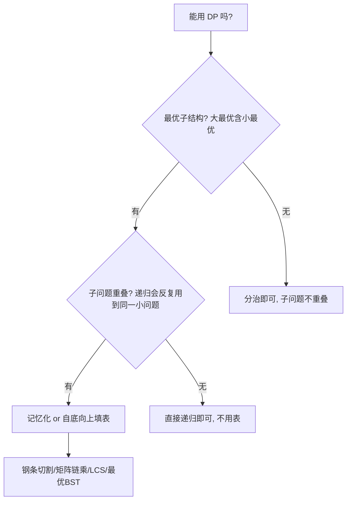

# 动态规划

- **难度**：进阶 | **涉及章节**：第 15 章

## 一句话定义
**当问题有「最优子结构」且「子问题反复重叠」时，把每个子问题的解存进表，自底向上填，避免重复算——这就是动态规划（DP）。**

## 为什么重要
DP 解决「看起来要穷举指数、其实子问题只有多项式个」的问题：钢条切割、矩阵链乘、最长公共子序列、最优二叉搜索树。它是算法面试和实际优化问题的常客。

## 图示

**看图说明**：DP 的两个适用条件缺一不可；缺「最优子结构」问题都不能拆，缺「重叠」就退化成普通分治。

## 详解
- **四步走**：① 刻画最优子结构；② 递归定义最优值；③ 自底向上算值；④ 构造最优解。
- **记忆化（top-down）**：递归 + 查表；算过的子问题存起来。
- **自底向上（bottom-up）**：按子问题规模从小到大填表。
- **经典问题**：
  - 钢条切割：r[n]=max_{i} (p[i]+r[n−i])。
  - 矩阵链乘：m[i,j]=min_{k} (m[i,k]+m[k+1,j]+p_{i−1}p_kp_j)，O(n³)。
  - LCS：c[i,j] 按 s[i]==t[j] 分两支。
  - 最优 BST：e[i,j] 类似矩阵链。

类比：DP 像「记账」——算过的子问题写在账本上，下次遇到直接查，不再重算。失效边界：若子问题不重叠（如归并排序的左右两半互不相同），DP 的表是浪费的。

## 常见误解
- 别以为「DP 就是递归」——实际上朴素递归没有表，会指数重复；DP 的灵魂是「存子问题答案」。
- 别以为「所有最优化问题都能 DP」——实际上必须同时有最优子结构和重叠子问题。

## 在书中出现的脉络
| 章节 | 语境 | 关键结论 |
|---|---|---|
| ch15 | DP | 钢条切割 O(n²)、矩阵链 O(n³)、LCS O(mn) |

## 相关概念
- 前置：递归式与分治。
- 后续：贪心（DP 的特例优化）、最短路径（最优子结构）。
