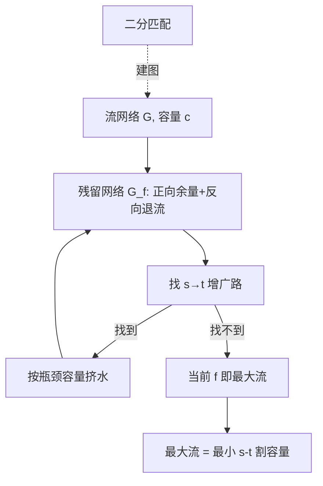

# 最大流

- **难度**：高难 | **涉及章节**：第 26 章

## 一句话定义
**在「每条管有容量、中间点守恒」的网络里，求从源 s 到汇 t 最大能压多少水；不断在残留网络找增广路挤水，直到找不到路——此时最大流 = 最小割。**

## 为什么重要
最大流是网络流问题的「母问题」：二分匹配、航线调度、二分图任务分配、甚至某些线性规划都能归约成最大流。它是「用图建模实际分配问题」的典范。

## 图示

**看图说明**：核心循环「找路→挤水→更新残留」；反向边保证算法能反悔；最大流-最小割定理给终止条件。

## 详解
- **流**：容量限制 0≤f(u,v)≤c(u,v)；中间点守恒（流入=流出）。
- **残留容量** c_f(u,v)=c(u,v)−f(u,v)；反向边 c_f(v,u)=f(u,v) 用于退流。
- **Ford-Fulkerson**：任意选增广路；Edmonds-Karp 用 BFS 选最短路径，O(VE²)。
- **最大流-最小割定理**：找不到增广路时，|f| = 最小 s-t 割的容量。
- **Push-relabel**：逐个顶点推送/重贴标签，O(V³)。
- **二分匹配**：源→左部→右部→汇，边容量 1，最大流 = 最大匹配。

类比：最大流像水管网供水——每根管粗细有限，你想最大化水厂到用户的总流量；反向边像「之前接错的管可以拆了重接」。失效边界：不允许负容量；节点守恒必须满足。

## 常见误解
- 别以为「反向边是为了加新容量」——实际上它是「撤销之前流」的账本。
- 别以为「最大流只在水管里有用」——实际上二分匹配、任务分配都靠它。

## 在书中出现的脉络
| 章节 | 语境 | 关键结论 |
|---|---|---|
| ch26 | Ford-Fulkerson | 最大流=最小割 |
| ch26 | 二分匹配 | 最大流归约 |

## 相关概念
- 前置：图搜索（BFS）、最短路径思想。
- 后续：线性规划（LP 是最大流的推广）。
