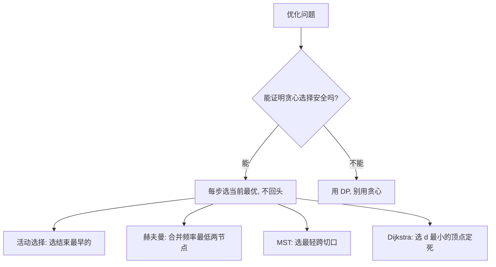

# 贪心算法

- **难度**：基础 | **涉及章节**：第 16、23、24 章

## 一句话定义
**每一步都选「当前看起来最好」的选择，不回头——当问题具有「贪心选择性质」和「最优子结构」时，这种短视反而能得到全局最优。**

## 为什么重要
DP 要填表、慢；贪心只要排序后线性扫描、快。活动选择、赫夫曼编码、最小生成树、Dijkstra 都是贪心——前提是先证明「当前最优不会害全局」。

## 图示

**看图说明**：贪心和 DP 共用「最优子结构」，但多了一个「贪心选择性质」——当前最优安全。

## 详解
- **贪心选择性质**：全局最优解可以通过「每步做局部最优选择」达到。
- **最优子结构**：全局最优包含子问题最优（与 DP 共用）。
- **经典算法**：
  - **活动选择**：每次选「结束最早」的兼容活动，O(n lg n)。
  - **赫夫曼编码**：频率最小的两节点反复合并，得到最优前缀码。
  - **MST（Kruskal/Prim）**：选最轻跨切口（见 MST 概念页）。
  - **Dijkstra**：选 d 最小的顶点定死（见最短路径概念页）。

类比：贪心像「逛超市每次拿最近的货架」——只有当「最近」永远不会让你错过更优路线时（如活动结束时间不重叠），这个短视才是全局最优。失效边界：若当前最优会锁死未来（如 0/1 背包），贪心就错了，必须 DP。

## 常见误解
- 别以为「贪心就是『短视』所以总是错」——实际上对满足性质的问题，短视就是最优。
- 别以为「背包问题能用贪心」——实际上 0/1 背包贪心错（物品按性价比选可能不如组合），要用 DP。

## 在书中出现的脉络
| 章节 | 语境 | 关键结论 |
|---|---|---|
| ch16 | 活动选择/赫夫曼 | 贪心选择性质 |
| ch23 | MST | 切分性质保证贪心安全 |
| ch24 | Dijkstra | 非负权保证「最小 d 可定死」 |

## 相关概念
- 前置：动态规划（贪心是 DP 的特例）。
- 后续：最小生成树、最短路径、近似算法。
